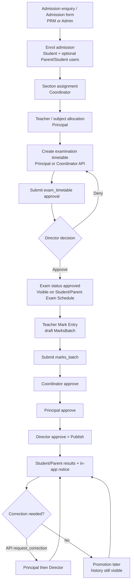

# QMIS ERP — Academic Workflow User Manual

| Field | Value |
|---|---|
| **Product** | Queen Mira International School (QMIS) ERP |
| **Document** | Academic Workflow User Manual (Admission → Result Publication) |
| **Version** | 1.1.2 |
| **Prepared from** | Source inspection of `C:\karan\QMIS` on **28 October 2026** (`main` / `qmis/main`, commit around `2e3711f`) |
| **Audience** | School administrators, PRM / Front Office, Coordinators, Principals, Directors, Teachers, Students, Parents, and UAT testers |
| **Evidence basis** | Frontend routes & screens, backend APIs/services/models, approval configuration, automated tests / prior testing report, plus deeper read-only audits ([Explore admission enrolment](72db8ba5-f37b-44ac-91a4-49d7746d5492), [Explore exams marks results](78aacb88-d235-4e4d-98a3-7b690459ef47)). **No live school-data walkthrough was performed for this document.** |

> **How to read status labels in this manual**  
> - **Implemented and verified** — present in code and covered by automated tests and/or documented isolated browser evidence in `reports/testing-report.md`.  
> - **Implemented but not verified** — present in code; no automated/browser evidence reviewed for this manual.  
> - **Partially implemented** — backend and/or UI exist but one side is incomplete, or behaviour differs from the intended school process.  
> - **Missing or blocked** — not found in code, or blocked by a known gap.

---

## 1. Purpose and scope

### 1.1 Purpose

This manual describes the **academic path** as implemented in QMIS ERP:

1. Admit and enrol a student.  
2. Place the student in a class/section.  
3. Create and approve an examination timetable.  
4. Enter marks, approve them, and publish results.  
5. Let students and parents view published results (including after promotion).  
6. Correct published marks when the server workflow is used.

### 1.2 In scope

- Admission enquiry → admission → enrol (student + optional parent/student login).  
- Section placement and promotion.  
- Exam timetable create → submit → Director approval.  
- Marks batches: draft → submit → Coordinator → Principal → Director (publish).  
- Student/parent result viewing and in-app “Result published” notices.  
- Published marks correction (server + tests; limited UI).  
- Role permissions and data isolation rules found in code.

### 1.3 Out of scope

- Finance fee posting after enrol.  
- Email / WhatsApp result alerts (not wired for results; in-app only).  
- Lesson-plan approval (separate academic process; mentioned only where it shares the same approval engine).  
- Class (period) timetable vs exam timetable are **different** features; this manual focuses on the **exam** path that unlocks mark entry.

### 1.4 Important product facts

| Fact | Evidence |
|---|---|
| Marks approval chain | `backend/app/services/approvals.py` → `ACADEMIC_CHAIN = ["coordinator", "principal", "director"]` for `marks_batch` |
| Exam timetable approval chain | Same file → `exam_timetable` chain is **`["director"]` only** (Principal/Coordinator submit; Director decides) |
| Marks correction chain | `MARKS_CORRECTION_CHAIN = ["principal", "director"]` |
| Letter grades / pass mark | Frontend `src/Common/MarkEntryApproval/gradeRules.js` (`PASS_MARK_PERCENT = 33`). Server stores marks; it does **not** own a grading configuration table |
| Result visibility | Only batches whose approval status is **`approved`** (treated as published) appear in student results |
| Historical results after promotion | Built from the student’s own mark rows, **not** from current class (`exams.student_results` / `_exam_table`) |

---

## 2. Roles and responsibilities

Role codes below are the **system role codes** used by the API. Sidebar labels may use friendlier names.

| Role (UI / school) | Role code (typical) | Academic responsibilities in this workflow |
|---|---|---|
| **PRM / Front Office** | `prm` | Admission enquiry, admission form, enrol; student database. Routes under `/front-office/...` (`prmSidebarLinks`). |
| **Admin** | `admin` | Same admission screens under `/admin/front-office/...`; masters (classes, sections); often used in tests to seed data. |
| **Coordinator** | `coordinator` | Section assignment / promotion (`/coordinator/student-placement`); mark entry; **first** marks-approval step (skipped when the coordinator submitted their own batch); lesson-plan review. Grade-band limited. |
| **Principal** | `principal` | Official examination timetable create/submit; teacher allocation; placement override + promote (`/principal/student-allocation-approval`); coordinator grade bands; **second** marks-approval step; **first** marks-correction step. **No** `admissions.write`. |
| **Director** | `director` | Exam timetable approval; **final** marks approval (= publication); **final** marks correction; exam weightage configure. |
| **Teacher** | `teacher` | Mark entry for owned batches; revise denied batches; (API) request published correction. Has `exams.read` / `marks.write` but **not** `exams.write` — official timetable create belongs to Principal/Coordinator. |
| **Student** | `student` | View exam schedule and exam results for **own** linked student record. |
| **Parent** | `parent` | View schedule/results for **linked children** only; receives in-app result notifications. |

**Note:** There is **no separate role code** named “Admission Officer” in the inspected codebase. Day-to-day admission work is done by **PRM** (`prm`) and/or **Admin** using Front Office admission screens.

Permission examples used by APIs:

- Admissions write: `admissions.write`  
- Approval decide: `approvals.decide`  
- Students / placement: staff student scopes + coordinator grade bands  

---

## 3. Academic workflow overview



---

## 4. Detailed step-by-step instructions

### Stage 1 — Student admission (PRM / Admin)

**Status:** Implemented but not re-verified in this documentation pass (covered historically by `backend/docs/ADMISSIONS_ANALYSIS.md` and `tests/test_admissions.py`).

#### Navigation

| Role | Path |
|---|---|
| PRM | `/front-office/admission-enquiry` → Add / View / Edit |
| PRM | `/front-office/admission-list` → Add / View / Edit |
| Admin | `/admin/front-office/admission-enquiry...` and `/admin/front-office/admission-list...` |

#### Typical flow

1. Create an **Admission Enquiry** (name, mobile, class, source, follow-up, etc.).  
2. Convert enquiry → admission **or** create an admission directly.  
3. Complete admission fields (student, parent, transport, fees blocks as shown on the form).  
4. Under account information, set **parent** (and, where allowed, **student**) portal email/password before enrol.

#### APIs (when `VITE_USE_API_ADMISSIONS` / admissions API client is enabled)

| Action | Method / path |
|---|---|
| Enquiries | `GET/POST /api/v1/admissions/enquiries` |
| Convert | `POST /api/v1/admissions/enquiries/{id}/convert` |
| Admissions | `GET/POST/PATCH /api/v1/admissions...` |
| Enrol | `POST /api/v1/admissions/{admission_id}/enroll` |

**Permission:** `admissions.write`.

#### Required / important fields

- Student identity and target **class name**.  
- Parent contact details.  
- For portal login: `parent_account_email` / password (and student account fields when the class policy allows student login). Weak passwords are rejected by server policy.

---

### Stage 2 — Enrolment and class/section assignment

#### 2a. Enrol (PRM / Admin)

**Status:** Implemented but not re-verified here.

- Action: **Enroll** on the admission.  
- Backend: `enroll_admission` creates `Student` (+ guardian), optional `User` rows for parent/student with `is_active=True` and typically `must_change_password=True`.  
- Admission status becomes enrolled; student starts with placement pending until section assignment.

#### 2b. Section assignment (Coordinator / Principal)

**Status:** Implemented but not re-verified here (service + routes present).

| Navigation | Path |
|---|---|
| Placement (Coordinator) | `/coordinator/student-placement` |
| Place one student | `/coordinator/student-placement/place/:id` |
| Promote (Coordinator) | `/coordinator/student-placement/promote` |
| Placement (Principal override) | `/principal/student-allocation-approval` (+ `/place/:id`, `/promote`) |
| Coordinator grade bands | `/principal/coordinator-grade-bands` |

Backend: `place_student` / `promote_student` in `backend/app/services/placement.py`; permissions `students.place`, `students.promote`.

Behaviour of note:

- After enrol, `placement_status` is **`pending`** until section assignment; then **`placed`** with auto roll.  
- Coordinator is limited by **grade band**; Principal/Director/Admin (and related bypass roles) are not.  
- Capacity checks apply on the section.  
- Portals may show “awaiting section assignment” until `placed`.

---

### Stage 3 — Student and parent account creation, activation, login

**Status:** Partially / Implemented but not verified end-to-end for this manual (login stack exists; school UAT of first-login email delivery was not evidenced here).

| Step | Behaviour in code |
|---|---|
| Create accounts | On enrol, parent/student `User` rows via `_ensure_portal_user` / pending password hashes on the admission |
| Activation | Users are created **`is_active=True`** immediately — there is **no** separate invite/activation email step |
| First login | Typically `must_change_password=True`; change via `/api/v1/auth/change-password` |
| Login | `POST /api/v1/auth/login`; OTP: `/api/v1/auth/otp/challenge`, `/otp/verify` |
| Student portal age rule | Student login allowed from configured minimum grade (default **Grade 6**, `student_login_min_grade`) |
| Enrol defaults | API `EnrollAdmissionIn` defaults `skip_student_account=True`; parent account is the usual path |
| Isolation | Parent: `parent_user_id`; student: `student_user_id` |

**Gaps / partial UX:** No email verification or invite link. Admission list enrol often prompts for a parent password even when the backend can link an existing parent by email. Student credentials saved on the admission form can still be consumed from pending hashes even when the enrol API body omits student fields. Unenrol is **not** supported (soft status `In Active` only).

---

### Stage 4 — Examination timetable creation

**Status:** Implemented but not fully verified in the Oct 28 academic-phase suite (main branch also ships exam timetable edit/view; frontend build succeeded).

#### Navigation

| Role | Path |
|---|---|
| Principal — list (official) | `/principal/examination-timetable` |
| Principal — create / edit | `/principal/create-examination-timetable`, `/principal/edit-examination-timetable/:id` (uses `createExamApi` / `submitExamApi` when API auth is on) |
| Teacher — create schedule | `/teacher/examination/create-schedule` — UI calls `createExamApi` when API auth is on, but teachers **lack** `exams.write` (403). Offline / API-off path uses **localStorage** only. Not the operational campus path. |
| Coordinator CreateExamSchedule pages | Present under `src/Pages/Coordinator/CreateExamSchedule/` but **not registered** in `CoordinatorRoutes.jsx` (unreachable). Coordinators **do** have `exams.write` and can create via Principal-style API if a routed screen is used. |
| Director — approvals | `/director/examination-approvals` |
| Director — edit | `/director/edit-examination-timetable/:id` |

#### APIs

| Action | Endpoint |
|---|---|
| Create | `POST /api/v1/exams` |
| Update | `PUT /api/v1/exams/{exam_id}` |
| Get / list | `GET /api/v1/exams`, `GET /api/v1/exams/{exam_id}` |
| Submit for approval | `POST /api/v1/exams/{exam_id}/submit` |
| Exam types | `GET/POST /api/v1/exam-types` |

#### Required fields (create)

- Name, exam type, class name, start date, end date.  
- Optional: academic year, section, teacher name, **timelines** (subject schedule).  

`endDate` cannot be before `startDate`.

---

### Stage 5 — Subject and teacher assignment

**Status:** Partially implemented / Implemented but not verified as a hard gate on mark entry.

| Feature | Path / storage | Notes |
|---|---|---|
| Teacher Allocation (Principal) | `/principal/academic/teacher-allocation` | Uses academics collection `teacher-allocations` (+ local storage fallback). Feeds class timetable subject mapping. |
| Mark entry subjects | Mark Entry loads subjects via **class details / subjects masters** when API is on | Teacher still chooses exam + subject + section when creating a marks batch; ownership is the **logged-in teacher** on the batch |

**Do not assume** that Teacher Allocation alone blocks mark entry for unassigned subjects—the marks service keys batches by teacher + exam + subject + section.

---

### Stage 6 — Timetable submission for approval

**Status:** Implemented (service `submit_exam`).

1. Open the exam timetable.  
2. Submit → creates approval entity type **`exam_timetable`**.  
3. If a prior approval was already decided, submit clears and opens a **fresh** chain.  
4. Pending resubmit while still pending returns conflict (“Already submitted”).

Who may submit: Principal / Coordinator (workflow submit set) and users allowed to edit the exam (`principal`, `director`, `admin`, creator, etc.).

---

### Stage 7 — Principal / Director approval (actual configured workflow)

**Status:** Implemented (approval engine).

#### Exam timetable — actual chain

| Step | Role |
|---|---|
| Submit | Principal or Coordinator (and allowed editors) |
| Approve / Deny | **Director only** |

This is **not** Coordinator → Principal → Director. Do not train staff to expect a Principal approval step for **exam_timetable**.

Decide API: `POST /api/v1/approvals/{approval_id}/decide` with `decision: "approve" | "deny"` and a **required comment on deny**.

Rules:

- Only the role currently awaited may decide.  
- Initiator (and entity owner) cannot approve their own submission.  
- Deny ends the request; a new submission is required.  
- Events are append-only (`ApprovalEvent`).

#### Marks batches — actual chain (for later stages)

| Step | Role |
|---|---|
| 1 | Coordinator |
| 2 | Principal |
| 3 | Director (**final approve = publish**) |

---

### Stage 8 — Approved timetable publication and portal visibility

**Status:** Implemented but not verified in the Oct 28 focused academic pytest set; UI uses merged exam records.

| Portal | Path |
|---|---|
| Student | `/student/student-evaluation/exam-schedule` |
| Parent | `/parent/student-evaluation/exam-schedule` |

Frontend (`ExamSchedule.jsx`) loads via `loadMergedExamRecords()` and filters to **approved / published** exams matching the active student’s class (and section when set).

Mark entry unlocks only when exam status is **`approved`** (`examEntryState` in `markEntryStatus.js`). Otherwise teachers see reasons such as waiting for Director approval or schedule not submitted.

---

### Stage 9 — Teacher marks entry

**Status:** Implemented and verified (phase 1 tests + static frontend checks).

| Role | Path |
|---|---|
| Teacher | `/teacher/student-evaluation/mark-entry` |
| Coordinator | `/coordinator/student-evaluation/mark-entry` |

#### API flow

1. `POST /api/v1/marks-batches` — create draft (exam, subject, section, max marks, entries).  
2. `PUT /api/v1/marks-batches/{id}/entries` — save (owner teacher only; locked after submit).  
3. Optional revise after deny: `POST /api/v1/marks-batches/{id}/revise`.

#### UI behaviour (API mode)

- Select academic year / class context from class-details masters when available.  
- Select an **approved** exam, section, subject.  
- Load students, enter marks / absent, save, then submit.  
- If the exam is not approved, load is blocked with an explicit reason (not a generic “Entry closed” string from the API—see Troubleshooting).

Demo-only `EntryClosureGate` appears when the exams API is **not** used.

---

### Stage 10 — Marks submission and approval

**Status:** Implemented and verified (approval screens phase 2 + marks phase tests).

#### Submit

`POST /api/v1/marks-batches/{id}/submit` → entity type `marks_batch`, chain Coordinator → Principal → Director.

Creating a batch (`POST /api/v1/marks-batches`) **requires an approved exam** (409 if the timetable is not Director-approved).

If a **Coordinator** submits their own marks batch, the coordinator approval step is **skipped** and the batch awaits the Principal.

#### Approver screens

| Role | List | Review |
|---|---|---|
| Coordinator | `/coordinator/student-evaluation/mark-entry-approval` | `.../review/:contextKey` |
| Principal | `/principal/mark-entry-approval` | `.../review/:contextKey` |
| Director | `/director/mark-entry-approval` | `.../review/:contextKey` |

Shared UI: `MarkApprovalListPage` / `MarkApprovalReviewPage` with `ApprovalHistory`.

On each step, approvers **Approve** or **Deny** (deny requires reason). Denial unlocks **Revise** for the teacher (new version).

---

### Stage 11 — Result calculation (grading and pass rules)

**Status:** Implemented on the **frontend display** layer; server returns numeric marks / percentages.

| Rule | Value | Source |
|---|---|---|
| Pass mark | **33%** | `gradeRules.js` → `PASS_MARK_PERCENT` |
| A+ | ≥ 90 | same |
| A | ≥ 80 | |
| B+ | ≥ 70 | |
| B | ≥ 60 | |
| C | ≥ 50 | |
| D | ≥ 33 | |
| F | &lt; 33 | |

Server `_exam_table` computes totals, percentages, and **ranks** from published subject marks. Weighted final percentage uses exam-weightage APIs when configured (`GET/PUT /api/v1/exam-weightage`, Director `exams.configure`); weightage is tied to the student’s **current** class and can lock once the exam cycle has started.

**Teacher remarks** may be stored on mark entries but are **not** returned in the published results API payload (portals show “—” for remarks).

**Do not use** demo/hardcoded figures such as **80.25%** as real results; Result Details is wired to `getStudentResultsApi` when authenticated.

---

### Stage 12 — Final result approval

**Status:** Implemented and verified (same as Director marks approve).

There is **no separate “result approval” entity**. The Director’s approval of the **`marks_batch`** (or `marks_correction`) **is** final publication.

---

### Stage 13 — Result publication

**Status:** Implemented and verified.

On final approve, `approvals.decide` calls `notify_parents_result_published` for `marks_batch` / `marks_correction`.

Published definition for queries: approval status **`approved`**; if multiple approved versions exist for the same teacher/subject/section, the **highest version** wins (`_published_batches`).

---

### Stage 14 — Student and parent viewing of published results

**Status:** Implemented and verified (API + phase 3 helpers; Result Details uses API on main).

| Role | Path |
|---|---|
| Student | `/student/student-evaluation/exam-result` |
| Parent | `/parent/student-evaluation/exam-result` |
| Teacher view of a student | Student profile embeds `StudentResultDetails` |

API: `GET /api/v1/results/students/{student_id}` (`student_results`).

Isolation:

- Parent: only children linked via `parent_user_id`.  
- Student: only own `student_user_id`.  
- Staff: campus + staff student scope helpers.

Parent dashboard summary can read published API results (wired; isolated browser noted in testing report).

---

### Stage 15 — In-app notifications after publication

**Status:** Implemented and verified (phase 7 tests + isolated browser note).

| Property | Behaviour |
|---|---|
| Channel | **In-app** `Notification` rows only |
| Audience | Linked **parent** users (`student.parent_user_id`) |
| Title | `Result published` |
| Body | `{student}'s {exam} ({subject}) result is now available.` |
| Idempotency | One notice per parent per `(batch_id, student_id)` |
| Email / WhatsApp | **Not implemented** for this event |

Students do not receive this specific `result_published` notice in the inspected function (parents only).

---

### Stage 16 — Published marks correction

**Status:** Partially implemented.

| Layer | Status |
|---|---|
| Backend `POST /api/v1/marks-batches/{id}/request-correction` | Implemented and verified (phase 6 tests) |
| Approval chain Principal → Director | Implemented and verified |
| Audit | `MARKS_CORRECTION_REQUESTED` + approval events |
| Frontend API helper `requestMarksCorrectionApi` | Present in `examsApi.js` |
| Dedicated Teacher UI to request correction | **Not found** wired into Mark Entry screens at inspection time |

#### Server behaviour (when API is used)

1. Only the **owning teacher** may request.  
2. Batch must already be **published**.  
3. Reason is required; corrected entries required.  
4. Creates a **new version** draft and opens `marks_correction` approval.  
5. Original published marks remain visible until the correction is approved.  
6. On Director approve, parents get another idempotent “Result published” notice for the new batch version.  
7. Reject leaves the previous published version unchanged.

---

### Stage 17 — Historical results after promotion

**Status:** Implemented and verified (phase 4 + phase 5 tests; isolated parent browser evidence in testing report).

- `student_results` discovers exams via the student’s **mark entries**, not current class.  
- Promotion: `promote_student` — next grade only; student must already be `placed`; duplicate year promotion guarded via `AcademicsRecord` uniqueness (**no new migration**).  
- Coordinator UI: `/coordinator/student-placement/promote`.

After promotion, parents/students should still see earlier class exams that were published.

---

### Stage 18 — End-to-end verification and troubleshooting

See **§13 UAT cases** and **§14 Troubleshooting**.

Evidence already on record (not repeated as live UAT for this document):

- Focused pytest **82 passed** (28 Oct 2026 merge verification) including mark entry, approvals UI static checks, results helpers, promotion, correction, notifications.  
- Isolated browser: parent saw Grade 7 Maths after promotion to Grade 8; two “Result published” notices after publish + correction approve.

---

## 5. Screen navigation paths and required fields (quick reference)

| Stage | Primary screens |
|---|---|
| Enquiry / Admission | PRM `/front-office/admission-*`; Admin `/admin/front-office/admission-*` |
| Enrol | Admission list → Enroll |
| Placement | `/coordinator/student-placement` |
| Teacher allocation | `/principal/academic/teacher-allocation` |
| Exam timetable | `/principal/examination-timetable`, create/edit routes; Director `/director/examination-approvals` |
| Mark entry | `/teacher/.../mark-entry`, `/coordinator/.../mark-entry` |
| Marks approval | Coordinator / Principal / Director mark-entry-approval routes above |
| Results | `/student|parent/student-evaluation/exam-result` |
| Exam schedule portal | `/student|parent/student-evaluation/exam-schedule` |
| Notifications | Role notifications pages (parent inbox for `result_published`) |

**Marks batch required before submit:** at least one mark entry; teacher must own the batch; exam should be approved for practical school use.

---

## 6. Approval sequence, status transitions, rejection, resubmission

### 6.1 Exam timetable (`exam_timetable`)

```text
draft exam → submit → pending (awaiting director)
                     → approve → approved (mark entry allowed; portal schedule)
                     → deny    → denied  → edit → submit again
```

### 6.2 Marks (`marks_batch`)

```text
draft → submit → pending @ coordinator
               → approve → pending @ principal
               → approve → pending @ director
               → approve → approved/published (+ parent notices)
               → deny at any step → denied → teacher revise (new version) → submit again
```

### 6.3 Marks correction (`marks_correction`)

```text
published batch → request-correction → pending @ principal → director
                                    → approve → new version published (+ notice)
                                    → deny    → previous published version remains
```

### 6.4 Shared engine rules

- Deny requires a comment.  
- Cannot decide your own submission.  
- History is append-only approval events.  
- Domain-owned types (`marks_batch`, `marks_correction`, `exam_timetable`, …) are opened from their domain services, not arbitrary clients.

---

## 7. Student and parent portal instructions

1. Sign in with the enrolled account (`/auth/login`; change password if prompted).  
2. Parents: select the active child if multiple children are linked.  
3. Open **Exam Schedule** to see approved exams for the child’s class.  
4. Open **Exam Result** to see published subject marks, grades (client rules), and summaries from the API.  
5. Open **Notifications** to read “Result published” items.  
6. Parents cannot open another family’s student IDs (API returns not found / forbidden).

---

## 8. Marks calculation and result publication

1. Teacher enters marks per subject batch (`max_marks`, marks or absent).  
2. After full approval, `_exam_table` sums non-absent marks and computes percentage.  
3. Portals map rows through Result Details / helpers; grades use `getGradeFromPercentage`.  
4. Optional weightage configuration can supply a weighted final percentage when complete.  
5. Publication is **Director approve**, not a separate publish button.

---

## 9. Published-mark correction workflow

See Stage 16. For school operations today:

- Prefer correcting **before** Director publish when possible (deny + revise).  
- After publish, use the **API/correction workflow** (or a future UI) — do not silently edit a locked published batch.  
- Confirm Principal then Director decide the correction request.  
- Confirm parents see updated marks and a second notice when approved.

---

## 10. Historical result handling after promotion

1. Ensure marks are published for the current year before promoting.  
2. Coordinator promotes to the **next grade only** with a valid target section.  
3. Student’s current class changes; published exams remain reachable via mark history.  
4. Duplicate promotion for the same academic-year record is blocked by existing uniqueness on academics records.

---

## 11. Role permissions and data-access rules

| Concern | Rule in code |
|---|---|
| Campus | Actors only see their `campus_id` |
| Admissions | `admissions.write` |
| Approval decide | `approvals.decide` + matching chain role |
| Marks edit/submit | Owning `teacher_id` only |
| Marks list | Teachers see own; elevated roles see more (`VIEW_ALL_ROLES`) with scope filters |
| Parent results | Linked children only |
| Student results | Own linked student only |
| Class result table | Staff; portal roles forbidden from exam-wide table endpoint |
| Coordinator placement | Grade-band limited |

---

## 12. UAT end-to-end test cases (expected results)

Use a **non-production** campus/database. Do not run against live school data for exploratory UAT without approval.

| ID | Steps | Expected |
|---|---|---|
| UAT-01 | PRM creates admission with parent email/password and enrols | Student row created; parent can log in (or must change password) |
| UAT-02 | Coordinator places student into section | `placement_status` placed; roll assigned; portals show class/section |
| UAT-03 | Principal creates exam timetable and submits | Approval pending for **Director** |
| UAT-04 | Director denies with reason | Teacher/Principal can edit and resubmit; mark entry still closed |
| UAT-05 | Director approves | Exam `approved`; appears on Student/Parent Exam Schedule; mark entry opens |
| UAT-06 | Teacher enters marks and submits | Batch pending at **Coordinator** |
| UAT-07 | Coordinator approves | Pending at **Principal** |
| UAT-08 | Principal approves | Pending at **Director** |
| UAT-09 | Director denies marks | Teacher can **Revise** to new version; results still hidden |
| UAT-10 | Director approves marks | Results visible; parent gets in-app “Result published” |
| UAT-11 | Parent opens Exam Result | Sees published subjects; no hardcoded demo average |
| UAT-12 | Parent opens another student’s UUID | Not found / denied |
| UAT-13 | API correction request → Principal → Director approve | New version visible; second notice; audit trail present |
| UAT-14 | Promote student to next grade | Prior published results still listed |
| UAT-15 | Attempt second promotion same year | Blocked by promotion guard |

**Automated evidence mapping:** UAT-06–10 / 13–14 behaviours are covered by backend phase tests; UAT-14 parent browser evidence is recorded in `reports/testing-report.md` (isolated ports).

---

## 13. Troubleshooting guide

| Symptom | Likely cause | What to check |
|---|---|---|
| Login “Failed to fetch” | API not running / wrong base URL | Backend on configured host (often `127.0.0.1:8000/api/v1`); CORS; auth |
| Mark entry blocked / waiting message | Exam not approved | Exam status; Director examination approvals inbox |
| “Already submitted” on exam or marks | Pending approval exists | Wait for decision or use revise/correction paths |
| Missing students on mark entry | Wrong class/section; not placed; API student list scope | Placement status; section filter; teacher scope |
| Approval not in inbox | Wrong role step; own submission; campus mismatch | `awaitingRole`; do not self-approve; chain order |
| Results unavailable | Marks not fully approved | Director final approve; published subjects list |
| Parent sees no notification | No `parent_user_id`; notice already sent; wrong user | Enrol parent link; notifications list; idempotency |
| Grades look wrong | Client grade bands vs school policy | `gradeRules.js` (33% pass); server has no alternate grade table |
| “Entry closed” (demo gate) | Local governance closure with API **off** | Enable API auth path or clear demo entry-closure for that module |
| Correction button missing | UI not wired | Use supported API/process; treat as partial feature |
| Historical result missing after promotion | Marks never published, or wrong student login | Confirm publish before promote; correct child selected |

---

## 14. Implementation status matrix

| # | Stage | Status | Evidence summary |
|---|---|---|---|
| 1 | Admission (PRM/Admin) | Implemented but not verified (this pass) | Routes, admissions API/service, prior admissions docs/tests |
| 2 | Enrol + section assignment | Implemented but not verified (this pass) | `enroll_admission`, `place_student`, Coordinator placement routes |
| 3 | Account create / login | Partially implemented | Users created on enrol; login/OTP exist; credential delivery / school UAT not evidenced here |
| 4 | Exam timetable create | Partially implemented | Official path: Principal (or Coordinator with `exams.write`) + Director approve. Teacher screen tries API without `exams.write` (fails when auth on) or localStorage when API off; Coordinator create pages unrouted |
| 5 | Subject/teacher assignment | Partially implemented | Teacher Allocation UI + collections; timetable has optional single `teacherName`, not per-subject enforcement on marks |
| 6 | Timetable submit | Implemented but not verified (this pass) | `submit_exam` / `exam_timetable` |
| 7 | Exam approval sequence | Implemented but not verified (this pass) | Chain = Director only (config) |
| 8 | Portal exam schedule | Implemented but not verified (this pass) | Student/Parent `ExamSchedule.jsx` filters approved |
| 9 | Marks entry | **Implemented and verified** | Phase 1 tests; Mark Entry page; build OK |
| 10 | Marks approval chain | **Implemented and verified** | Phase 2 + approval engine tests/static checks |
| 11 | Grading display rules | Implemented but not verified as school-signed policy | Frontend `gradeRules.js`; server numeric only |
| 12 | Final result approval | **Implemented and verified** | = Director marks approve |
| 13 | Publication | **Implemented and verified** | Approved batch + `_published_batches` |
| 14 | Portal results view | **Implemented and verified** | API + isolated browser 28 Oct 2026: parent + student Exam Result for **Uat Meera** (46/50, 92%, A+, Pass); remarks show **—** |
| 15 | In-app publish notices | **Implemented and verified** | Phase 7 + isolated API notice for UAT parent (“Result published”) |
| 16 | Published correction | **Partially implemented** | Backend+tests verified; teacher UI request flow not found |
| 17 | History after promotion | **Implemented and verified** | Phase 4/5 + prior isolated browser note |
| 18 | Full school UAT sign-off | **Missing / not claimed** | Isolated engineering UAT only (SQLite `:8001`); not school-signed on live data |

---

## 15. Known limitations and recommended next steps

### Known limitations

1. **Exam timetable** and **marks** use **different** approval chains; training materials must not conflate them.  
2. **Grading bands live in the frontend**; changing school policy requires a code/config change, not an admin screen (none found).  
3. **Published correction** lacks a complete teacher-facing screen even though the API exists.  
4. **Result alerts** are in-app only (parents only; no student `result_published` notice; no email/WhatsApp).  
5. **Teacher Allocation** is not proven as an enforcement gate for mark entry subjects.  
6. Teacher **Create Exam Schedule** is not the campus SoT (no `exams.write`; API-off = localStorage). Unreachable Coordinator create-exam pages add confusion — train staff on Principal → Director.  
7. **Remarks** are not exposed on the parent/student results API.  
8. Demo/localStorage paths still exist when API flags/tokens are off; production should run with API auth enabled.  
9. Unenrol / hard-delete admission is not supported.  
10. This manual did **not** execute live DB operations, migrations, or production publishes.

### Recommended next steps

1. School UAT using the cases in §12 on a sandbox campus.  
2. Add a clear Mark Entry UI for **Request correction** calling `requestMarksCorrectionApi`.  
3. Hide or rewire Teacher “Create Exam Schedule” to the campus API; route or remove dead Coordinator create-exam pages.  
4. Confirm with the school whether exam timetable should stay Director-only or gain Principal review.  
5. Decide whether grading bands (and remarks) should move to server-managed / API-exposed configuration.  
6. Only if requested: wire email/WhatsApp for results (separate from in-app notices).  
7. Keep `reports/daily-work-report.md` / `reports/testing-report.md` updated when academic behaviour changes.

---

## 16. Key source references (for maintainers)

| Area | Paths |
|---|---|
| Approvals | `backend/app/services/approvals.py`, `backend/app/api/v1/endpoints/approvals.py` |
| Exams / marks / results | `backend/app/services/exams.py`, `backend/app/api/v1/endpoints/exams.py`, `backend/app/models/exams.py` |
| Placement / promotion | `backend/app/services/placement.py`, `backend/app/models/academics_record.py` |
| Admissions | `backend/app/services/admissions.py`, `backend/app/api/v1/endpoints/admissions.py`, `backend/docs/ADMISSIONS_ANALYSIS.md` |
| Frontend marks | `src/Common/MarkEntryApproval/*`, role pages under Coordinator/Principal/Director |
| Frontend results | `src/Pages/Student/Results/ResultDetails.jsx`, `src/services/resultsApi.js`, `src/Common/Results/*` |
| Routes / nav | `src/Routes/*Routes.jsx`, `src/Common/CommonSidebar/Components/sidebarLinks.js` |
| Tests | `backend/tests/test_mark_entry_phase1.py`, `test_approval_screens_phase2.py`, `test_results_phase3.py`, `test_results_after_promotion.py`, `test_promotion_guard_phase5.py`, `test_marks_correction_phase6.py`, `test_result_notifications_phase7.py` |
| Prior evidence | `reports/testing-report.md`, `reports/daily-work-report.md` |

---

*End of document.*
)
