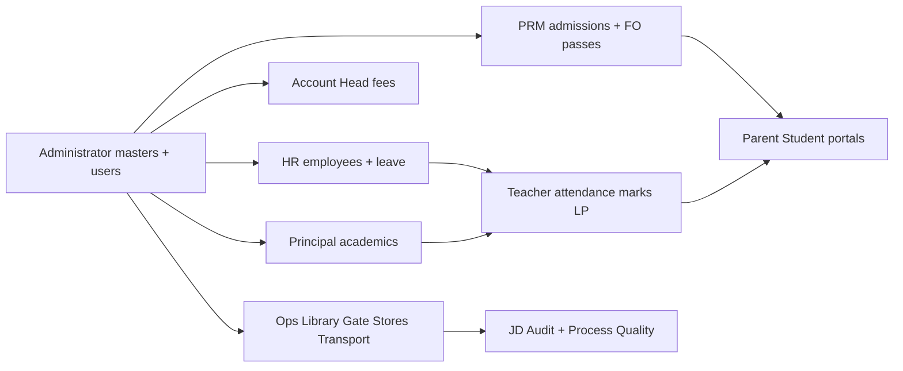

# QMIS ERP — Full Module Flow Test Guide (leaf inventory)

**Primary guide (campus story):** `reports/QMIS-ERP-Full-Panel-Test-Guide.md`  
Use that for admission → parent → fees → teacher onboard → class assign journeys.

**This file:** optional **sidebar-leaf** checklist (Do / Stored in / Reflects to) if you need every menu item once.

**Updated:** 18 October 2026  
**Stack:** Postgres 18 `@5433` · API `http://127.0.0.1:8000` · App `http://localhost:5173`  
**Status sheet:** `reports/QMIS-ERP-Role-Module-Status.480-complete.17oct.docx` (480/0/0/0)

Regenerate PDF: `python3 reports/_build_module_flow_test_guide_pdf.py`

---

## How to use this guide

1. Start API (`cd backend && ./run-local.sh`) and frontend (`npm run dev`).
2. Follow roles in **campus order** (sections below). Later roles need data created earlier (classes, students, employees, logins).
3. For each module row:
   - **Do** — actions on the screen
   - **Stored in** — API / collection
   - **Reflects to** — other roles or screens that must show the same data
4. Pass rule: after create/edit, **hard refresh (F5)** — data still present (unless noted as demo-only / external).
5. If a staff role login is missing: Administrator / HR → create employee + login, then continue.

### Cross-campus data flow (summary)

---

## Seed logins (development)

| Role | Email | Password |
|------|-------|----------|
| Administrator | `admin@qmis.edu` | `admin123` |
| Super Admin | `superadmin@qmis.edu` | `superadmin123` |
| HR | `hr@qmis.edu` | `hr12345` |
| Account Head | `accounthead@qmis.edu` | `accounts123` |
| PRM (Front Office) | `prm@qmis.edu` | `prm12345` |
| Principal | `principal@qmis.edu` | `principal123` |
| Director | `director@qmis.edu` | `director123` |
| Coordinator | `coordinator@qmis.edu` | `coord123` |
| Teacher | `teacher@qmis.edu` | `teacher123` |
| Parent | `(from Admission enroll)` | `(set at enroll)` |
| Student | `(optional student login)` | `(if provisioned)` |
| Librarian | `(HR create staff login / seed if present)` | `—` |
| Gate Keeper | `(HR create staff login)` | `—` |
| Gate Keeper Manager | `(HR create staff login)` | `—` |
| Canteen Manager | `(HR create staff login)` | `—` |
| IT Support Manager | `(HR create staff login)` | `—` |
| Stationery Store Manager | `(HR create staff login)` | `—` |
| Housekeeping Manager | `(HR create staff login)` | `—` |
| Transport Manager | `(HR create staff login)` | `—` |
| Driver | `(HR create staff login)` | `—` |
| Joint Director | `(HR create staff login)` | `—` |
| Joint Director Assistant | `(HR create staff login)` | `—` |
| Joint Director Audit | `(HR create staff login)` | `—` |
| Process Auditor | `(HR create staff login)` | `—` |
| Quality Auditor | `(HR create staff login)` | `—` |

Override passwords via `backend/.env` `*_SEED_PASSWORD` if set.

---

## Step 1 — Administrator

**Login:** `admin@qmis.edu` / `admin123`  
**Modules in sidebar:** 26

### 1.1 Dashboard

#### 1.1.1 Dashboard

- **Path:** `/dashboard`
- **Do:** Open dashboard; confirm KPIs/cards load (not blank). Note counts for later checks.
- **Stored in:** `GET /api/v1/admin/dashboard` — Live KPIs from campus aggregates
- **Reflects to:** Same role after refresh; related roles that share `GET /api/v1/admin/dashboard`
- **Pass:** List/detail still correct after F5; no console/API 500.

### 1.2 Admissions

#### 1.2.1 Admission Enquiry

- **Path:** `/admin/front-office/admission-enquiry`
- **Do:** Create a new enquiry (student name, class interest, parent phone/email). Save. Note enquiry ID. F5 — enquiry still listed.
- **Stored in:** `/api/v1/admissions` (enquiries)
- **Reflects to:** Admission List / convert flow; later Enroll creates Student Database + Parent login (often done as **PRM**)
- **Pass:** Enquiry survives F5; no API 500.

#### 1.2.2 Admission List

- **Path:** `/admin/front-office/admission-list`
- **Do:** Open admissions from enquiry convert (or existing). Confirm the student admission row. Prefer full enroll on **PRM** login if Admin path is view-only.
- **Stored in:** `/api/v1/admissions`
- **Reflects to:** User Database → Student Database; Parent portal after enroll
- **Pass:** Admission row visible after F5.

### 1.3 User Database

#### 1.3.1 Student Database

- **Path:** `/admin/user-management/student-database`
- **Do:** Open **Student Database** (`/admin/user-management/student-database`). Exercise primary action (view/list/add). Refresh and confirm data behaviour.
- **Stored in:** `/api/v1/students|/admissions` — Campus student SoT; Parent/Student portals
- **Reflects to:** Same role after refresh; related roles that share `/api/v1/students|/admissions`
- **Pass:** List/detail still correct after F5; no console/API 500.

#### 1.3.2 Employee Database

- **Path:** `/admin/user-management/employee-database`
- **Do:** Open **Employee Database** (`/admin/user-management/employee-database`). Exercise primary action (view/list/add). Refresh and confirm data behaviour.
- **Stored in:** `/api/v1/hr/*` — Staff directory; links logins; JD employee overview read
- **Reflects to:** Same role after refresh; related roles that share `/api/v1/hr/*`
- **Pass:** List/detail still correct after F5; no console/API 500.

### 1.4 Class Details

#### 1.4.1 Class Details

- **Path:** `/admin/class/class-details`
- **Do:** Open **Class Details**. If Add exists: create one record with today's date in a field. Hard refresh (F5). Confirm the row is still there.
- **Stored in:** `/api/v1/masters (classes/sections)` — Teachers mark attendance against these classes
- **Reflects to:** Same role after refresh; related roles that share `/api/v1/masters (classes/sections)`
- **Pass:** List/detail still correct after F5; no console/API 500.

### 1.5 Attendance

#### 1.5.1 Students

- **Path:** `/admin/attendance/students-list`
- **Do:** Open **Students**. If Add exists: create one record with today's date in a field. Hard refresh (F5). Confirm the row is still there.
- **Stored in:** `/api/v1/attendance` — Class attendance; Parent/Student can read published
- **Reflects to:** Parent/Student attendance views; Admin attendance read
- **Pass:** List/detail still correct after F5; no console/API 500.

#### 1.5.2 Employees

- **Path:** `/admin/attendance/employees-list`
- **Do:** Open **Employees**. If Add exists: create one record with today's date in a field. Hard refresh (F5). Confirm the row is still there.
- **Stored in:** `/api/v1/attendance` — Class attendance; Parent/Student can read published
- **Reflects to:** Parent/Student attendance views; Admin attendance read
- **Pass:** List/detail still correct after F5; no console/API 500.

### 1.6 Activities

#### 1.6.1 Cultural

- **Path:** `/admin/activities/cultural-list`
- **Do:** Open **Cultural** (`/admin/activities/cultural-list`). Exercise primary action (view/list/add). Refresh and confirm data behaviour.
- **Stored in:** `/api/v1/activities` — Admin/Principal write; others read
- **Reflects to:** Same role after refresh; related roles that share `/api/v1/activities`
- **Pass:** List/detail still correct after F5; no console/API 500.

#### 1.6.2 Sports

- **Path:** `/admin/activities/sports-list`
- **Do:** Open **Sports**. If Add exists: create one record with today's date in a field. Hard refresh (F5). Confirm the row is still there.
- **Stored in:** `/api/v1/activities` — Admin/Principal write; others read
- **Reflects to:** Same role after refresh; related roles that share `/api/v1/activities`
- **Pass:** List/detail still correct after F5; no console/API 500.

#### 1.6.3 Chess Result

- **Path:** `/admin/activities/chess-result`
- **Do:** Open **Chess Result** (`/admin/activities/chess-result`). Exercise primary action (view/list/add). Refresh and confirm data behaviour.
- **Stored in:** `/api/v1/exams|marks|results` — Teacher enter → publish → Parent/Student results
- **Reflects to:** Parent/Student Exam Result after publish
- **Pass:** List/detail still correct after F5; no console/API 500.

#### 1.6.4 Competitions

- **Path:** `/admin/activities/competitions-list`
- **Do:** Open **Competitions**. If Add exists: create one record with today's date in a field. Hard refresh (F5). Confirm the row is still there.
- **Stored in:** `/api/v1/activities` — Admin/Principal write; others read
- **Reflects to:** Same role after refresh; related roles that share `/api/v1/activities`
- **Pass:** List/detail still correct after F5; no console/API 500.

### 1.7 Documents

#### 1.7.1 Student Documents

- **Path:** `/admin/documents/student-documents`
- **Do:** Open **Student Documents**. If Add exists: create one record with today's date in a field. Hard refresh (F5). Confirm the row is still there.
- **Stored in:** `/api/v1/students|/admissions` — Campus student SoT; Parent/Student portals
- **Reflects to:** Same role after refresh; related roles that share `/api/v1/students|/admissions`
- **Pass:** List/detail still correct after F5; no console/API 500.

#### 1.7.2 Employee Documents

- **Path:** `/admin/documents/employee-documents`
- **Do:** Open **Employee Documents**. If Add exists: create one record with today's date in a field. Hard refresh (F5). Confirm the row is still there.
- **Stored in:** `/api/v1/hr/*` — Staff directory; links logins; JD employee overview read
- **Reflects to:** Same role after refresh; related roles that share `/api/v1/hr/*`
- **Pass:** List/detail still correct after F5; no console/API 500.

### 1.8 Task Management

#### 1.8.1 Assign Tasks

- **Path:** `/admin/task-management/assign-tasks`
- **Do:** Open **Assign Tasks**. If Add exists: create one record with today's date in a field. Hard refresh (F5). Confirm the row is still there.
- **Stored in:** `/api/v1/tasks` — Assignee My Tasks; assigner can track
- **Reflects to:** Same role after refresh; related roles that share `/api/v1/tasks`
- **Pass:** List/detail still correct after F5; no console/API 500.

#### 1.8.2 Assigned Tasks

- **Path:** `/admin/task-management/assigned-tasks`
- **Do:** Open **Assigned Tasks**. If Add exists: create one record with today's date in a field. Hard refresh (F5). Confirm the row is still there.
- **Stored in:** `/api/v1/tasks` — Assignee My Tasks; assigner can track
- **Reflects to:** Same role after refresh; related roles that share `/api/v1/tasks`
- **Pass:** List/detail still correct after F5; no console/API 500.

### 1.9 Leave Request

#### 1.9.1 My Leave Requests

- **Path:** `/admin/leave-request/my-requests`
- **Do:** Open **My Leave Requests**. If Add exists: create one record with today's date in a field. Hard refresh (F5). Confirm the row is still there.
- **Stored in:** `/api/v1/leave-requests` — Approver Received list; HR/Principal/Director as chain
- **Reflects to:** Approver Received Leave; notifications
- **Pass:** List/detail still correct after F5; no console/API 500.

#### 1.9.2 Received Leave Requests

- **Path:** `/admin/leave-request/received`
- **Do:** Open **Received Leave Requests**. If Add exists: create one record with today's date in a field. Hard refresh (F5). Confirm the row is still there.
- **Stored in:** `/api/v1/leave-requests` — Approver Received list; HR/Principal/Director as chain
- **Reflects to:** Approver Received Leave; notifications
- **Pass:** List/detail still correct after F5; no console/API 500.

### 1.10 Announcement

#### 1.10.1 Announcement

- **Path:** `/admin/announcement`
- **Do:** Open list; if you can create, send to a known audience role; switch login and confirm it appears.
- **Stored in:** `GET/POST /api/v1/announcements` — Audience roles see list; acknowledgements per login
- **Reflects to:** Every role in the audience sidebar Announcement list
- **Pass:** List/detail still correct after F5; no console/API 500.

### 1.11 TC Request Approval

#### 1.11.1 TC Request Approval

- **Path:** `/admin/tc-request-approval`
- **Do:** Open **TC Request Approval** (`/admin/tc-request-approval`). Exercise primary action (view/list/add). Refresh and confirm data behaviour.
- **Stored in:** `/api/v1/tc-requests` — Parent/Student file → PRM forward → Admin decide
- **Reflects to:** Same role after refresh; related roles that share `/api/v1/tc-requests`
- **Pass:** List/detail still correct after F5; no console/API 500.

### 1.12 Communication

#### 1.12.1 Communication

- **Path:** `/admin/communication/inbox`
- **Do:** Open inbox; send a short message to another campus login; confirm thread on recipient.
- **Stored in:** `/api/v1/communication` — Recipient inbox; campus logins as directory
- **Reflects to:** Recipient Communication inbox
- **Pass:** List/detail still correct after F5; no console/API 500.

### 1.13 Calendar

#### 1.13.1 Calendar

- **Path:** `/admin/academic-calendar`
- **Do:** Open calendar; confirm seeded/campus events appear. Editors: add one event and refresh.
- **Stored in:** `GET/PUT /api/v1/calendar` — All roles with calendar.read see events
- **Reflects to:** Same role after refresh; related roles that share `GET/PUT /api/v1/calendar`
- **Pass:** List/detail still correct after F5; no console/API 500.

### 1.14 Notifications

#### 1.14.1 Notifications

- **Path:** `/admin/notifications`
- **Do:** Open **Notifications**. If Add exists: create one record with today's date in a field. Hard refresh (F5). Confirm the row is still there.
- **Stored in:** `GET /api/v1/notifications` — Own inbox; mark-read updates server
- **Reflects to:** Same role after refresh; related roles that share `GET /api/v1/notifications`
- **Pass:** List/detail still correct after F5; no console/API 500.

### 1.15 Escalation Management

#### 1.15.1 Escalation Management

- **Path:** `/admin/escalation-management`
- **Do:** Open **Escalation Management**. If Add exists: create one record with today's date in a field. Hard refresh (F5). Confirm the row is still there.
- **Stored in:** `/api/v1/escalations` — Next level in hierarchy; notifications
- **Reflects to:** Same role after refresh; related roles that share `/api/v1/escalations`
- **Pass:** List/detail still correct after F5; no console/API 500.

### 1.16 RBAC

#### 1.16.1 User Creation

- **Path:** `/admin/rbac/user-creation`
- **Do:** Open **User Creation** (`/admin/rbac/user-creation`). Exercise primary action (view/list/add). Refresh and confirm data behaviour.
- **Stored in:** `/api/v1/admin users / students` — Creates logins used by every later role
- **Reflects to:** Same role after refresh; related roles that share `/api/v1/admin users / students`
- **Pass:** List/detail still correct after F5; no console/API 500.

#### 1.16.2 Roles

- **Path:** `/admin/rbac/roles`
- **Do:** Open **Roles**. If Add exists: create one record with today's date in a field. Hard refresh (F5). Confirm the row is still there.
- **Stored in:** `RBAC / permissions matrix` — Controls which APIs each role can call
- **Reflects to:** Same role after refresh; related roles that share `RBAC / permissions matrix`
- **Pass:** List/detail still correct after F5; no console/API 500.

---

## Step 2 — Super Admin

**Login:** `superadmin@qmis.edu` / `superadmin123`  
**Modules in sidebar:** 43

### 2.1 Dashboard

#### 2.1.1 Dashboard

- **Path:** `/super-admin/dashboard`
- **Do:** Open dashboard; confirm KPIs/cards load (not blank). Note counts for later checks.
- **Stored in:** `Campus API or ops/audit collection for this screen` — Refresh must keep row if SoT-backed; demo-only screens noted in Known gaps
- **Reflects to:** Same role after refresh; related roles that share `Campus API or ops/audit collection for this screen`
- **Pass:** List/detail still correct after F5; no console/API 500.

### 2.2 Attendance

#### 2.2.1 Student Attendance

- **Path:** `/super-admin/attendance/students/list`
- **Do:** Open attendance; mark/save if allowed; refresh; confirm persisted.
- **Stored in:** `/api/v1/students|/admissions` — Campus student SoT; Parent/Student portals
- **Reflects to:** Parent/Student attendance views; Admin attendance read
- **Pass:** List/detail still correct after F5; no console/API 500.

#### 2.2.2 Employee Attendance

- **Path:** `/super-admin/attendance/employees`
- **Do:** Open attendance; mark/save if allowed; refresh; confirm persisted.
- **Stored in:** `/api/v1/hr/*` — Staff directory; links logins; JD employee overview read
- **Reflects to:** Parent/Student attendance views; Admin attendance read
- **Pass:** List/detail still correct after F5; no console/API 500.

### 2.3 User Database

#### 2.3.1 Students List

- **Path:** `/super-admin/user-database/students`
- **Do:** Open **Students List**. If Add exists: create one record with today's date in a field. Hard refresh (F5). Confirm the row is still there.
- **Stored in:** `/api/v1/students|/admissions` — Campus student SoT; Parent/Student portals
- **Reflects to:** Same role after refresh; related roles that share `/api/v1/students|/admissions`
- **Pass:** List/detail still correct after F5; no console/API 500.

#### 2.3.2 Employee List

- **Path:** `/super-admin/user-database/employees`
- **Do:** Open **Employee List**. If Add exists: create one record with today's date in a field. Hard refresh (F5). Confirm the row is still there.
- **Stored in:** `/api/v1/hr/*` — Staff directory; links logins; JD employee overview read
- **Reflects to:** Same role after refresh; related roles that share `/api/v1/hr/*`
- **Pass:** List/detail still correct after F5; no console/API 500.

### 2.4 User Creation

#### 2.4.1 User Creation

- **Path:** `/super-admin/user-creation`
- **Do:** Open **User Creation** (`/super-admin/user-creation`). Exercise primary action (view/list/add). Refresh and confirm data behaviour.
- **Stored in:** `/api/v1/admin users / students` — Creates logins used by every later role
- **Reflects to:** Same role after refresh; related roles that share `/api/v1/admin users / students`
- **Pass:** List/detail still correct after F5; no console/API 500.

### 2.5 Gate Pass

#### 2.5.1 Gate Pass

- **Path:** `/super-admin/gate-pass`
- **Do:** Open **Gate Pass**. If Add exists: create one record with today's date in a field. Hard refresh (F5). Confirm the row is still there.
- **Stored in:** `/api/v1/admissions or /api/v1/front-office/{collection}` — PRM write; Principal/Director/Gate may read/write passes
- **Reflects to:** Gate Keeper lists; PRM Front Office collections
- **Pass:** List/detail still correct after F5; no console/API 500.

### 2.6 Transport Overview

#### 2.6.1 Transport Overview

- **Path:** `/super-admin/transport-overview`
- **Do:** Open **Transport Overview** (`/super-admin/transport-overview`). Exercise primary action (view/list/add). Refresh and confirm data behaviour.
- **Stored in:** `/api/v1/activities` — Admin/Principal write; others read
- **Reflects to:** Same role after refresh; related roles that share `/api/v1/activities`
- **Pass:** List/detail still correct after F5; no console/API 500.

### 2.7 Finance

#### 2.7.1 Finance Overview

- **Path:** `/super-admin/finance/overview`
- **Do:** Open **Finance Overview** (`/super-admin/finance/overview`). Exercise primary action (view/list/add). Refresh and confirm data behaviour.
- **Stored in:** `/api/v1/finance/*` — Fee ledger; Parent payment views; approvals
- **Reflects to:** Same role after refresh; related roles that share `/api/v1/finance/*`
- **Pass:** List/detail still correct after F5; no console/API 500.

#### 2.7.2 Fees Management

- **Path:** `/super-admin/finance/fees`
- **Do:** Open **Fees Management**. If Add exists: create one record with today's date in a field. Hard refresh (F5). Confirm the row is still there.
- **Stored in:** `/api/v1/finance/*` — Fee ledger; Parent payment views; approvals
- **Reflects to:** Same role after refresh; related roles that share `/api/v1/finance/*`
- **Pass:** List/detail still correct after F5; no console/API 500.

#### 2.7.3 Collections

- **Path:** `/super-admin/finance/collections`
- **Do:** Open **Collections**. If Add exists: create one record with today's date in a field. Hard refresh (F5). Confirm the row is still there.
- **Stored in:** `/api/v1/finance/*` — Fee ledger; Parent payment views; approvals
- **Reflects to:** Same role after refresh; related roles that share `/api/v1/finance/*`
- **Pass:** List/detail still correct after F5; no console/API 500.

#### 2.7.4 Wallet Management

- **Path:** `/super-admin/finance/wallets`
- **Do:** Open **Wallet Management**. If Add exists: create one record with today's date in a field. Hard refresh (F5). Confirm the row is still there.
- **Stored in:** `/api/v1/finance/*` — Fee ledger; Parent payment views; approvals
- **Reflects to:** Same role after refresh; related roles that share `/api/v1/finance/*`
- **Pass:** List/detail still correct after F5; no console/API 500.

#### 2.7.5 Transport Finance

- **Path:** `/super-admin/finance/transport`
- **Do:** Open **Transport Finance** (`/super-admin/finance/transport`). Exercise primary action (view/list/add). Refresh and confirm data behaviour.
- **Stored in:** `/api/v1/activities` — Admin/Principal write; others read
- **Reflects to:** Same role after refresh; related roles that share `/api/v1/activities`
- **Pass:** List/detail still correct after F5; no console/API 500.

#### 2.7.6 Accounting

- **Path:** `/super-admin/finance/accounting`
- **Do:** Open **Accounting** (`/super-admin/finance/accounting`). Exercise primary action (view/list/add). Refresh and confirm data behaviour.
- **Stored in:** `/api/v1/finance/*` — Fee ledger; Parent payment views; approvals
- **Reflects to:** Same role after refresh; related roles that share `/api/v1/finance/*`
- **Pass:** List/detail still correct after F5; no console/API 500.

#### 2.7.7 Reports & Analytics

- **Path:** `/super-admin/finance/reports`
- **Do:** Open **Reports & Analytics**. If Add exists: create one record with today's date in a field. Hard refresh (F5). Confirm the row is still there.
- **Stored in:** `/api/v1/finance/*` — Fee ledger; Parent payment views; approvals
- **Reflects to:** Same role after refresh; related roles that share `/api/v1/finance/*`
- **Pass:** List/detail still correct after F5; no console/API 500.

### 2.8 Audit Reports

#### 2.8.1 Overview

- **Path:** `/super-admin/audit-reports/overview`
- **Do:** Open **Overview** (`/super-admin/audit-reports/overview`). Exercise primary action (view/list/add). Refresh and confirm data behaviour.
- **Stored in:** `Campus API or ops/audit collection for this screen` — Refresh must keep row if SoT-backed; demo-only screens noted in Known gaps
- **Reflects to:** JD Audit monitoring/findings; paired auditor role
- **Pass:** List/detail still correct after F5; no console/API 500.

#### 2.8.2 Compliance Score

- **Path:** `/super-admin/audit-reports/compliance`
- **Do:** Open **Compliance Score** (`/super-admin/audit-reports/compliance`). Exercise primary action (view/list/add). Refresh and confirm data behaviour.
- **Stored in:** `Campus API or ops/audit collection for this screen` — Refresh must keep row if SoT-backed; demo-only screens noted in Known gaps
- **Reflects to:** JD Audit monitoring/findings; paired auditor role
- **Pass:** List/detail still correct after F5; no console/API 500.

#### 2.8.3 Department Ranking

- **Path:** `/super-admin/audit-reports/department-ranking`
- **Do:** Open **Department Ranking** (`/super-admin/audit-reports/department-ranking`). Exercise primary action (view/list/add). Refresh and confirm data behaviour.
- **Stored in:** `Campus API or ops/audit collection for this screen` — Refresh must keep row if SoT-backed; demo-only screens noted in Known gaps
- **Reflects to:** JD Audit monitoring/findings; paired auditor role
- **Pass:** List/detail still correct after F5; no console/API 500.

#### 2.8.4 Pending Findings

- **Path:** `/super-admin/audit-reports/pending-findings`
- **Do:** Open **Pending Findings**. If Add exists: create one record with today's date in a field. Hard refresh (F5). Confirm the row is still there.
- **Stored in:** `Campus API or ops/audit collection for this screen` — Refresh must keep row if SoT-backed; demo-only screens noted in Known gaps
- **Reflects to:** JD Audit monitoring/findings; paired auditor role
- **Pass:** List/detail still correct after F5; no console/API 500.

#### 2.8.5 Critical Findings

- **Path:** `/super-admin/audit-reports/critical-findings`
- **Do:** Open **Critical Findings**. If Add exists: create one record with today's date in a field. Hard refresh (F5). Confirm the row is still there.
- **Stored in:** `Campus API or ops/audit collection for this screen` — Refresh must keep row if SoT-backed; demo-only screens noted in Known gaps
- **Reflects to:** JD Audit monitoring/findings; paired auditor role
- **Pass:** List/detail still correct after F5; no console/API 500.

#### 2.8.6 Risk Dashboard

- **Path:** `/super-admin/audit-reports/risk-dashboard`
- **Do:** Open dashboard; confirm KPIs/cards load (not blank). Note counts for later checks.
- **Stored in:** `Campus API or ops/audit collection for this screen` — Refresh must keep row if SoT-backed; demo-only screens noted in Known gaps
- **Reflects to:** JD Audit monitoring/findings; paired auditor role
- **Pass:** List/detail still correct after F5; no console/API 500.

### 2.9 Star Ratings

#### 2.9.1 Star of the Month

- **Path:** `/super-admin/star-ratings/star-of-month`
- **Do:** Open **Star of the Month** (`/super-admin/star-ratings/star-of-month`). Exercise primary action (view/list/add). Refresh and confirm data behaviour.
- **Stored in:** `Campus API or ops/audit collection for this screen` — Refresh must keep row if SoT-backed; demo-only screens noted in Known gaps
- **Reflects to:** Same role after refresh; related roles that share `Campus API or ops/audit collection for this screen`
- **Pass:** List/detail still correct after F5; no console/API 500.

#### 2.9.2 Star of the Year

- **Path:** `/super-admin/star-ratings/star-of-year`
- **Do:** Open **Star of the Year** (`/super-admin/star-ratings/star-of-year`). Exercise primary action (view/list/add). Refresh and confirm data behaviour.
- **Stored in:** `Campus API or ops/audit collection for this screen` — Refresh must keep row if SoT-backed; demo-only screens noted in Known gaps
- **Reflects to:** Same role after refresh; related roles that share `Campus API or ops/audit collection for this screen`
- **Pass:** List/detail still correct after F5; no console/API 500.

### 2.10 Task Management

#### 2.10.1 Task Management

- **Path:** `/super-admin/task-management/assign-tasks`
- **Do:** Open **Task Management**. If Add exists: create one record with today's date in a field. Hard refresh (F5). Confirm the row is still there.
- **Stored in:** `/api/v1/tasks` — Assignee My Tasks; assigner can track
- **Reflects to:** Same role after refresh; related roles that share `/api/v1/tasks`
- **Pass:** List/detail still correct after F5; no console/API 500.

### 2.11 Leave Request

#### 2.11.1 Leave Request

- **Path:** `/super-admin/leave-request/received`
- **Do:** File a leave/permission request; note ID; check Received on approver login.
- **Stored in:** `/api/v1/leave-requests` — Approver Received list; HR/Principal/Director as chain
- **Reflects to:** Approver Received Leave; notifications
- **Pass:** List/detail still correct after F5; no console/API 500.

### 2.12 Approvals

#### 2.12.1 Approvals

- **Path:** `/super-admin/approvals`
- **Do:** Open **Approvals**. If Add exists: create one record with today's date in a field. Hard refresh (F5). Confirm the row is still there.
- **Stored in:** `Campus API or ops/audit collection for this screen` — Refresh must keep row if SoT-backed; demo-only screens noted in Known gaps
- **Reflects to:** Same role after refresh; related roles that share `Campus API or ops/audit collection for this screen`
- **Pass:** List/detail still correct after F5; no console/API 500.

### 2.13 Activities

#### 2.13.1 Cultural

- **Path:** `/super-admin/activities/cultural-list`
- **Do:** Open **Cultural** (`/super-admin/activities/cultural-list`). Exercise primary action (view/list/add). Refresh and confirm data behaviour.
- **Stored in:** `/api/v1/activities` — Admin/Principal write; others read
- **Reflects to:** Same role after refresh; related roles that share `/api/v1/activities`
- **Pass:** List/detail still correct after F5; no console/API 500.

#### 2.13.2 Sports

- **Path:** `/super-admin/activities/sports-list`
- **Do:** Open **Sports**. If Add exists: create one record with today's date in a field. Hard refresh (F5). Confirm the row is still there.
- **Stored in:** `/api/v1/activities` — Admin/Principal write; others read
- **Reflects to:** Same role after refresh; related roles that share `/api/v1/activities`
- **Pass:** List/detail still correct after F5; no console/API 500.

#### 2.13.3 Competitions

- **Path:** `/super-admin/activities/competitions-list`
- **Do:** Open **Competitions**. If Add exists: create one record with today's date in a field. Hard refresh (F5). Confirm the row is still there.
- **Stored in:** `/api/v1/activities` — Admin/Principal write; others read
- **Reflects to:** Same role after refresh; related roles that share `/api/v1/activities`
- **Pass:** List/detail still correct after F5; no console/API 500.

### 2.14 Announcement

#### 2.14.1 Announcement

- **Path:** `/super-admin/announcement`
- **Do:** Open list; if you can create, send to a known audience role; switch login and confirm it appears.
- **Stored in:** `GET/POST /api/v1/announcements` — Audience roles see list; acknowledgements per login
- **Reflects to:** Every role in the audience sidebar Announcement list
- **Pass:** List/detail still correct after F5; no console/API 500.

### 2.15 Communication

#### 2.15.1 Communication

- **Path:** `/super-admin/communication/inbox`
- **Do:** Open inbox; send a short message to another campus login; confirm thread on recipient.
- **Stored in:** `/api/v1/communication` — Recipient inbox; campus logins as directory
- **Reflects to:** Recipient Communication inbox
- **Pass:** List/detail still correct after F5; no console/API 500.

### 2.16 Calendar

#### 2.16.1 Calendar

- **Path:** `/super-admin/academic-calendar`
- **Do:** Open calendar; confirm seeded/campus events appear. Editors: add one event and refresh.
- **Stored in:** `GET/PUT /api/v1/calendar` — All roles with calendar.read see events
- **Reflects to:** Same role after refresh; related roles that share `GET/PUT /api/v1/calendar`
- **Pass:** List/detail still correct after F5; no console/API 500.

### 2.17 Notifications

#### 2.17.1 Notifications

- **Path:** `/super-admin/notifications`
- **Do:** Open **Notifications**. If Add exists: create one record with today's date in a field. Hard refresh (F5). Confirm the row is still there.
- **Stored in:** `GET /api/v1/notifications` — Own inbox; mark-read updates server
- **Reflects to:** Same role after refresh; related roles that share `GET /api/v1/notifications`
- **Pass:** List/detail still correct after F5; no console/API 500.

### 2.18 Escalation Management

#### 2.18.1 Escalation Management

- **Path:** `/super-admin/escalation-management`
- **Do:** Open **Escalation Management**. If Add exists: create one record with today's date in a field. Hard refresh (F5). Confirm the row is still there.
- **Stored in:** `/api/v1/escalations` — Next level in hierarchy; notifications
- **Reflects to:** Same role after refresh; related roles that share `/api/v1/escalations`
- **Pass:** List/detail still correct after F5; no console/API 500.

### 2.19 Activity Logs

#### 2.19.1 Login History

- **Path:** `/super-admin/activity-logs/login-history`
- **Do:** Open **Login History** (`/super-admin/activity-logs/login-history`). Exercise primary action (view/list/add). Refresh and confirm data behaviour.
- **Stored in:** `/api/v1/activities` — Admin/Principal write; others read
- **Reflects to:** Same role after refresh; related roles that share `/api/v1/activities`
- **Pass:** List/detail still correct after F5; no console/API 500.

#### 2.19.2 Data Changes

- **Path:** `/super-admin/activity-logs/data-changes`
- **Do:** Open **Data Changes**. If Add exists: create one record with today's date in a field. Hard refresh (F5). Confirm the row is still there.
- **Stored in:** `/api/v1/activities` — Admin/Principal write; others read
- **Reflects to:** Same role after refresh; related roles that share `/api/v1/activities`
- **Pass:** List/detail still correct after F5; no console/API 500.

#### 2.19.3 Deleted Records

- **Path:** `/super-admin/activity-logs/deleted-records`
- **Do:** Open **Deleted Records**. If Add exists: create one record with today's date in a field. Hard refresh (F5). Confirm the row is still there.
- **Stored in:** `/api/v1/activities` — Admin/Principal write; others read
- **Reflects to:** Same role after refresh; related roles that share `/api/v1/activities`
- **Pass:** List/detail still correct after F5; no console/API 500.

#### 2.19.4 Approval Actions

- **Path:** `/super-admin/activity-logs/approval-actions`
- **Do:** Open **Approval Actions**. If Add exists: create one record with today's date in a field. Hard refresh (F5). Confirm the row is still there.
- **Stored in:** `/api/v1/activities` — Admin/Principal write; others read
- **Reflects to:** Same role after refresh; related roles that share `/api/v1/activities`
- **Pass:** List/detail still correct after F5; no console/API 500.

#### 2.19.5 Audit Logs

- **Path:** `/super-admin/activity-logs/audit-logs`
- **Do:** Open **Audit Logs**. If Add exists: create one record with today's date in a field. Hard refresh (F5). Confirm the row is still there.
- **Stored in:** `/api/v1/activities` — Admin/Principal write; others read
- **Reflects to:** JD Audit monitoring/findings; paired auditor role
- **Pass:** List/detail still correct after F5; no console/API 500.

#### 2.19.6 Failed Logins

- **Path:** `/super-admin/activity-logs/failed-logins`
- **Do:** Open **Failed Logins**. If Add exists: create one record with today's date in a field. Hard refresh (F5). Confirm the row is still there.
- **Stored in:** `/api/v1/activities` — Admin/Principal write; others read
- **Reflects to:** Same role after refresh; related roles that share `/api/v1/activities`
- **Pass:** List/detail still correct after F5; no console/API 500.

#### 2.19.7 Demo Activity

- **Path:** `/super-admin/activity-logs/demo-activity`
- **Do:** Open **Demo Activity** (`/super-admin/activity-logs/demo-activity`). Exercise primary action (view/list/add). Refresh and confirm data behaviour.
- **Stored in:** `/api/v1/activities` — Admin/Principal write; others read
- **Reflects to:** Same role after refresh; related roles that share `/api/v1/activities`
- **Pass:** List/detail still correct after F5; no console/API 500.

### 2.20 Re-entry Approvals

#### 2.20.1 Re-entry Approvals

- **Path:** `/super-admin/reentry`
- **Do:** Open **Re-entry Approvals**. If Add exists: create one record with today's date in a field. Hard refresh (F5). Confirm the row is still there.
- **Stored in:** `Campus API or ops/audit collection for this screen` — Refresh must keep row if SoT-backed; demo-only screens noted in Known gaps
- **Reflects to:** Same role after refresh; related roles that share `Campus API or ops/audit collection for this screen`
- **Pass:** List/detail still correct after F5; no console/API 500.

### 2.21 Module Health

#### 2.21.1 Module Health

- **Path:** `/super-admin/module-health`
- **Do:** Open **Module Health** (`/super-admin/module-health`). Exercise primary action (view/list/add). Refresh and confirm data behaviour.
- **Stored in:** `Campus API or ops/audit collection for this screen` — Refresh must keep row if SoT-backed; demo-only screens noted in Known gaps
- **Reflects to:** Same role after refresh; related roles that share `Campus API or ops/audit collection for this screen`
- **Pass:** List/detail still correct after F5; no console/API 500.

---

## Step 3 — HR

**Login:** `hr@qmis.edu` / `hr12345`  
**Modules in sidebar:** 36

### 3.1 Dashboard

#### 3.1.1 Dashboard

- **Path:** `/hr/dashboard`
- **Do:** Open dashboard; confirm KPIs/cards load (not blank). Note counts for later checks.
- **Stored in:** `/api/v1/hr/*` — Staff directory; links logins; JD employee overview read
- **Reflects to:** Same role after refresh; related roles that share `/api/v1/hr/*`
- **Pass:** List/detail still correct after F5; no console/API 500.

### 3.2 Staff Management

#### 3.2.1 Employees

- **Path:** `/hr/employee-management/employees`
- **Do:** Open **Employees**. If Add exists: create one record with today's date in a field. Hard refresh (F5). Confirm the row is still there.
- **Stored in:** `/api/v1/hr/*` — Staff directory; links logins; JD employee overview read
- **Reflects to:** Same role after refresh; related roles that share `/api/v1/hr/*`
- **Pass:** List/detail still correct after F5; no console/API 500.

#### 3.2.2 Employee Documents

- **Path:** `/hr/employee-management/documents`
- **Do:** Open **Employee Documents**. If Add exists: create one record with today's date in a field. Hard refresh (F5). Confirm the row is still there.
- **Stored in:** `/api/v1/hr/*` — Staff directory; links logins; JD employee overview read
- **Reflects to:** Same role after refresh; related roles that share `/api/v1/hr/*`
- **Pass:** List/detail still correct after F5; no console/API 500.

### 3.3 Recruitment

#### 3.3.1 Job Openings

- **Path:** `/hr/recruitment/job-openings`
- **Do:** Open **Job Openings**. If Add exists: create one record with today's date in a field. Hard refresh (F5). Confirm the row is still there.
- **Stored in:** `Campus API or ops/audit collection for this screen` — Refresh must keep row if SoT-backed; demo-only screens noted in Known gaps
- **Reflects to:** Same role after refresh; related roles that share `Campus API or ops/audit collection for this screen`
- **Pass:** List/detail still correct after F5; no console/API 500.

#### 3.3.2 Candidates

- **Path:** `/hr/recruitment/candidates`
- **Do:** Open **Candidates**. If Add exists: create one record with today's date in a field. Hard refresh (F5). Confirm the row is still there.
- **Stored in:** `Campus API or ops/audit collection for this screen` — Refresh must keep row if SoT-backed; demo-only screens noted in Known gaps
- **Reflects to:** Same role after refresh; related roles that share `Campus API or ops/audit collection for this screen`
- **Pass:** List/detail still correct after F5; no console/API 500.

#### 3.3.3 Interviews

- **Path:** `/hr/recruitment/interviews`
- **Do:** Open **Interviews**. If Add exists: create one record with today's date in a field. Hard refresh (F5). Confirm the row is still there.
- **Stored in:** `Campus API or ops/audit collection for this screen` — Refresh must keep row if SoT-backed; demo-only screens noted in Known gaps
- **Reflects to:** Same role after refresh; related roles that share `Campus API or ops/audit collection for this screen`
- **Pass:** List/detail still correct after F5; no console/API 500.

#### 3.3.4 Interview Feedback

- **Path:** `/hr/recruitment/interview-feedback`
- **Do:** Open **Interview Feedback** (`/hr/recruitment/interview-feedback`). Exercise primary action (view/list/add). Refresh and confirm data behaviour.
- **Stored in:** `Campus API or ops/audit collection for this screen` — Refresh must keep row if SoT-backed; demo-only screens noted in Known gaps
- **Reflects to:** Same role after refresh; related roles that share `Campus API or ops/audit collection for this screen`
- **Pass:** List/detail still correct after F5; no console/API 500.

### 3.4 Onboarding

#### 3.4.1 Offer Letters

- **Path:** `/hr/onboarding/offers`
- **Do:** Open **Offer Letters**. If Add exists: create one record with today's date in a field. Hard refresh (F5). Confirm the row is still there.
- **Stored in:** `/api/v1/hr/*` — Staff directory; links logins; JD employee overview read
- **Reflects to:** Same role after refresh; related roles that share `/api/v1/hr/*`
- **Pass:** List/detail still correct after F5; no console/API 500.

#### 3.4.2 Appointment Letters

- **Path:** `/hr/onboarding/appointment`
- **Do:** Open **Appointment Letters**. If Add exists: create one record with today's date in a field. Hard refresh (F5). Confirm the row is still there.
- **Stored in:** `/api/v1/hr/*` — Staff directory; links logins; JD employee overview read
- **Reflects to:** Same role after refresh; related roles that share `/api/v1/hr/*`
- **Pass:** List/detail still correct after F5; no console/API 500.

#### 3.4.3 New Joiner Details

- **Path:** `/hr/onboarding/joiners`
- **Do:** Open **New Joiner Details**. If Add exists: create one record with today's date in a field. Hard refresh (F5). Confirm the row is still there.
- **Stored in:** `/api/v1/hr/*` — Staff directory; links logins; JD employee overview read
- **Reflects to:** Same role after refresh; related roles that share `/api/v1/hr/*`
- **Pass:** List/detail still correct after F5; no console/API 500.

#### 3.4.4 New Joinee Observation

- **Path:** `/hr/onboarding/observations`
- **Do:** Open **New Joinee Observation** (`/hr/onboarding/observations`). Exercise primary action (view/list/add). Refresh and confirm data behaviour.
- **Stored in:** `/api/v1/hr/*` — Staff directory; links logins; JD employee overview read
- **Reflects to:** JD Audit monitoring/findings; paired auditor role
- **Pass:** List/detail still correct after F5; no console/API 500.

#### 3.4.5 Shadow Mentor

- **Path:** `/hr/onboarding/shadow-mentor`
- **Do:** Open **Shadow Mentor** (`/hr/onboarding/shadow-mentor`). Exercise primary action (view/list/add). Refresh and confirm data behaviour.
- **Stored in:** `/api/v1/hr/*` — Staff directory; links logins; JD employee overview read
- **Reflects to:** Same role after refresh; related roles that share `/api/v1/hr/*`
- **Pass:** List/detail still correct after F5; no console/API 500.

#### 3.4.6 Checklist

- **Path:** `/hr/onboarding-checklist`
- **Do:** Open **Checklist**. If Add exists: create one record with today's date in a field. Hard refresh (F5). Confirm the row is still there.
- **Stored in:** `/api/v1/hr/*` — Staff directory; links logins; JD employee overview read
- **Reflects to:** Same role after refresh; related roles that share `/api/v1/hr/*`
- **Pass:** List/detail still correct after F5; no console/API 500.

### 3.5 Attendance & Leave

#### 3.5.1 Attendance

- **Path:** `/hr/attendance`
- **Do:** Open attendance; mark/save if allowed; refresh; confirm persisted.
- **Stored in:** `/api/v1/hr/*` — Staff directory; links logins; JD employee overview read
- **Reflects to:** Parent/Student attendance views; Admin attendance read
- **Pass:** List/detail still correct after F5; no console/API 500.

#### 3.5.2 Leave Management

- **Path:** `/hr/leave-management`
- **Do:** Open **Leave Management**. If Add exists: create one record with today's date in a field. Hard refresh (F5). Confirm the row is still there.
- **Stored in:** `/api/v1/leave-requests` — Approver Received list; HR/Principal/Director as chain
- **Reflects to:** Approver Received Leave; notifications
- **Pass:** List/detail still correct after F5; no console/API 500.

#### 3.5.3 Staff Leave Requests

- **Path:** `/hr/leave-request/received`
- **Do:** Open **Staff Leave Requests**. If Add exists: create one record with today's date in a field. Hard refresh (F5). Confirm the row is still there.
- **Stored in:** `/api/v1/leave-requests` — Approver Received list; HR/Principal/Director as chain
- **Reflects to:** Approver Received Leave; notifications
- **Pass:** List/detail still correct after F5; no console/API 500.

#### 3.5.4 Leave Policies

- **Path:** `/hr/leave-management/policies`
- **Do:** Open **Leave Policies**. If Add exists: create one record with today's date in a field. Hard refresh (F5). Confirm the row is still there.
- **Stored in:** `/api/v1/leave-requests` — Approver Received list; HR/Principal/Director as chain
- **Reflects to:** Approver Received Leave; notifications
- **Pass:** List/detail still correct after F5; no console/API 500.

### 3.6 Training

#### 3.6.1 Training Schedule

- **Path:** `/hr/training`
- **Do:** Open **Training Schedule** (`/hr/training`). Exercise primary action (view/list/add). Refresh and confirm data behaviour.
- **Stored in:** `/api/v1/hr/*` — Staff directory; links logins; JD employee overview read
- **Reflects to:** Same role after refresh; related roles that share `/api/v1/hr/*`
- **Pass:** List/detail still correct after F5; no console/API 500.

#### 3.6.2 Training Records

- **Path:** `/hr/training-records`
- **Do:** Open **Training Records**. If Add exists: create one record with today's date in a field. Hard refresh (F5). Confirm the row is still there.
- **Stored in:** `/api/v1/hr/*` — Staff directory; links logins; JD employee overview read
- **Reflects to:** Same role after refresh; related roles that share `/api/v1/hr/*`
- **Pass:** List/detail still correct after F5; no console/API 500.

#### 3.6.3 Training Feedback

- **Path:** `/hr/training-feedback`
- **Do:** Open **Training Feedback** (`/hr/training-feedback`). Exercise primary action (view/list/add). Refresh and confirm data behaviour.
- **Stored in:** `/api/v1/hr/*` — Staff directory; links logins; JD employee overview read
- **Reflects to:** Same role after refresh; related roles that share `/api/v1/hr/*`
- **Pass:** List/detail still correct after F5; no console/API 500.

### 3.7 Performance

#### 3.7.1 Performance Review

- **Path:** `/hr/performance-review`
- **Do:** Open **Performance Review** (`/hr/performance-review`). Exercise primary action (view/list/add). Refresh and confirm data behaviour.
- **Stored in:** `/api/v1/hr/*` — Staff directory; links logins; JD employee overview read
- **Reflects to:** Same role after refresh; related roles that share `/api/v1/hr/*`
- **Pass:** List/detail still correct after F5; no console/API 500.

#### 3.7.2 Performance Comparison

- **Path:** `/hr/performance-comparison`
- **Do:** Open **Performance Comparison** (`/hr/performance-comparison`). Exercise primary action (view/list/add). Refresh and confirm data behaviour.
- **Stored in:** `/api/v1/hr/*` — Staff directory; links logins; JD employee overview read
- **Reflects to:** Same role after refresh; related roles that share `/api/v1/hr/*`
- **Pass:** List/detail still correct after F5; no console/API 500.

#### 3.7.3 BSC / Audit Score

- **Path:** `/hr/performance-bsc`
- **Do:** Open **BSC / Audit Score** (`/hr/performance-bsc`). Exercise primary action (view/list/add). Refresh and confirm data behaviour.
- **Stored in:** `/api/v1/hr/*` — Staff directory; links logins; JD employee overview read
- **Reflects to:** Same role after refresh; related roles that share `/api/v1/hr/*`
- **Pass:** List/detail still correct after F5; no console/API 500.

#### 3.7.4 Increment / Promotion

- **Path:** `/hr/performance-increment`
- **Do:** Open **Increment / Promotion** (`/hr/performance-increment`). Exercise primary action (view/list/add). Refresh and confirm data behaviour.
- **Stored in:** `/api/v1/hr/*` — Staff directory; links logins; JD employee overview read
- **Reflects to:** Same role after refresh; related roles that share `/api/v1/hr/*`
- **Pass:** List/detail still correct after F5; no console/API 500.

### 3.8 Payroll & Benefits

#### 3.8.1 Salary Statement

- **Path:** `/hr/payroll/salary-statement`
- **Do:** Open **Salary Statement** (`/hr/payroll/salary-statement`). Exercise primary action (view/list/add). Refresh and confirm data behaviour.
- **Stored in:** `/api/v1/hr/*` — Staff directory; links logins; JD employee overview read
- **Reflects to:** Same role after refresh; related roles that share `/api/v1/hr/*`
- **Pass:** List/detail still correct after F5; no console/API 500.

#### 3.8.2 Payslip

- **Path:** `/hr/payroll/payslip`
- **Do:** Open **Payslip** (`/hr/payroll/payslip`). Exercise primary action (view/list/add). Refresh and confirm data behaviour.
- **Stored in:** `/api/v1/hr/*` — Staff directory; links logins; JD employee overview read
- **Reflects to:** Same role after refresh; related roles that share `/api/v1/hr/*`
- **Pass:** List/detail still correct after F5; no console/API 500.

#### 3.8.3 Salary Advance / Loan

- **Path:** `/hr/payroll/salary-advance`
- **Do:** Open **Salary Advance / Loan** (`/hr/payroll/salary-advance`). Exercise primary action (view/list/add). Refresh and confirm data behaviour.
- **Stored in:** `/api/v1/hr/*` — Staff directory; links logins; JD employee overview read
- **Reflects to:** Same role after refresh; related roles that share `/api/v1/hr/*`
- **Pass:** List/detail still correct after F5; no console/API 500.

#### 3.8.4 CTC

- **Path:** `/hr/payroll/ctc`
- **Do:** Open **CTC** (`/hr/payroll/ctc`). Exercise primary action (view/list/add). Refresh and confirm data behaviour.
- **Stored in:** `/api/v1/hr/*` — Staff directory; links logins; JD employee overview read
- **Reflects to:** Same role after refresh; related roles that share `/api/v1/hr/*`
- **Pass:** List/detail still correct after F5; no console/API 500.

#### 3.8.5 Referral Bonus

- **Path:** `/hr/payroll/referral-bonus`
- **Do:** Open **Referral Bonus**. If Add exists: create one record with today's date in a field. Hard refresh (F5). Confirm the row is still there.
- **Stored in:** `/api/v1/hr/*` — Staff directory; links logins; JD employee overview read
- **Reflects to:** Same role after refresh; related roles that share `/api/v1/hr/*`
- **Pass:** List/detail still correct after F5; no console/API 500.

#### 3.8.6 Employee Child Concession

- **Path:** `/hr/payroll/child-concession`
- **Do:** Open **Employee Child Concession** (`/hr/payroll/child-concession`). Exercise primary action (view/list/add). Refresh and confirm data behaviour.
- **Stored in:** `/api/v1/hr/*` — Staff directory; links logins; JD employee overview read
- **Reflects to:** Same role after refresh; related roles that share `/api/v1/hr/*`
- **Pass:** List/detail still correct after F5; no console/API 500.

#### 3.8.7 Claim Compensation

- **Path:** `/hr/payroll/claim-compensation`
- **Do:** Open **Claim Compensation** (`/hr/payroll/claim-compensation`). Exercise primary action (view/list/add). Refresh and confirm data behaviour.
- **Stored in:** `/api/v1/hr/*` — Staff directory; links logins; JD employee overview read
- **Reflects to:** Same role after refresh; related roles that share `/api/v1/hr/*`
- **Pass:** List/detail still correct after F5; no console/API 500.

### 3.9 Disciplinary Action

#### 3.9.1 Disciplinary Action

- **Path:** `/hr/disciplinary`
- **Do:** Open **Disciplinary Action** (`/hr/disciplinary`). Exercise primary action (view/list/add). Refresh and confirm data behaviour.
- **Stored in:** `/api/v1/hr/*` — Staff directory; links logins; JD employee overview read
- **Reflects to:** Same role after refresh; related roles that share `/api/v1/hr/*`
- **Pass:** List/detail still correct after F5; no console/API 500.

### 3.10 Exit Formalities

#### 3.10.1 Exit Formalities

- **Path:** `/hr/exit`
- **Do:** Open **Exit Formalities**. If Add exists: create one record with today's date in a field. Hard refresh (F5). Confirm the row is still there.
- **Stored in:** `/api/v1/hr/*` — Staff directory; links logins; JD employee overview read
- **Reflects to:** Same role after refresh; related roles that share `/api/v1/hr/*`
- **Pass:** List/detail still correct after F5; no console/API 500.

### 3.11 Reports

#### 3.11.1 Reports

- **Path:** `/hr/reports`
- **Do:** Open **Reports**. If Add exists: create one record with today's date in a field. Hard refresh (F5). Confirm the row is still there.
- **Stored in:** `/api/v1/hr/*` — Staff directory; links logins; JD employee overview read
- **Reflects to:** Same role after refresh; related roles that share `/api/v1/hr/*`
- **Pass:** List/detail still correct after F5; no console/API 500.

### 3.12 Notifications / Announcements

#### 3.12.1 Notifications

- **Path:** `/hr/notifications`
- **Do:** Open **Notifications**. If Add exists: create one record with today's date in a field. Hard refresh (F5). Confirm the row is still there.
- **Stored in:** `GET /api/v1/notifications` — Own inbox; mark-read updates server
- **Reflects to:** Same role after refresh; related roles that share `GET /api/v1/notifications`
- **Pass:** List/detail still correct after F5; no console/API 500.

#### 3.12.2 Announcements

- **Path:** `/hr/announcements`
- **Do:** Open **Announcements**. If Add exists: create one record with today's date in a field. Hard refresh (F5). Confirm the row is still there.
- **Stored in:** `GET/POST /api/v1/announcements` — Audience roles see list; acknowledgements per login
- **Reflects to:** Every role in the audience sidebar Announcement list
- **Pass:** List/detail still correct after F5; no console/API 500.

---

## Step 4 — Account Head

**Login:** `accounthead@qmis.edu` / `accounts123`  
**Modules in sidebar:** 22

### 4.1 Dashboard

#### 4.1.1 Dashboard

- **Path:** `/account-head/dashboard`
- **Do:** Open dashboard; confirm KPIs/cards load (not blank). Note counts for later checks.
- **Stored in:** `Campus API or ops/audit collection for this screen` — Refresh must keep row if SoT-backed; demo-only screens noted in Known gaps
- **Reflects to:** Same role after refresh; related roles that share `Campus API or ops/audit collection for this screen`
- **Pass:** List/detail still correct after F5; no console/API 500.

### 4.2 Fees Management

#### 4.2.1 Fees Management

- **Path:** `/account-head/fees-management`
- **Do:** Open **Fees Management**. If Add exists: create one record with today's date in a field. Hard refresh (F5). Confirm the row is still there.
- **Stored in:** `/api/v1/finance/*` — Fee ledger; Parent payment views; approvals
- **Reflects to:** Same role after refresh; related roles that share `/api/v1/finance/*`
- **Pass:** List/detail still correct after F5; no console/API 500.

### 4.3 Collections

#### 4.3.1 Collections

- **Path:** `/account-head/collections`
- **Do:** Open **Collections**. If Add exists: create one record with today's date in a field. Hard refresh (F5). Confirm the row is still there.
- **Stored in:** `/api/v1/finance/*` — Fee ledger; Parent payment views; approvals
- **Reflects to:** Same role after refresh; related roles that share `/api/v1/finance/*`
- **Pass:** List/detail still correct after F5; no console/API 500.

### 4.4 Wallet Management

#### 4.4.1 Wallet Management

- **Path:** `/account-head/wallet-management`
- **Do:** Open **Wallet Management**. If Add exists: create one record with today's date in a field. Hard refresh (F5). Confirm the row is still there.
- **Stored in:** `Campus API or ops/audit collection for this screen` — Refresh must keep row if SoT-backed; demo-only screens noted in Known gaps
- **Reflects to:** Same role after refresh; related roles that share `Campus API or ops/audit collection for this screen`
- **Pass:** List/detail still correct after F5; no console/API 500.

### 4.5 Transport Finance

#### 4.5.1 Transport Finance

- **Path:** `/account-head/transport-finance`
- **Do:** Open **Transport Finance** (`/account-head/transport-finance`). Exercise primary action (view/list/add). Refresh and confirm data behaviour.
- **Stored in:** `/api/v1/activities` — Admin/Principal write; others read
- **Reflects to:** Same role after refresh; related roles that share `/api/v1/activities`
- **Pass:** List/detail still correct after F5; no console/API 500.

### 4.6 Accounting

#### 4.6.1 Day Book

- **Path:** `/account-head/accounting/day-book`
- **Do:** Open **Day Book** (`/account-head/accounting/day-book`). Exercise primary action (view/list/add). Refresh and confirm data behaviour.
- **Stored in:** `Campus API or ops/audit collection for this screen` — Refresh must keep row if SoT-backed; demo-only screens noted in Known gaps
- **Reflects to:** Same role after refresh; related roles that share `Campus API or ops/audit collection for this screen`
- **Pass:** List/detail still correct after F5; no console/API 500.

#### 4.6.2 Online Book

- **Path:** `/account-head/accounting/online-book`
- **Do:** Open **Online Book** (`/account-head/accounting/online-book`). Exercise primary action (view/list/add). Refresh and confirm data behaviour.
- **Stored in:** `Campus API or ops/audit collection for this screen` — Refresh must keep row if SoT-backed; demo-only screens noted in Known gaps
- **Reflects to:** Same role after refresh; related roles that share `Campus API or ops/audit collection for this screen`
- **Pass:** List/detail still correct after F5; no console/API 500.

#### 4.6.3 General Ledger

- **Path:** `/account-head/accounting/general-ledger`
- **Do:** Open **General Ledger** (`/account-head/accounting/general-ledger`). Exercise primary action (view/list/add). Refresh and confirm data behaviour.
- **Stored in:** `/api/v1/finance/*` — Fee ledger; Parent payment views; approvals
- **Reflects to:** Same role after refresh; related roles that share `/api/v1/finance/*`
- **Pass:** List/detail still correct after F5; no console/API 500.

#### 4.6.4 Cash Book

- **Path:** `/account-head/accounting/cash-book`
- **Do:** Open **Cash Book** (`/account-head/accounting/cash-book`). Exercise primary action (view/list/add). Refresh and confirm data behaviour.
- **Stored in:** `Campus API or ops/audit collection for this screen` — Refresh must keep row if SoT-backed; demo-only screens noted in Known gaps
- **Reflects to:** Same role after refresh; related roles that share `Campus API or ops/audit collection for this screen`
- **Pass:** List/detail still correct after F5; no console/API 500.

#### 4.6.5 Bank Book

- **Path:** `/account-head/accounting/bank-book`
- **Do:** Open **Bank Book** (`/account-head/accounting/bank-book`). Exercise primary action (view/list/add). Refresh and confirm data behaviour.
- **Stored in:** `Campus API or ops/audit collection for this screen` — Refresh must keep row if SoT-backed; demo-only screens noted in Known gaps
- **Reflects to:** Same role after refresh; related roles that share `Campus API or ops/audit collection for this screen`
- **Pass:** List/detail still correct after F5; no console/API 500.

#### 4.6.6 Chart of Accounts

- **Path:** `/account-head/accounting/chart-of-accounts`
- **Do:** Open **Chart of Accounts**. If Add exists: create one record with today's date in a field. Hard refresh (F5). Confirm the row is still there.
- **Stored in:** `Campus API or ops/audit collection for this screen` — Refresh must keep row if SoT-backed; demo-only screens noted in Known gaps
- **Reflects to:** Same role after refresh; related roles that share `Campus API or ops/audit collection for this screen`
- **Pass:** List/detail still correct after F5; no console/API 500.

#### 4.6.7 Journal Vouchers

- **Path:** `/account-head/accounting/journal-vouchers`
- **Do:** Open **Journal Vouchers**. If Add exists: create one record with today's date in a field. Hard refresh (F5). Confirm the row is still there.
- **Stored in:** `Campus API or ops/audit collection for this screen` — Refresh must keep row if SoT-backed; demo-only screens noted in Known gaps
- **Reflects to:** Same role after refresh; related roles that share `Campus API or ops/audit collection for this screen`
- **Pass:** List/detail still correct after F5; no console/API 500.

#### 4.6.8 Bank Reconciliation

- **Path:** `/account-head/accounting/bank-reconciliation`
- **Do:** Open **Bank Reconciliation** (`/account-head/accounting/bank-reconciliation`). Exercise primary action (view/list/add). Refresh and confirm data behaviour.
- **Stored in:** `Campus API or ops/audit collection for this screen` — Refresh must keep row if SoT-backed; demo-only screens noted in Known gaps
- **Reflects to:** Same role after refresh; related roles that share `Campus API or ops/audit collection for this screen`
- **Pass:** List/detail still correct after F5; no console/API 500.

#### 4.6.9 Financial Statements

- **Path:** `/account-head/accounting/financial-statements`
- **Do:** Open **Financial Statements**. If Add exists: create one record with today's date in a field. Hard refresh (F5). Confirm the row is still there.
- **Stored in:** `Campus API or ops/audit collection for this screen` — Refresh must keep row if SoT-backed; demo-only screens noted in Known gaps
- **Reflects to:** Same role after refresh; related roles that share `Campus API or ops/audit collection for this screen`
- **Pass:** List/detail still correct after F5; no console/API 500.

### 4.7 Approvals

#### 4.7.1 Approvals

- **Path:** `/account-head/approvals`
- **Do:** Open **Approvals**. If Add exists: create one record with today's date in a field. Hard refresh (F5). Confirm the row is still there.
- **Stored in:** `Campus API or ops/audit collection for this screen` — Refresh must keep row if SoT-backed; demo-only screens noted in Known gaps
- **Reflects to:** Same role after refresh; related roles that share `Campus API or ops/audit collection for this screen`
- **Pass:** List/detail still correct after F5; no console/API 500.

### 4.8 Reports & Analytics

#### 4.8.1 Reports & Analytics

- **Path:** `/account-head/reports-analytics`
- **Do:** Open **Reports & Analytics**. If Add exists: create one record with today's date in a field. Hard refresh (F5). Confirm the row is still there.
- **Stored in:** `Campus API or ops/audit collection for this screen` — Refresh must keep row if SoT-backed; demo-only screens noted in Known gaps
- **Reflects to:** Same role after refresh; related roles that share `Campus API or ops/audit collection for this screen`
- **Pass:** List/detail still correct after F5; no console/API 500.

### 4.9 Task Management

#### 4.9.1 Task Management

- **Path:** `/account-head/task-management/my-tasks`
- **Do:** Open **Task Management**. If Add exists: create one record with today's date in a field. Hard refresh (F5). Confirm the row is still there.
- **Stored in:** `/api/v1/tasks` — Assignee My Tasks; assigner can track
- **Reflects to:** Same role after refresh; related roles that share `/api/v1/tasks`
- **Pass:** List/detail still correct after F5; no console/API 500.

### 4.10 Settings

#### 4.10.1 Settings

- **Path:** `/account-head/settings`
- **Do:** Open **Settings**. If Add exists: create one record with today's date in a field. Hard refresh (F5). Confirm the row is still there.
- **Stored in:** `Campus API or ops/audit collection for this screen` — Refresh must keep row if SoT-backed; demo-only screens noted in Known gaps
- **Reflects to:** Same role after refresh; related roles that share `Campus API or ops/audit collection for this screen`
- **Pass:** List/detail still correct after F5; no console/API 500.

### 4.11 Payment Vouchers

#### 4.11.1 Payment Vouchers

- **Path:** `/account-head/payment-vouchers`
- **Do:** Open **Payment Vouchers**. If Add exists: create one record with today's date in a field. Hard refresh (F5). Confirm the row is still there.
- **Stored in:** `Campus API or ops/audit collection for this screen` — Refresh must keep row if SoT-backed; demo-only screens noted in Known gaps
- **Reflects to:** Same role after refresh; related roles that share `Campus API or ops/audit collection for this screen`
- **Pass:** List/detail still correct after F5; no console/API 500.

### 4.12 Book Fee

#### 4.12.1 Book Fee

- **Path:** `/account-head/book-fee`
- **Do:** Open **Book Fee** (`/account-head/book-fee`). Exercise primary action (view/list/add). Refresh and confirm data behaviour.
- **Stored in:** `/api/v1/finance/*` — Fee ledger; Parent payment views; approvals
- **Reflects to:** Same role after refresh; related roles that share `/api/v1/finance/*`
- **Pass:** List/detail still correct after F5; no console/API 500.

### 4.13 Annual Budget

#### 4.13.1 Annual Budget

- **Path:** `/account-head/annual-budget`
- **Do:** Open **Annual Budget** (`/account-head/annual-budget`). Exercise primary action (view/list/add). Refresh and confirm data behaviour.
- **Stored in:** `/api/v1/finance/*` — Fee ledger; Parent payment views; approvals
- **Reflects to:** Same role after refresh; related roles that share `/api/v1/finance/*`
- **Pass:** List/detail still correct after F5; no console/API 500.

### 4.14 MFP Report

#### 4.14.1 MFP Report

- **Path:** `/account-head/mfp`
- **Do:** Open **MFP Report** (`/account-head/mfp`). Exercise primary action (view/list/add). Refresh and confirm data behaviour.
- **Stored in:** `Campus API or ops/audit collection for this screen` — Refresh must keep row if SoT-backed; demo-only screens noted in Known gaps
- **Reflects to:** Same role after refresh; related roles that share `Campus API or ops/audit collection for this screen`
- **Pass:** List/detail still correct after F5; no console/API 500.

---

## Step 5 — PRM (Front Office)

**Login:** `prm@qmis.edu` / `prm12345`  
**Modules in sidebar:** 21

### 5.1 Admission Enquiry

#### 5.1.1 Admission Enquiry

- **Path:** `/front-office/admission-enquiry`
- **Do:** Open **Admission Enquiry** (`/front-office/admission-enquiry`). Exercise primary action (view/list/add). Refresh and confirm data behaviour.
- **Stored in:** `/api/v1/admissions or /api/v1/front-office/{collection}` — PRM write; Principal/Director/Gate may read/write passes
- **Reflects to:** Student Database; Parent login; class lists
- **Pass:** List/detail still correct after F5; no console/API 500.

### 5.2 Admission List

#### 5.2.1 Admission List

- **Path:** `/front-office/admission-list`
- **Do:** Open **Admission List**. If Add exists: create one record with today's date in a field. Hard refresh (F5). Confirm the row is still there.
- **Stored in:** `/api/v1/admissions or /api/v1/front-office/{collection}` — PRM write; Principal/Director/Gate may read/write passes
- **Reflects to:** Student Database; Parent login; class lists
- **Pass:** List/detail still correct after F5; no console/API 500.

### 5.3 User Database

#### 5.3.1 Student Database

- **Path:** `/front-office/student-management`
- **Do:** Open **Student Database** (`/front-office/student-management`). Exercise primary action (view/list/add). Refresh and confirm data behaviour.
- **Stored in:** `Campus API or ops/audit collection for this screen` — Refresh must keep row if SoT-backed; demo-only screens noted in Known gaps
- **Reflects to:** Same role after refresh; related roles that share `Campus API or ops/audit collection for this screen`
- **Pass:** List/detail still correct after F5; no console/API 500.

#### 5.3.2 Teacher Database

- **Path:** `/front-office/teacher-management`
- **Do:** Open **Teacher Database** (`/front-office/teacher-management`). Exercise primary action (view/list/add). Refresh and confirm data behaviour.
- **Stored in:** `Campus API or ops/audit collection for this screen` — Refresh must keep row if SoT-backed; demo-only screens noted in Known gaps
- **Reflects to:** Same role after refresh; related roles that share `Campus API or ops/audit collection for this screen`
- **Pass:** List/detail still correct after F5; no console/API 500.

### 5.4 Student Transfer

#### 5.4.1 Student Transfer

- **Path:** `/front-office/student-transfer`
- **Do:** Open **Student Transfer** (`/front-office/student-transfer`). Exercise primary action (view/list/add). Refresh and confirm data behaviour.
- **Stored in:** `/api/v1/admissions or /api/v1/front-office/{collection}` — PRM write; Principal/Director/Gate may read/write passes
- **Reflects to:** Same role after refresh; related roles that share `/api/v1/admissions or /api/v1/front-office/{collection}`
- **Pass:** List/detail still correct after F5; no console/API 500.

### 5.5 Student Re-Enrollment

#### 5.5.1 Student Re-Enrollment

- **Path:** `/front-office/student-re-enrollment`
- **Do:** Open **Student Re-Enrollment** (`/front-office/student-re-enrollment`). Exercise primary action (view/list/add). Refresh and confirm data behaviour.
- **Stored in:** `/api/v1/admissions or /api/v1/front-office/{collection}` — PRM write; Principal/Director/Gate may read/write passes
- **Reflects to:** Student Database; Parent login; class lists
- **Pass:** List/detail still correct after F5; no console/API 500.

### 5.6 TC Request

#### 5.6.1 TC Request

- **Path:** `/front-office/tc-request`
- **Do:** Open **TC Request** (`/front-office/tc-request`). Exercise primary action (view/list/add). Refresh and confirm data behaviour.
- **Stored in:** `/api/v1/tc-requests` — Parent/Student file → PRM forward → Admin decide
- **Reflects to:** Same role after refresh; related roles that share `/api/v1/tc-requests`
- **Pass:** List/detail still correct after F5; no console/API 500.

### 5.7 Gate Pass

#### 5.7.1 Student Gate Pass

- **Path:** `/front-office/gate-pass-list`
- **Do:** Open **Student Gate Pass**. If Add exists: create one record with today's date in a field. Hard refresh (F5). Confirm the row is still there.
- **Stored in:** `/api/v1/admissions or /api/v1/front-office/{collection}` — PRM write; Principal/Director/Gate may read/write passes
- **Reflects to:** Gate Keeper lists; PRM Front Office collections
- **Pass:** List/detail still correct after F5; no console/API 500.

#### 5.7.2 Hostel Gate Pass

- **Path:** `/front-office/hostel-gate-pass-list`
- **Do:** Open **Hostel Gate Pass**. If Add exists: create one record with today's date in a field. Hard refresh (F5). Confirm the row is still there.
- **Stored in:** `/api/v1/admissions or /api/v1/front-office/{collection}` — PRM write; Principal/Director/Gate may read/write passes
- **Reflects to:** Gate Keeper lists; PRM Front Office collections
- **Pass:** List/detail still correct after F5; no console/API 500.

#### 5.7.3 Material Gate Pass

- **Path:** `/front-office/material-gate-pass-list`
- **Do:** Open **Material Gate Pass**. If Add exists: create one record with today's date in a field. Hard refresh (F5). Confirm the row is still there.
- **Stored in:** `/api/v1/admissions or /api/v1/front-office/{collection}` — PRM write; Principal/Director/Gate may read/write passes
- **Reflects to:** Gate Keeper lists; PRM Front Office collections
- **Pass:** List/detail still correct after F5; no console/API 500.

#### 5.7.4 Goods Received Pass

- **Path:** `/front-office/goods-received-pass-list`
- **Do:** Open **Goods Received Pass**. If Add exists: create one record with today's date in a field. Hard refresh (F5). Confirm the row is still there.
- **Stored in:** `/api/v1/admissions or /api/v1/front-office/{collection}` — PRM write; Principal/Director/Gate may read/write passes
- **Reflects to:** Same role after refresh; related roles that share `/api/v1/admissions or /api/v1/front-office/{collection}`
- **Pass:** List/detail still correct after F5; no console/API 500.

### 5.8 Task Management

#### 5.8.1 Assign Tasks

- **Path:** `/front-office/task-management/assign-tasks`
- **Do:** Open **Assign Tasks**. If Add exists: create one record with today's date in a field. Hard refresh (F5). Confirm the row is still there.
- **Stored in:** `/api/v1/tasks` — Assignee My Tasks; assigner can track
- **Reflects to:** Same role after refresh; related roles that share `/api/v1/tasks`
- **Pass:** List/detail still correct after F5; no console/API 500.

#### 5.8.2 My Tasks

- **Path:** `/front-office/task-management/my-tasks`
- **Do:** Open **My Tasks**. If Add exists: create one record with today's date in a field. Hard refresh (F5). Confirm the row is still there.
- **Stored in:** `/api/v1/tasks` — Assignee My Tasks; assigner can track
- **Reflects to:** Same role after refresh; related roles that share `/api/v1/tasks`
- **Pass:** List/detail still correct after F5; no console/API 500.

### 5.9 Leave Request

#### 5.9.1 My Leave Requests

- **Path:** `/front-office/leave-request/my-requests`
- **Do:** Open **My Leave Requests**. If Add exists: create one record with today's date in a field. Hard refresh (F5). Confirm the row is still there.
- **Stored in:** `/api/v1/leave-requests` — Approver Received list; HR/Principal/Director as chain
- **Reflects to:** Approver Received Leave; notifications
- **Pass:** List/detail still correct after F5; no console/API 500.

#### 5.9.2 Received Leave Requests

- **Path:** `/front-office/leave-request/received`
- **Do:** Open **Received Leave Requests**. If Add exists: create one record with today's date in a field. Hard refresh (F5). Confirm the row is still there.
- **Stored in:** `/api/v1/leave-requests` — Approver Received list; HR/Principal/Director as chain
- **Reflects to:** Approver Received Leave; notifications
- **Pass:** List/detail still correct after F5; no console/API 500.

### 5.10 My Attendance

#### 5.10.1 My Attendance

- **Path:** `/front-office/attendance/my-attendance`
- **Do:** Open attendance; mark/save if allowed; refresh; confirm persisted.
- **Stored in:** `GET /api/v1/hr/attendance/mine (hr.self)` — Linked HR employee punches only
- **Reflects to:** Same role after refresh; related roles that share `GET /api/v1/hr/attendance/mine (hr.self)`
- **Pass:** List/detail still correct after F5; no console/API 500.

### 5.11 Announcement

#### 5.11.1 Announcement

- **Path:** `/front-office/announcement`
- **Do:** Open list; if you can create, send to a known audience role; switch login and confirm it appears.
- **Stored in:** `GET/POST /api/v1/announcements` — Audience roles see list; acknowledgements per login
- **Reflects to:** Every role in the audience sidebar Announcement list
- **Pass:** List/detail still correct after F5; no console/API 500.

### 5.12 Communication

#### 5.12.1 Communication

- **Path:** `/front-office/communication/inbox`
- **Do:** Open inbox; send a short message to another campus login; confirm thread on recipient.
- **Stored in:** `/api/v1/communication` — Recipient inbox; campus logins as directory
- **Reflects to:** Recipient Communication inbox
- **Pass:** List/detail still correct after F5; no console/API 500.

### 5.13 Calendar

#### 5.13.1 Calendar

- **Path:** `/front-office/academic-calendar`
- **Do:** Open calendar; confirm seeded/campus events appear. Editors: add one event and refresh.
- **Stored in:** `GET/PUT /api/v1/calendar` — All roles with calendar.read see events
- **Reflects to:** Same role after refresh; related roles that share `GET/PUT /api/v1/calendar`
- **Pass:** List/detail still correct after F5; no console/API 500.

### 5.14 Notifications

#### 5.14.1 Notifications

- **Path:** `/front-office/notifications`
- **Do:** Open **Notifications**. If Add exists: create one record with today's date in a field. Hard refresh (F5). Confirm the row is still there.
- **Stored in:** `GET /api/v1/notifications` — Own inbox; mark-read updates server
- **Reflects to:** Same role after refresh; related roles that share `GET /api/v1/notifications`
- **Pass:** List/detail still correct after F5; no console/API 500.

### 5.15 Escalation Management

#### 5.15.1 Escalation Management

- **Path:** `/front-office/escalation-management`
- **Do:** Open **Escalation Management**. If Add exists: create one record with today's date in a field. Hard refresh (F5). Confirm the row is still there.
- **Stored in:** `/api/v1/escalations` — Next level in hierarchy; notifications
- **Reflects to:** Same role after refresh; related roles that share `/api/v1/escalations`
- **Pass:** List/detail still correct after F5; no console/API 500.

---

## Step 6 — Principal

**Login:** `principal@qmis.edu` / `principal123`  
**Modules in sidebar:** 21

### 6.1 Task Management

#### 6.1.1 Assign Tasks

- **Path:** `/principal/task-management/assign-tasks`
- **Do:** Open **Assign Tasks**. If Add exists: create one record with today's date in a field. Hard refresh (F5). Confirm the row is still there.
- **Stored in:** `/api/v1/tasks` — Assignee My Tasks; assigner can track
- **Reflects to:** Same role after refresh; related roles that share `/api/v1/tasks`
- **Pass:** List/detail still correct after F5; no console/API 500.

#### 6.1.2 My Tasks

- **Path:** `/principal/task-management/my-tasks`
- **Do:** Open **My Tasks**. If Add exists: create one record with today's date in a field. Hard refresh (F5). Confirm the row is still there.
- **Stored in:** `/api/v1/tasks` — Assignee My Tasks; assigner can track
- **Reflects to:** Same role after refresh; related roles that share `/api/v1/tasks`
- **Pass:** List/detail still correct after F5; no console/API 500.

### 6.2 Star Ratings

#### 6.2.1 Star of the Month

- **Path:** `/principal/star-ratings/star-of-month`
- **Do:** Open **Star of the Month** (`/principal/star-ratings/star-of-month`). Exercise primary action (view/list/add). Refresh and confirm data behaviour.
- **Stored in:** `Campus API or ops/audit collection for this screen` — Refresh must keep row if SoT-backed; demo-only screens noted in Known gaps
- **Reflects to:** Same role after refresh; related roles that share `Campus API or ops/audit collection for this screen`
- **Pass:** List/detail still correct after F5; no console/API 500.

#### 6.2.2 Star of the Year

- **Path:** `/principal/star-ratings/star-of-year`
- **Do:** Open **Star of the Year** (`/principal/star-ratings/star-of-year`). Exercise primary action (view/list/add). Refresh and confirm data behaviour.
- **Stored in:** `Campus API or ops/audit collection for this screen` — Refresh must keep row if SoT-backed; demo-only screens noted in Known gaps
- **Reflects to:** Same role after refresh; related roles that share `Campus API or ops/audit collection for this screen`
- **Pass:** List/detail still correct after F5; no console/API 500.

### 6.3 Examination Timetable

#### 6.3.1 Examination Timetable

- **Path:** `/principal/examination-timetable`
- **Do:** Open **Examination Timetable** (`/principal/examination-timetable`). Exercise primary action (view/list/add). Refresh and confirm data behaviour.
- **Stored in:** `/api/v1/academics/{collection}` — Principal write; Teacher change-requests; Student/Parent read published
- **Reflects to:** Teacher/Coordinator/Student/Parent timetable views
- **Pass:** List/detail still correct after F5; no console/API 500.

### 6.4 Class Timetable

#### 6.4.1 Class Timetable

- **Path:** `/principal/class-timetable`
- **Do:** Open **Class Timetable** (`/principal/class-timetable`). Exercise primary action (view/list/add). Refresh and confirm data behaviour.
- **Stored in:** `/api/v1/academics/{collection}` — Principal write; Teacher change-requests; Student/Parent read published
- **Reflects to:** Teacher/Coordinator/Student/Parent timetable views
- **Pass:** List/detail still correct after F5; no console/API 500.

### 6.5 User Database

#### 6.5.1 Student Database

- **Path:** `/principal/user-management/student-database`
- **Do:** Open **Student Database** (`/principal/user-management/student-database`). Exercise primary action (view/list/add). Refresh and confirm data behaviour.
- **Stored in:** `/api/v1/admin users / students` — Creates logins used by every later role
- **Reflects to:** Same role after refresh; related roles that share `/api/v1/admin users / students`
- **Pass:** List/detail still correct after F5; no console/API 500.

#### 6.5.2 Employee Database

- **Path:** `/principal/user-management/employee-database`
- **Do:** Open **Employee Database** (`/principal/user-management/employee-database`). Exercise primary action (view/list/add). Refresh and confirm data behaviour.
- **Stored in:** `/api/v1/hr/*` — Staff directory; links logins; JD employee overview read
- **Reflects to:** Same role after refresh; related roles that share `/api/v1/hr/*`
- **Pass:** List/detail still correct after F5; no console/API 500.

### 6.6 Teacher Allocation

#### 6.6.1 Teacher Allocation

- **Path:** `/principal/academic/teacher-allocation`
- **Do:** Open **Teacher Allocation** (`/principal/academic/teacher-allocation`). Exercise primary action (view/list/add). Refresh and confirm data behaviour.
- **Stored in:** `/api/v1/academics/{collection}` — Principal write; Teacher change-requests; Student/Parent read published
- **Reflects to:** Teacher/Coordinator/Student/Parent timetable views
- **Pass:** List/detail still correct after F5; no console/API 500.

### 6.7 Student Allocation

#### 6.7.1 Student Allocation

- **Path:** `/principal/student-allocation-approval`
- **Do:** Open **Student Allocation** (`/principal/student-allocation-approval`). Exercise primary action (view/list/add). Refresh and confirm data behaviour.
- **Stored in:** `Campus API or ops/audit collection for this screen` — Refresh must keep row if SoT-backed; demo-only screens noted in Known gaps
- **Reflects to:** Teacher/Coordinator/Student/Parent timetable views
- **Pass:** List/detail still correct after F5; no console/API 500.

### 6.8 Extended Class

#### 6.8.1 Extended Class

- **Path:** `/principal/class/extra-class`
- **Do:** Open **Extended Class**. If Add exists: create one record with today's date in a field. Hard refresh (F5). Confirm the row is still there.
- **Stored in:** `Campus API or ops/audit collection for this screen` — Refresh must keep row if SoT-backed; demo-only screens noted in Known gaps
- **Reflects to:** Same role after refresh; related roles that share `Campus API or ops/audit collection for this screen`
- **Pass:** List/detail still correct after F5; no console/API 500.

### 6.9 Home Fun

#### 6.9.1 Student Home Fun

- **Path:** `/principal/lms/student-lms`
- **Do:** Open **Student Home Fun** (`/principal/lms/student-lms`). Exercise primary action (view/list/add). Refresh and confirm data behaviour.
- **Stored in:** `Campus API or ops/audit collection for this screen` — Refresh must keep row if SoT-backed; demo-only screens noted in Known gaps
- **Reflects to:** Same role after refresh; related roles that share `Campus API or ops/audit collection for this screen`
- **Pass:** List/detail still correct after F5; no console/API 500.

#### 6.9.2 Teacher Home Fun

- **Path:** `/principal/lms/teacher-lms`
- **Do:** Open **Teacher Home Fun** (`/principal/lms/teacher-lms`). Exercise primary action (view/list/add). Refresh and confirm data behaviour.
- **Stored in:** `Campus API or ops/audit collection for this screen` — Refresh must keep row if SoT-backed; demo-only screens noted in Known gaps
- **Reflects to:** Same role after refresh; related roles that share `Campus API or ops/audit collection for this screen`
- **Pass:** List/detail still correct after F5; no console/API 500.

### 6.10 Leave Request

#### 6.10.1 My Leave Requests

- **Path:** `/principal/leave-request/my-requests`
- **Do:** Open **My Leave Requests**. If Add exists: create one record with today's date in a field. Hard refresh (F5). Confirm the row is still there.
- **Stored in:** `/api/v1/leave-requests` — Approver Received list; HR/Principal/Director as chain
- **Reflects to:** Approver Received Leave; notifications
- **Pass:** List/detail still correct after F5; no console/API 500.

#### 6.10.2 Received Leave Requests

- **Path:** `/principal/leave-request/received`
- **Do:** Open **Received Leave Requests**. If Add exists: create one record with today's date in a field. Hard refresh (F5). Confirm the row is still there.
- **Stored in:** `/api/v1/leave-requests` — Approver Received list; HR/Principal/Director as chain
- **Reflects to:** Approver Received Leave; notifications
- **Pass:** List/detail still correct after F5; no console/API 500.

### 6.11 My Attendance

#### 6.11.1 My Attendance

- **Path:** `/principal/attendance/my-attendance`
- **Do:** Open attendance; mark/save if allowed; refresh; confirm persisted.
- **Stored in:** `GET /api/v1/hr/attendance/mine (hr.self)` — Linked HR employee punches only
- **Reflects to:** Same role after refresh; related roles that share `GET /api/v1/hr/attendance/mine (hr.self)`
- **Pass:** List/detail still correct after F5; no console/API 500.

### 6.12 Announcement

#### 6.12.1 Announcement

- **Path:** `/principal/announcement`
- **Do:** Open list; if you can create, send to a known audience role; switch login and confirm it appears.
- **Stored in:** `GET/POST /api/v1/announcements` — Audience roles see list; acknowledgements per login
- **Reflects to:** Every role in the audience sidebar Announcement list
- **Pass:** List/detail still correct after F5; no console/API 500.

### 6.13 Communication

#### 6.13.1 Communication

- **Path:** `/principal/communication/inbox`
- **Do:** Open inbox; send a short message to another campus login; confirm thread on recipient.
- **Stored in:** `/api/v1/communication` — Recipient inbox; campus logins as directory
- **Reflects to:** Recipient Communication inbox
- **Pass:** List/detail still correct after F5; no console/API 500.

### 6.14 Calendar

#### 6.14.1 Calendar

- **Path:** `/principal/academic-calendar`
- **Do:** Open calendar; confirm seeded/campus events appear. Editors: add one event and refresh.
- **Stored in:** `GET/PUT /api/v1/calendar` — All roles with calendar.read see events
- **Reflects to:** Same role after refresh; related roles that share `GET/PUT /api/v1/calendar`
- **Pass:** List/detail still correct after F5; no console/API 500.

### 6.15 Notifications

#### 6.15.1 Notifications

- **Path:** `/principal/notifications`
- **Do:** Open **Notifications**. If Add exists: create one record with today's date in a field. Hard refresh (F5). Confirm the row is still there.
- **Stored in:** `GET /api/v1/notifications` — Own inbox; mark-read updates server
- **Reflects to:** Same role after refresh; related roles that share `GET /api/v1/notifications`
- **Pass:** List/detail still correct after F5; no console/API 500.

### 6.16 Escalation Management

#### 6.16.1 Escalation Management

- **Path:** `/principal/escalation-management`
- **Do:** Open **Escalation Management**. If Add exists: create one record with today's date in a field. Hard refresh (F5). Confirm the row is still there.
- **Stored in:** `/api/v1/escalations` — Next level in hierarchy; notifications
- **Reflects to:** Same role after refresh; related roles that share `/api/v1/escalations`
- **Pass:** List/detail still correct after F5; no console/API 500.

---

## Step 7 — Director

**Login:** `director@qmis.edu` / `director123`  
**Modules in sidebar:** 24

### 7.1 Task Management

#### 7.1.1 Assign Tasks

- **Path:** `/director/task-management/assign-tasks`
- **Do:** Open **Assign Tasks**. If Add exists: create one record with today's date in a field. Hard refresh (F5). Confirm the row is still there.
- **Stored in:** `/api/v1/tasks` — Assignee My Tasks; assigner can track
- **Reflects to:** Same role after refresh; related roles that share `/api/v1/tasks`
- **Pass:** List/detail still correct after F5; no console/API 500.

#### 7.1.2 My Tasks

- **Path:** `/director/task-management/my-tasks`
- **Do:** Open **My Tasks**. If Add exists: create one record with today's date in a field. Hard refresh (F5). Confirm the row is still there.
- **Stored in:** `/api/v1/tasks` — Assignee My Tasks; assigner can track
- **Reflects to:** Same role after refresh; related roles that share `/api/v1/tasks`
- **Pass:** List/detail still correct after F5; no console/API 500.

### 7.2 Star Ratings

#### 7.2.1 Star of the Month

- **Path:** `/director/star-ratings/star-of-month`
- **Do:** Open **Star of the Month** (`/director/star-ratings/star-of-month`). Exercise primary action (view/list/add). Refresh and confirm data behaviour.
- **Stored in:** `Campus API or ops/audit collection for this screen` — Refresh must keep row if SoT-backed; demo-only screens noted in Known gaps
- **Reflects to:** Same role after refresh; related roles that share `Campus API or ops/audit collection for this screen`
- **Pass:** List/detail still correct after F5; no console/API 500.

#### 7.2.2 Star of the Year

- **Path:** `/director/star-ratings/star-of-year`
- **Do:** Open **Star of the Year** (`/director/star-ratings/star-of-year`). Exercise primary action (view/list/add). Refresh and confirm data behaviour.
- **Stored in:** `Campus API or ops/audit collection for this screen` — Refresh must keep row if SoT-backed; demo-only screens noted in Known gaps
- **Reflects to:** Same role after refresh; related roles that share `Campus API or ops/audit collection for this screen`
- **Pass:** List/detail still correct after F5; no console/API 500.

### 7.3 Timetable Approvals

#### 7.3.1 Exam Timetable

- **Path:** `/director/examination-approvals`
- **Do:** Open **Exam Timetable** (`/director/examination-approvals`). Exercise primary action (view/list/add). Refresh and confirm data behaviour.
- **Stored in:** `/api/v1/exams|marks|results` — Teacher enter → publish → Parent/Student results
- **Reflects to:** Same role after refresh; related roles that share `/api/v1/exams|marks|results`
- **Pass:** List/detail still correct after F5; no console/API 500.

### 7.4 User Database

#### 7.4.1 Student Database

- **Path:** `/director/user-management/student-database`
- **Do:** Open **Student Database** (`/director/user-management/student-database`). Exercise primary action (view/list/add). Refresh and confirm data behaviour.
- **Stored in:** `/api/v1/admin users / students` — Creates logins used by every later role
- **Reflects to:** Same role after refresh; related roles that share `/api/v1/admin users / students`
- **Pass:** List/detail still correct after F5; no console/API 500.

#### 7.4.2 Employee Database

- **Path:** `/director/user-management/employee-database`
- **Do:** Open **Employee Database** (`/director/user-management/employee-database`). Exercise primary action (view/list/add). Refresh and confirm data behaviour.
- **Stored in:** `/api/v1/hr/*` — Staff directory; links logins; JD employee overview read
- **Reflects to:** Same role after refresh; related roles that share `/api/v1/hr/*`
- **Pass:** List/detail still correct after F5; no console/API 500.

### 7.5 Activities

#### 7.5.1 Cultural

- **Path:** `/director/activities/cultural-list`
- **Do:** Open **Cultural** (`/director/activities/cultural-list`). Exercise primary action (view/list/add). Refresh and confirm data behaviour.
- **Stored in:** `/api/v1/activities` — Admin/Principal write; others read
- **Reflects to:** Same role after refresh; related roles that share `/api/v1/activities`
- **Pass:** List/detail still correct after F5; no console/API 500.

#### 7.5.2 Sports

- **Path:** `/director/activities/sports-list`
- **Do:** Open **Sports**. If Add exists: create one record with today's date in a field. Hard refresh (F5). Confirm the row is still there.
- **Stored in:** `/api/v1/activities` — Admin/Principal write; others read
- **Reflects to:** Same role after refresh; related roles that share `/api/v1/activities`
- **Pass:** List/detail still correct after F5; no console/API 500.

#### 7.5.3 Chess Result

- **Path:** `/director/activities/chess-result`
- **Do:** Open **Chess Result** (`/director/activities/chess-result`). Exercise primary action (view/list/add). Refresh and confirm data behaviour.
- **Stored in:** `/api/v1/exams|marks|results` — Teacher enter → publish → Parent/Student results
- **Reflects to:** Parent/Student Exam Result after publish
- **Pass:** List/detail still correct after F5; no console/API 500.

#### 7.5.4 Competitions

- **Path:** `/director/activities/competitions-list`
- **Do:** Open **Competitions**. If Add exists: create one record with today's date in a field. Hard refresh (F5). Confirm the row is still there.
- **Stored in:** `/api/v1/activities` — Admin/Principal write; others read
- **Reflects to:** Same role after refresh; related roles that share `/api/v1/activities`
- **Pass:** List/detail still correct after F5; no console/API 500.

### 7.6 Lesson Plan Approval

#### 7.6.1 Lesson Plan Approval

- **Path:** `/director/lesson-plan-approval`
- **Do:** Open **Lesson Plan Approval** (`/director/lesson-plan-approval`). Exercise primary action (view/list/add). Refresh and confirm data behaviour.
- **Stored in:** `/api/v1/lesson-plans` — Teacher submit → Coordinator/Principal/Director approve
- **Reflects to:** Coordinator/Principal/Director approval queues
- **Pass:** List/detail still correct after F5; no console/API 500.

### 7.7 Mark Entry Approval

#### 7.7.1 Mark Entry Approval

- **Path:** `/director/mark-entry-approval`
- **Do:** Open **Mark Entry Approval** (`/director/mark-entry-approval`). Exercise primary action (view/list/add). Refresh and confirm data behaviour.
- **Stored in:** `/api/v1/exams|marks|results` — Teacher enter → publish → Parent/Student results
- **Reflects to:** Parent/Student Exam Result after publish
- **Pass:** List/detail still correct after F5; no console/API 500.

### 7.8 Home Fun

#### 7.8.1 Student Home Fun

- **Path:** `/director/lms/student-lms`
- **Do:** Open **Student Home Fun** (`/director/lms/student-lms`). Exercise primary action (view/list/add). Refresh and confirm data behaviour.
- **Stored in:** `Campus API or ops/audit collection for this screen` — Refresh must keep row if SoT-backed; demo-only screens noted in Known gaps
- **Reflects to:** Same role after refresh; related roles that share `Campus API or ops/audit collection for this screen`
- **Pass:** List/detail still correct after F5; no console/API 500.

#### 7.8.2 Teacher Home Fun

- **Path:** `/director/lms/teacher-lms`
- **Do:** Open **Teacher Home Fun** (`/director/lms/teacher-lms`). Exercise primary action (view/list/add). Refresh and confirm data behaviour.
- **Stored in:** `Campus API or ops/audit collection for this screen` — Refresh must keep row if SoT-backed; demo-only screens noted in Known gaps
- **Reflects to:** Same role after refresh; related roles that share `Campus API or ops/audit collection for this screen`
- **Pass:** List/detail still correct after F5; no console/API 500.

### 7.9 Request Approvals

#### 7.9.1 Request Approvals

- **Path:** `/director/request-approvals`
- **Do:** Open **Request Approvals**. If Add exists: create one record with today's date in a field. Hard refresh (F5). Confirm the row is still there.
- **Stored in:** `Campus API or ops/audit collection for this screen` — Refresh must keep row if SoT-backed; demo-only screens noted in Known gaps
- **Reflects to:** Same role after refresh; related roles that share `Campus API or ops/audit collection for this screen`
- **Pass:** List/detail still correct after F5; no console/API 500.

### 7.10 Leave Request

#### 7.10.1 My Leave Requests

- **Path:** `/director/leave-request/my-requests`
- **Do:** Open **My Leave Requests**. If Add exists: create one record with today's date in a field. Hard refresh (F5). Confirm the row is still there.
- **Stored in:** `/api/v1/leave-requests` — Approver Received list; HR/Principal/Director as chain
- **Reflects to:** Approver Received Leave; notifications
- **Pass:** List/detail still correct after F5; no console/API 500.

#### 7.10.2 Received Leave Requests

- **Path:** `/director/leave-request/received`
- **Do:** Open **Received Leave Requests**. If Add exists: create one record with today's date in a field. Hard refresh (F5). Confirm the row is still there.
- **Stored in:** `/api/v1/leave-requests` — Approver Received list; HR/Principal/Director as chain
- **Reflects to:** Approver Received Leave; notifications
- **Pass:** List/detail still correct after F5; no console/API 500.

### 7.11 My Attendance

#### 7.11.1 My Attendance

- **Path:** `/director/attendance/my-attendance`
- **Do:** Open attendance; mark/save if allowed; refresh; confirm persisted.
- **Stored in:** `GET /api/v1/hr/attendance/mine (hr.self)` — Linked HR employee punches only
- **Reflects to:** Same role after refresh; related roles that share `GET /api/v1/hr/attendance/mine (hr.self)`
- **Pass:** List/detail still correct after F5; no console/API 500.

### 7.12 Announcement

#### 7.12.1 Announcement

- **Path:** `/director/broadcast`
- **Do:** Open list; if you can create, send to a known audience role; switch login and confirm it appears.
- **Stored in:** `GET/POST /api/v1/announcements` — Audience roles see list; acknowledgements per login
- **Reflects to:** Same role after refresh; related roles that share `GET/POST /api/v1/announcements`
- **Pass:** List/detail still correct after F5; no console/API 500.

### 7.13 Communication

#### 7.13.1 Communication

- **Path:** `/director/communication/inbox`
- **Do:** Open inbox; send a short message to another campus login; confirm thread on recipient.
- **Stored in:** `/api/v1/communication` — Recipient inbox; campus logins as directory
- **Reflects to:** Recipient Communication inbox
- **Pass:** List/detail still correct after F5; no console/API 500.

### 7.14 Calendar

#### 7.14.1 Calendar

- **Path:** `/director/academic-calendar`
- **Do:** Open calendar; confirm seeded/campus events appear. Editors: add one event and refresh.
- **Stored in:** `GET/PUT /api/v1/calendar` — All roles with calendar.read see events
- **Reflects to:** Same role after refresh; related roles that share `GET/PUT /api/v1/calendar`
- **Pass:** List/detail still correct after F5; no console/API 500.

### 7.15 Notifications

#### 7.15.1 Notifications

- **Path:** `/director/notifications`
- **Do:** Open **Notifications**. If Add exists: create one record with today's date in a field. Hard refresh (F5). Confirm the row is still there.
- **Stored in:** `GET /api/v1/notifications` — Own inbox; mark-read updates server
- **Reflects to:** Same role after refresh; related roles that share `GET /api/v1/notifications`
- **Pass:** List/detail still correct after F5; no console/API 500.

### 7.16 Escalation Management

#### 7.16.1 Escalation Management

- **Path:** `/director/escalation-management`
- **Do:** Open **Escalation Management**. If Add exists: create one record with today's date in a field. Hard refresh (F5). Confirm the row is still there.
- **Stored in:** `/api/v1/escalations` — Next level in hierarchy; notifications
- **Reflects to:** Same role after refresh; related roles that share `/api/v1/escalations`
- **Pass:** List/detail still correct after F5; no console/API 500.

---

## Step 8 — Coordinator

**Login:** `coordinator@qmis.edu` / `coord123`  
**Modules in sidebar:** 30

### 8.1 Dashboard

#### 8.1.1 Dashboard

- **Path:** `/coordinator/dashboard`
- **Do:** Open dashboard; confirm KPIs/cards load (not blank). Note counts for later checks.
- **Stored in:** `Campus API or ops/audit collection for this screen` — Refresh must keep row if SoT-backed; demo-only screens noted in Known gaps
- **Reflects to:** Same role after refresh; related roles that share `Campus API or ops/audit collection for this screen`
- **Pass:** List/detail still correct after F5; no console/API 500.

### 8.2 Attendance

#### 8.2.1 Class Attendance

- **Path:** `/coordinator/attendance/class-attendance`
- **Do:** Open attendance; mark/save if allowed; refresh; confirm persisted.
- **Stored in:** `/api/v1/attendance` — Class attendance; Parent/Student can read published
- **Reflects to:** Parent/Student attendance views; Admin attendance read
- **Pass:** List/detail still correct after F5; no console/API 500.

### 8.3 Class

#### 8.3.1 Class Timetable

- **Path:** `/coordinator/class/class-routine`
- **Do:** Open **Class Timetable** (`/coordinator/class/class-routine`). Exercise primary action (view/list/add). Refresh and confirm data behaviour.
- **Stored in:** `Campus API or ops/audit collection for this screen` — Refresh must keep row if SoT-backed; demo-only screens noted in Known gaps
- **Reflects to:** Same role after refresh; related roles that share `Campus API or ops/audit collection for this screen`
- **Pass:** List/detail still correct after F5; no console/API 500.

#### 8.3.2 Lesson Plan

- **Path:** `/coordinator/lesson-plan/my-lesson-plan`
- **Do:** Open **Lesson Plan** (`/coordinator/lesson-plan/my-lesson-plan`). Exercise primary action (view/list/add). Refresh and confirm data behaviour.
- **Stored in:** `/api/v1/lesson-plans` — Teacher submit → Coordinator/Principal/Director approve
- **Reflects to:** Coordinator/Principal/Director approval queues
- **Pass:** List/detail still correct after F5; no console/API 500.

#### 8.3.3 Lesson Plan Approval

- **Path:** `/coordinator/lesson-plan-approval`
- **Do:** Open **Lesson Plan Approval** (`/coordinator/lesson-plan-approval`). Exercise primary action (view/list/add). Refresh and confirm data behaviour.
- **Stored in:** `/api/v1/lesson-plans` — Teacher submit → Coordinator/Principal/Director approve
- **Reflects to:** Coordinator/Principal/Director approval queues
- **Pass:** List/detail still correct after F5; no console/API 500.

#### 8.3.4 Extended Class

- **Path:** `/coordinator/class/extra-class`
- **Do:** Open **Extended Class**. If Add exists: create one record with today's date in a field. Hard refresh (F5). Confirm the row is still there.
- **Stored in:** `Campus API or ops/audit collection for this screen` — Refresh must keep row if SoT-backed; demo-only screens noted in Known gaps
- **Reflects to:** Same role after refresh; related roles that share `Campus API or ops/audit collection for this screen`
- **Pass:** List/detail still correct after F5; no console/API 500.

#### 8.3.5 Online Class

- **Path:** `/coordinator/class/online-class`
- **Do:** Open **Online Class**. If Add exists: create one record with today's date in a field. Hard refresh (F5). Confirm the row is still there.
- **Stored in:** `Campus API or ops/audit collection for this screen` — Refresh must keep row if SoT-backed; demo-only screens noted in Known gaps
- **Reflects to:** Same role after refresh; related roles that share `Campus API or ops/audit collection for this screen`
- **Pass:** List/detail still correct after F5; no console/API 500.

### 8.4 Task Management

#### 8.4.1 Task Management

- **Path:** `/coordinator/task-management/my-tasks`
- **Do:** Open **Task Management**. If Add exists: create one record with today's date in a field. Hard refresh (F5). Confirm the row is still there.
- **Stored in:** `/api/v1/tasks` — Assignee My Tasks; assigner can track
- **Reflects to:** Same role after refresh; related roles that share `/api/v1/tasks`
- **Pass:** List/detail still correct after F5; no console/API 500.

### 8.5 Student

#### 8.5.1 Students List

- **Path:** `/coordinator/user-management/students-list`
- **Do:** Open **Students List**. If Add exists: create one record with today's date in a field. Hard refresh (F5). Confirm the row is still there.
- **Stored in:** `/api/v1/admin users / students` — Creates logins used by every later role
- **Reflects to:** Same role after refresh; related roles that share `/api/v1/admin users / students`
- **Pass:** List/detail still correct after F5; no console/API 500.

#### 8.5.2 Parents List

- **Path:** `/coordinator/user-management/parents-list`
- **Do:** Open **Parents List**. If Add exists: create one record with today's date in a field. Hard refresh (F5). Confirm the row is still there.
- **Stored in:** `/api/v1/admin users / students` — Creates logins used by every later role
- **Reflects to:** Same role after refresh; related roles that share `/api/v1/admin users / students`
- **Pass:** List/detail still correct after F5; no console/API 500.

#### 8.5.3 CA / RCT

- **Path:** `/coordinator/unit-tests`
- **Do:** Open **CA / RCT** (`/coordinator/unit-tests`). Exercise primary action (view/list/add). Refresh and confirm data behaviour.
- **Stored in:** `Campus API or ops/audit collection for this screen` — Refresh must keep row if SoT-backed; demo-only screens noted in Known gaps
- **Reflects to:** Same role after refresh; related roles that share `Campus API or ops/audit collection for this screen`
- **Pass:** List/detail still correct after F5; no console/API 500.

#### 8.5.4 Exam

- **Path:** `/coordinator/student-evaluation/exam`
- **Do:** Open **Exam** (`/coordinator/student-evaluation/exam`). Exercise primary action (view/list/add). Refresh and confirm data behaviour.
- **Stored in:** `/api/v1/exams|marks|results` — Teacher enter → publish → Parent/Student results
- **Reflects to:** Same role after refresh; related roles that share `/api/v1/exams|marks|results`
- **Pass:** List/detail still correct after F5; no console/API 500.

#### 8.5.5 Question Bank

- **Path:** `/coordinator/student-deliverables/sample-questions`
- **Do:** Open **Question Bank** (`/coordinator/student-deliverables/sample-questions`). Exercise primary action (view/list/add). Refresh and confirm data behaviour.
- **Stored in:** `Campus API or ops/audit collection for this screen` — Refresh must keep row if SoT-backed; demo-only screens noted in Known gaps
- **Reflects to:** Same role after refresh; related roles that share `Campus API or ops/audit collection for this screen`
- **Pass:** List/detail still correct after F5; no console/API 500.

#### 8.5.6 Mark Entry

- **Path:** `/coordinator/student-evaluation/mark-entry`
- **Do:** Open **Mark Entry** (`/coordinator/student-evaluation/mark-entry`). Exercise primary action (view/list/add). Refresh and confirm data behaviour.
- **Stored in:** `/api/v1/exams|marks|results` — Teacher enter → publish → Parent/Student results
- **Reflects to:** Parent/Student Exam Result after publish
- **Pass:** List/detail still correct after F5; no console/API 500.

#### 8.5.7 Performance Analytics

- **Path:** `/coordinator/student-evaluation/analytics`
- **Do:** Open **Performance Analytics**. If Add exists: create one record with today's date in a field. Hard refresh (F5). Confirm the row is still there.
- **Stored in:** `Campus API or ops/audit collection for this screen` — Refresh must keep row if SoT-backed; demo-only screens noted in Known gaps
- **Reflects to:** Same role after refresh; related roles that share `Campus API or ops/audit collection for this screen`
- **Pass:** List/detail still correct after F5; no console/API 500.

#### 8.5.8 Biometric Attendance

- **Path:** `/coordinator/attendance/biometric`
- **Do:** Click Sync Biometric Data; refresh; confirm rows remain. Teacher: try one override.
- **Stored in:** `GET/PUT /api/v1/ops/biometric-attendance` — Teacher overrides; Coordinator views; punches simulated until eSSL import
- **Reflects to:** Same role after refresh; related roles that share `GET/PUT /api/v1/ops/biometric-attendance`
- **Pass:** List/detail still correct after F5; no console/API 500.

#### 8.5.9 Home Fun

- **Path:** `/coordinator/student-deliverables/home-fun`
- **Do:** Open **Home Fun** (`/coordinator/student-deliverables/home-fun`). Exercise primary action (view/list/add). Refresh and confirm data behaviour.
- **Stored in:** `Campus API or ops/audit collection for this screen` — Refresh must keep row if SoT-backed; demo-only screens noted in Known gaps
- **Reflects to:** Same role after refresh; related roles that share `Campus API or ops/audit collection for this screen`
- **Pass:** List/detail still correct after F5; no console/API 500.

#### 8.5.10 Study Materials

- **Path:** `/coordinator/student-deliverables/study-materials`
- **Do:** Open **Study Materials**. If Add exists: create one record with today's date in a field. Hard refresh (F5). Confirm the row is still there.
- **Stored in:** `Campus API or ops/audit collection for this screen` — Refresh must keep row if SoT-backed; demo-only screens noted in Known gaps
- **Reflects to:** Same role after refresh; related roles that share `Campus API or ops/audit collection for this screen`
- **Pass:** List/detail still correct after F5; no console/API 500.

#### 8.5.11 Star of the Month

- **Path:** `/coordinator/star-ratings/som-matrix`
- **Do:** Open **Star of the Month** (`/coordinator/star-ratings/som-matrix`). Exercise primary action (view/list/add). Refresh and confirm data behaviour.
- **Stored in:** `Campus API or ops/audit collection for this screen` — Refresh must keep row if SoT-backed; demo-only screens noted in Known gaps
- **Reflects to:** Same role after refresh; related roles that share `Campus API or ops/audit collection for this screen`
- **Pass:** List/detail still correct after F5; no console/API 500.

#### 8.5.12 Star of the Year

- **Path:** `/coordinator/star-ratings/star-of-year`
- **Do:** Open **Star of the Year** (`/coordinator/star-ratings/star-of-year`). Exercise primary action (view/list/add). Refresh and confirm data behaviour.
- **Stored in:** `Campus API or ops/audit collection for this screen` — Refresh must keep row if SoT-backed; demo-only screens noted in Known gaps
- **Reflects to:** Same role after refresh; related roles that share `Campus API or ops/audit collection for this screen`
- **Pass:** List/detail still correct after F5; no console/API 500.

### 8.6 My Profile

#### 8.6.1 My Profile

- **Path:** `/coordinator/my-profile`
- **Do:** Open **My Profile** (`/coordinator/my-profile`). Exercise primary action (view/list/add). Refresh and confirm data behaviour.
- **Stored in:** `Campus API or ops/audit collection for this screen` — Refresh must keep row if SoT-backed; demo-only screens noted in Known gaps
- **Reflects to:** Same role after refresh; related roles that share `Campus API or ops/audit collection for this screen`
- **Pass:** List/detail still correct after F5; no console/API 500.

#### 8.6.2 My Attendance

- **Path:** `/coordinator/attendance/my-attendance`
- **Do:** Open attendance; mark/save if allowed; refresh; confirm persisted.
- **Stored in:** `GET /api/v1/hr/attendance/mine (hr.self)` — Linked HR employee punches only
- **Reflects to:** Same role after refresh; related roles that share `GET /api/v1/hr/attendance/mine (hr.self)`
- **Pass:** List/detail still correct after F5; no console/API 500.

#### 8.6.3 My Leave Requests

- **Path:** `/coordinator/leave-request/my-requests`
- **Do:** Open **My Leave Requests**. If Add exists: create one record with today's date in a field. Hard refresh (F5). Confirm the row is still there.
- **Stored in:** `/api/v1/leave-requests` — Approver Received list; HR/Principal/Director as chain
- **Reflects to:** Approver Received Leave; notifications
- **Pass:** List/detail still correct after F5; no console/API 500.

#### 8.6.4 Received Leave Requests

- **Path:** `/coordinator/leave-request/received`
- **Do:** Open **Received Leave Requests**. If Add exists: create one record with today's date in a field. Hard refresh (F5). Confirm the row is still there.
- **Stored in:** `/api/v1/leave-requests` — Approver Received list; HR/Principal/Director as chain
- **Reflects to:** Approver Received Leave; notifications
- **Pass:** List/detail still correct after F5; no console/API 500.

#### 8.6.5 Books Borrowed

- **Path:** `/coordinator/library/books-borrowed`
- **Do:** Open **Books Borrowed** (`/coordinator/library/books-borrowed`). Exercise primary action (view/list/add). Refresh and confirm data behaviour.
- **Stored in:** `/api/v1/ops/library-*` — Librarian write; Parent/Student borrowed books if wired
- **Reflects to:** Same role after refresh; related roles that share `/api/v1/ops/library-*`
- **Pass:** List/detail still correct after F5; no console/API 500.

### 8.7 Announcement

#### 8.7.1 Announcement

- **Path:** `/coordinator/announcement`
- **Do:** Open list; if you can create, send to a known audience role; switch login and confirm it appears.
- **Stored in:** `GET/POST /api/v1/announcements` — Audience roles see list; acknowledgements per login
- **Reflects to:** Every role in the audience sidebar Announcement list
- **Pass:** List/detail still correct after F5; no console/API 500.

### 8.8 Communication

#### 8.8.1 Communication

- **Path:** `/coordinator/communication/inbox`
- **Do:** Open inbox; send a short message to another campus login; confirm thread on recipient.
- **Stored in:** `/api/v1/communication` — Recipient inbox; campus logins as directory
- **Reflects to:** Recipient Communication inbox
- **Pass:** List/detail still correct after F5; no console/API 500.

### 8.9 Calendar

#### 8.9.1 Calendar

- **Path:** `/coordinator/academic-calendar`
- **Do:** Open calendar; confirm seeded/campus events appear. Editors: add one event and refresh.
- **Stored in:** `GET/PUT /api/v1/calendar` — All roles with calendar.read see events
- **Reflects to:** Same role after refresh; related roles that share `GET/PUT /api/v1/calendar`
- **Pass:** List/detail still correct after F5; no console/API 500.

### 8.10 Notifications

#### 8.10.1 Notifications

- **Path:** `/coordinator/notifications`
- **Do:** Open **Notifications**. If Add exists: create one record with today's date in a field. Hard refresh (F5). Confirm the row is still there.
- **Stored in:** `GET /api/v1/notifications` — Own inbox; mark-read updates server
- **Reflects to:** Same role after refresh; related roles that share `GET /api/v1/notifications`
- **Pass:** List/detail still correct after F5; no console/API 500.

### 8.11 Escalation Management

#### 8.11.1 Escalation Management

- **Path:** `/coordinator/escalation-management`
- **Do:** Open **Escalation Management**. If Add exists: create one record with today's date in a field. Hard refresh (F5). Confirm the row is still there.
- **Stored in:** `/api/v1/escalations` — Next level in hierarchy; notifications
- **Reflects to:** Same role after refresh; related roles that share `/api/v1/escalations`
- **Pass:** List/detail still correct after F5; no console/API 500.

---

## Step 9 — Teacher

**Login:** `teacher@qmis.edu` / `teacher123`  
**Modules in sidebar:** 30

### 9.1 Dashboard

#### 9.1.1 Dashboard

- **Path:** `/teacher/dashboard`
- **Do:** Open dashboard; confirm KPIs/cards load (not blank). Note counts for later checks.
- **Stored in:** `Campus API or ops/audit collection for this screen` — Refresh must keep row if SoT-backed; demo-only screens noted in Known gaps
- **Reflects to:** Same role after refresh; related roles that share `Campus API or ops/audit collection for this screen`
- **Pass:** List/detail still correct after F5; no console/API 500.

### 9.2 Attendance

#### 9.2.1 Class Attendance

- **Path:** `/teacher/attendance/class-attendance`
- **Do:** Open attendance; mark/save if allowed; refresh; confirm persisted.
- **Stored in:** `/api/v1/attendance` — Class attendance; Parent/Student can read published
- **Reflects to:** Parent/Student attendance views; Admin attendance read
- **Pass:** List/detail still correct after F5; no console/API 500.

#### 9.2.2 Biometric Attendance

- **Path:** `/teacher/attendance/biometric`
- **Do:** Click Sync Biometric Data; refresh; confirm rows remain. Teacher: try one override.
- **Stored in:** `GET/PUT /api/v1/ops/biometric-attendance` — Teacher overrides; Coordinator views; punches simulated until eSSL import
- **Reflects to:** Same role after refresh; related roles that share `GET/PUT /api/v1/ops/biometric-attendance`
- **Pass:** List/detail still correct after F5; no console/API 500.

### 9.3 Class

#### 9.3.1 Class Timetable

- **Path:** `/teacher/class/class-routine`
- **Do:** Open **Class Timetable** (`/teacher/class/class-routine`). Exercise primary action (view/list/add). Refresh and confirm data behaviour.
- **Stored in:** `Campus API or ops/audit collection for this screen` — Refresh must keep row if SoT-backed; demo-only screens noted in Known gaps
- **Reflects to:** Same role after refresh; related roles that share `Campus API or ops/audit collection for this screen`
- **Pass:** List/detail still correct after F5; no console/API 500.

#### 9.3.2 Lesson Plan

- **Path:** `/teacher/lesson-plan/my-lesson-plan`
- **Do:** Open **Lesson Plan** (`/teacher/lesson-plan/my-lesson-plan`). Exercise primary action (view/list/add). Refresh and confirm data behaviour.
- **Stored in:** `/api/v1/lesson-plans` — Teacher submit → Coordinator/Principal/Director approve
- **Reflects to:** Coordinator/Principal/Director approval queues
- **Pass:** List/detail still correct after F5; no console/API 500.

#### 9.3.3 Lesson Plan Approval

- **Path:** `/teacher/lesson-plan-approval`
- **Do:** Open **Lesson Plan Approval** (`/teacher/lesson-plan-approval`). Exercise primary action (view/list/add). Refresh and confirm data behaviour.
- **Stored in:** `/api/v1/lesson-plans` — Teacher submit → Coordinator/Principal/Director approve
- **Reflects to:** Coordinator/Principal/Director approval queues
- **Pass:** List/detail still correct after F5; no console/API 500.

#### 9.3.4 Extended Class

- **Path:** `/teacher/class/extra-class`
- **Do:** Open **Extended Class**. If Add exists: create one record with today's date in a field. Hard refresh (F5). Confirm the row is still there.
- **Stored in:** `Campus API or ops/audit collection for this screen` — Refresh must keep row if SoT-backed; demo-only screens noted in Known gaps
- **Reflects to:** Same role after refresh; related roles that share `Campus API or ops/audit collection for this screen`
- **Pass:** List/detail still correct after F5; no console/API 500.

#### 9.3.5 Online Class

- **Path:** `/teacher/class/online-class`
- **Do:** Open **Online Class**. If Add exists: create one record with today's date in a field. Hard refresh (F5). Confirm the row is still there.
- **Stored in:** `Campus API or ops/audit collection for this screen` — Refresh must keep row if SoT-backed; demo-only screens noted in Known gaps
- **Reflects to:** Same role after refresh; related roles that share `Campus API or ops/audit collection for this screen`
- **Pass:** List/detail still correct after F5; no console/API 500.

### 9.4 Task Management

#### 9.4.1 Task Management

- **Path:** `/teacher/task-management/my-tasks`
- **Do:** Open **Task Management**. If Add exists: create one record with today's date in a field. Hard refresh (F5). Confirm the row is still there.
- **Stored in:** `/api/v1/tasks` — Assignee My Tasks; assigner can track
- **Reflects to:** Same role after refresh; related roles that share `/api/v1/tasks`
- **Pass:** List/detail still correct after F5; no console/API 500.

### 9.5 Student

#### 9.5.1 Students List

- **Path:** `/teacher/user-management/students-list`
- **Do:** Open **Students List**. If Add exists: create one record with today's date in a field. Hard refresh (F5). Confirm the row is still there.
- **Stored in:** `/api/v1/admin users / students` — Creates logins used by every later role
- **Reflects to:** Same role after refresh; related roles that share `/api/v1/admin users / students`
- **Pass:** List/detail still correct after F5; no console/API 500.

#### 9.5.2 Parents List

- **Path:** `/teacher/user-management/parents-list`
- **Do:** Open **Parents List**. If Add exists: create one record with today's date in a field. Hard refresh (F5). Confirm the row is still there.
- **Stored in:** `/api/v1/admin users / students` — Creates logins used by every later role
- **Reflects to:** Same role after refresh; related roles that share `/api/v1/admin users / students`
- **Pass:** List/detail still correct after F5; no console/API 500.

#### 9.5.3 CA / RCT

- **Path:** `/teacher/unit-tests`
- **Do:** Open **CA / RCT** (`/teacher/unit-tests`). Exercise primary action (view/list/add). Refresh and confirm data behaviour.
- **Stored in:** `Campus API or ops/audit collection for this screen` — Refresh must keep row if SoT-backed; demo-only screens noted in Known gaps
- **Reflects to:** Same role after refresh; related roles that share `Campus API or ops/audit collection for this screen`
- **Pass:** List/detail still correct after F5; no console/API 500.

#### 9.5.4 Exam

- **Path:** `/teacher/student-evaluation/exam`
- **Do:** Open **Exam** (`/teacher/student-evaluation/exam`). Exercise primary action (view/list/add). Refresh and confirm data behaviour.
- **Stored in:** `/api/v1/exams|marks|results` — Teacher enter → publish → Parent/Student results
- **Reflects to:** Same role after refresh; related roles that share `/api/v1/exams|marks|results`
- **Pass:** List/detail still correct after F5; no console/API 500.

#### 9.5.5 Question Bank

- **Path:** `/teacher/student-deliverables/sample-questions`
- **Do:** Open **Question Bank** (`/teacher/student-deliverables/sample-questions`). Exercise primary action (view/list/add). Refresh and confirm data behaviour.
- **Stored in:** `Campus API or ops/audit collection for this screen` — Refresh must keep row if SoT-backed; demo-only screens noted in Known gaps
- **Reflects to:** Same role after refresh; related roles that share `Campus API or ops/audit collection for this screen`
- **Pass:** List/detail still correct after F5; no console/API 500.

#### 9.5.6 Mark Entry

- **Path:** `/teacher/student-evaluation/mark-entry`
- **Do:** Open **Mark Entry** (`/teacher/student-evaluation/mark-entry`). Exercise primary action (view/list/add). Refresh and confirm data behaviour.
- **Stored in:** `/api/v1/exams|marks|results` — Teacher enter → publish → Parent/Student results
- **Reflects to:** Parent/Student Exam Result after publish
- **Pass:** List/detail still correct after F5; no console/API 500.

#### 9.5.7 Performance Analytics

- **Path:** `/teacher/student-evaluation/analytics`
- **Do:** Open **Performance Analytics**. If Add exists: create one record with today's date in a field. Hard refresh (F5). Confirm the row is still there.
- **Stored in:** `Campus API or ops/audit collection for this screen` — Refresh must keep row if SoT-backed; demo-only screens noted in Known gaps
- **Reflects to:** Same role after refresh; related roles that share `Campus API or ops/audit collection for this screen`
- **Pass:** List/detail still correct after F5; no console/API 500.

#### 9.5.8 Home Fun

- **Path:** `/teacher/student-deliverables/home-fun`
- **Do:** Open **Home Fun** (`/teacher/student-deliverables/home-fun`). Exercise primary action (view/list/add). Refresh and confirm data behaviour.
- **Stored in:** `Campus API or ops/audit collection for this screen` — Refresh must keep row if SoT-backed; demo-only screens noted in Known gaps
- **Reflects to:** Same role after refresh; related roles that share `Campus API or ops/audit collection for this screen`
- **Pass:** List/detail still correct after F5; no console/API 500.

#### 9.5.9 Study Materials

- **Path:** `/teacher/student-deliverables/study-materials`
- **Do:** Open **Study Materials**. If Add exists: create one record with today's date in a field. Hard refresh (F5). Confirm the row is still there.
- **Stored in:** `Campus API or ops/audit collection for this screen` — Refresh must keep row if SoT-backed; demo-only screens noted in Known gaps
- **Reflects to:** Same role after refresh; related roles that share `Campus API or ops/audit collection for this screen`
- **Pass:** List/detail still correct after F5; no console/API 500.

#### 9.5.10 Star of the Month

- **Path:** `/teacher/star-ratings/som-matrix`
- **Do:** Open **Star of the Month** (`/teacher/star-ratings/som-matrix`). Exercise primary action (view/list/add). Refresh and confirm data behaviour.
- **Stored in:** `Campus API or ops/audit collection for this screen` — Refresh must keep row if SoT-backed; demo-only screens noted in Known gaps
- **Reflects to:** Same role after refresh; related roles that share `Campus API or ops/audit collection for this screen`
- **Pass:** List/detail still correct after F5; no console/API 500.

#### 9.5.11 Star of the Year

- **Path:** `/teacher/star-ratings/star-of-year`
- **Do:** Open **Star of the Year** (`/teacher/star-ratings/star-of-year`). Exercise primary action (view/list/add). Refresh and confirm data behaviour.
- **Stored in:** `Campus API or ops/audit collection for this screen` — Refresh must keep row if SoT-backed; demo-only screens noted in Known gaps
- **Reflects to:** Same role after refresh; related roles that share `Campus API or ops/audit collection for this screen`
- **Pass:** List/detail still correct after F5; no console/API 500.

### 9.6 My Profile

#### 9.6.1 My Profile

- **Path:** `/teacher/my-profile`
- **Do:** Open **My Profile** (`/teacher/my-profile`). Exercise primary action (view/list/add). Refresh and confirm data behaviour.
- **Stored in:** `Campus API or ops/audit collection for this screen` — Refresh must keep row if SoT-backed; demo-only screens noted in Known gaps
- **Reflects to:** Same role after refresh; related roles that share `Campus API or ops/audit collection for this screen`
- **Pass:** List/detail still correct after F5; no console/API 500.

#### 9.6.2 My Attendance

- **Path:** `/teacher/attendance/my-attendance`
- **Do:** Open attendance; mark/save if allowed; refresh; confirm persisted.
- **Stored in:** `GET /api/v1/hr/attendance/mine (hr.self)` — Linked HR employee punches only
- **Reflects to:** Same role after refresh; related roles that share `GET /api/v1/hr/attendance/mine (hr.self)`
- **Pass:** List/detail still correct after F5; no console/API 500.

#### 9.6.3 My Leave Requests

- **Path:** `/teacher/leave-request/my-requests`
- **Do:** Open **My Leave Requests**. If Add exists: create one record with today's date in a field. Hard refresh (F5). Confirm the row is still there.
- **Stored in:** `/api/v1/leave-requests` — Approver Received list; HR/Principal/Director as chain
- **Reflects to:** Approver Received Leave; notifications
- **Pass:** List/detail still correct after F5; no console/API 500.

#### 9.6.4 Received Leave Requests

- **Path:** `/teacher/leave-request/received`
- **Do:** Open **Received Leave Requests**. If Add exists: create one record with today's date in a field. Hard refresh (F5). Confirm the row is still there.
- **Stored in:** `/api/v1/leave-requests` — Approver Received list; HR/Principal/Director as chain
- **Reflects to:** Approver Received Leave; notifications
- **Pass:** List/detail still correct after F5; no console/API 500.

#### 9.6.5 Books Borrowed

- **Path:** `/teacher/library/books-borrowed`
- **Do:** Open **Books Borrowed** (`/teacher/library/books-borrowed`). Exercise primary action (view/list/add). Refresh and confirm data behaviour.
- **Stored in:** `/api/v1/ops/library-*` — Librarian write; Parent/Student borrowed books if wired
- **Reflects to:** Same role after refresh; related roles that share `/api/v1/ops/library-*`
- **Pass:** List/detail still correct after F5; no console/API 500.

### 9.7 Announcement

#### 9.7.1 Announcement

- **Path:** `/teacher/announcement`
- **Do:** Open list; if you can create, send to a known audience role; switch login and confirm it appears.
- **Stored in:** `GET/POST /api/v1/announcements` — Audience roles see list; acknowledgements per login
- **Reflects to:** Every role in the audience sidebar Announcement list
- **Pass:** List/detail still correct after F5; no console/API 500.

### 9.8 Communication

#### 9.8.1 Communication

- **Path:** `/teacher/communication/inbox`
- **Do:** Open inbox; send a short message to another campus login; confirm thread on recipient.
- **Stored in:** `/api/v1/communication` — Recipient inbox; campus logins as directory
- **Reflects to:** Recipient Communication inbox
- **Pass:** List/detail still correct after F5; no console/API 500.

### 9.9 Calendar

#### 9.9.1 Calendar

- **Path:** `/teacher/academic-calendar`
- **Do:** Open calendar; confirm seeded/campus events appear. Editors: add one event and refresh.
- **Stored in:** `GET/PUT /api/v1/calendar` — All roles with calendar.read see events
- **Reflects to:** Same role after refresh; related roles that share `GET/PUT /api/v1/calendar`
- **Pass:** List/detail still correct after F5; no console/API 500.

### 9.10 Notifications

#### 9.10.1 Notifications

- **Path:** `/teacher/notifications`
- **Do:** Open **Notifications**. If Add exists: create one record with today's date in a field. Hard refresh (F5). Confirm the row is still there.
- **Stored in:** `GET /api/v1/notifications` — Own inbox; mark-read updates server
- **Reflects to:** Same role after refresh; related roles that share `GET /api/v1/notifications`
- **Pass:** List/detail still correct after F5; no console/API 500.

### 9.11 Escalation Management

#### 9.11.1 Escalation Management

- **Path:** `/teacher/escalation-management`
- **Do:** Open **Escalation Management**. If Add exists: create one record with today's date in a field. Hard refresh (F5). Confirm the row is still there.
- **Stored in:** `/api/v1/escalations` — Next level in hierarchy; notifications
- **Reflects to:** Same role after refresh; related roles that share `/api/v1/escalations`
- **Pass:** List/detail still correct after F5; no console/API 500.

---

## Step 10 — Parent

**Login:** `(from Admission enroll)` / `(set at enroll)`  
**Modules in sidebar:** 23

### 10.1 Dashboard

#### 10.1.1 Dashboard

- **Path:** `/parent/dashboard`
- **Do:** Open dashboard; confirm KPIs/cards load (not blank). Note counts for later checks.
- **Stored in:** `Campus API or ops/audit collection for this screen` — Refresh must keep row if SoT-backed; demo-only screens noted in Known gaps
- **Reflects to:** Same role after refresh; related roles that share `Campus API or ops/audit collection for this screen`
- **Pass:** List/detail still correct after F5; no console/API 500.

### 10.2 Class

#### 10.2.1 Online Class

- **Path:** `/parent/class/online-class`
- **Do:** Open **Online Class**. If Add exists: create one record with today's date in a field. Hard refresh (F5). Confirm the row is still there.
- **Stored in:** `Campus API or ops/audit collection for this screen` — Refresh must keep row if SoT-backed; demo-only screens noted in Known gaps
- **Reflects to:** Same role after refresh; related roles that share `Campus API or ops/audit collection for this screen`
- **Pass:** List/detail still correct after F5; no console/API 500.

#### 10.2.2 Extended Class

- **Path:** `/parent/class/extra-class`
- **Do:** Open **Extended Class**. If Add exists: create one record with today's date in a field. Hard refresh (F5). Confirm the row is still there.
- **Stored in:** `Campus API or ops/audit collection for this screen` — Refresh must keep row if SoT-backed; demo-only screens noted in Known gaps
- **Reflects to:** Same role after refresh; related roles that share `Campus API or ops/audit collection for this screen`
- **Pass:** List/detail still correct after F5; no console/API 500.

#### 10.2.3 Timetable

- **Path:** `/parent/class/timetable-list`
- **Do:** Open **Timetable** (`/parent/class/timetable-list`). Exercise primary action (view/list/add). Refresh and confirm data behaviour.
- **Stored in:** `/api/v1/academics/{collection}` — Principal write; Teacher change-requests; Student/Parent read published
- **Reflects to:** Teacher/Coordinator/Student/Parent timetable views
- **Pass:** List/detail still correct after F5; no console/API 500.

#### 10.2.4 Attendance List

- **Path:** `/parent/class/attendance-list`
- **Do:** Open **Attendance List**. If Add exists: create one record with today's date in a field. Hard refresh (F5). Confirm the row is still there.
- **Stored in:** `Campus API or ops/audit collection for this screen` — Refresh must keep row if SoT-backed; demo-only screens noted in Known gaps
- **Reflects to:** Parent/Student attendance views; Admin attendance read
- **Pass:** List/detail still correct after F5; no console/API 500.

### 10.3 Student Evaluation

#### 10.3.1 Exam Result

- **Path:** `/parent/student-evaluation/exam-result`
- **Do:** Open **Exam Result** (`/parent/student-evaluation/exam-result`). Exercise primary action (view/list/add). Refresh and confirm data behaviour.
- **Stored in:** `/api/v1/exams|marks|results` — Teacher enter → publish → Parent/Student results
- **Reflects to:** Parent/Student Exam Result after publish
- **Pass:** List/detail still correct after F5; no console/API 500.

#### 10.3.2 Exam Schedule

- **Path:** `/parent/student-evaluation/exam-schedule`
- **Do:** Open **Exam Schedule** (`/parent/student-evaluation/exam-schedule`). Exercise primary action (view/list/add). Refresh and confirm data behaviour.
- **Stored in:** `/api/v1/exams|marks|results` — Teacher enter → publish → Parent/Student results
- **Reflects to:** Same role after refresh; related roles that share `/api/v1/exams|marks|results`
- **Pass:** List/detail still correct after F5; no console/API 500.

#### 10.3.3 Performance Analytics

- **Path:** `/parent/student-evaluation/analytics`
- **Do:** Open **Performance Analytics**. If Add exists: create one record with today's date in a field. Hard refresh (F5). Confirm the row is still there.
- **Stored in:** `Campus API or ops/audit collection for this screen` — Refresh must keep row if SoT-backed; demo-only screens noted in Known gaps
- **Reflects to:** Same role after refresh; related roles that share `Campus API or ops/audit collection for this screen`
- **Pass:** List/detail still correct after F5; no console/API 500.

### 10.4 Student Deliverables

#### 10.4.1 Home Fun

- **Path:** `/parent/student-deliverables/home-fun`
- **Do:** Open **Home Fun** (`/parent/student-deliverables/home-fun`). Exercise primary action (view/list/add). Refresh and confirm data behaviour.
- **Stored in:** `Campus API or ops/audit collection for this screen` — Refresh must keep row if SoT-backed; demo-only screens noted in Known gaps
- **Reflects to:** Same role after refresh; related roles that share `Campus API or ops/audit collection for this screen`
- **Pass:** List/detail still correct after F5; no console/API 500.

#### 10.4.2 Study Materials

- **Path:** `/parent/student-deliverables/study-materials`
- **Do:** Open **Study Materials**. If Add exists: create one record with today's date in a field. Hard refresh (F5). Confirm the row is still there.
- **Stored in:** `Campus API or ops/audit collection for this screen` — Refresh must keep row if SoT-backed; demo-only screens noted in Known gaps
- **Reflects to:** Same role after refresh; related roles that share `Campus API or ops/audit collection for this screen`
- **Pass:** List/detail still correct after F5; no console/API 500.

#### 10.4.3 Sample Questions

- **Path:** `/parent/student-deliverables/sample-questions`
- **Do:** Open **Sample Questions**. If Add exists: create one record with today's date in a field. Hard refresh (F5). Confirm the row is still there.
- **Stored in:** `Campus API or ops/audit collection for this screen` — Refresh must keep row if SoT-backed; demo-only screens noted in Known gaps
- **Reflects to:** Same role after refresh; related roles that share `Campus API or ops/audit collection for this screen`
- **Pass:** List/detail still correct after F5; no console/API 500.

### 10.5 Library

#### 10.5.1 Borrowed Books

- **Path:** `/parent/library/borrowed-books-list`
- **Do:** Open **Borrowed Books**. If Add exists: create one record with today's date in a field. Hard refresh (F5). Confirm the row is still there.
- **Stored in:** `/api/v1/ops/library-*` — Librarian write; Parent/Student borrowed books if wired
- **Reflects to:** Same role after refresh; related roles that share `/api/v1/ops/library-*`
- **Pass:** List/detail still correct after F5; no console/API 500.

### 10.6 Transport

#### 10.6.1 Track Bus

- **Path:** `/parent/transport/track-bus`
- **Do:** Open **Track Bus**. If Add exists: create one record with today's date in a field. Hard refresh (F5). Confirm the row is still there.
- **Stored in:** `GET /api/v1/protrack/devices|track` — Live GPS if PROTRACK_* in backend/.env and ProTrack Open API allowed
- **Reflects to:** Parent Track Bus (parent panel); TM Track (admin panel)
- **Pass:** List/detail still correct after F5; no console/API 500.

### 10.7 Hostel Details

#### 10.7.1 Hostel Details

- **Path:** `/parent/hostel/hostel-details`
- **Do:** Open **Hostel Details**. If Add exists: create one record with today's date in a field. Hard refresh (F5). Confirm the row is still there.
- **Stored in:** `Campus API or ops/audit collection for this screen` — Refresh must keep row if SoT-backed; demo-only screens noted in Known gaps
- **Reflects to:** Same role after refresh; related roles that share `Campus API or ops/audit collection for this screen`
- **Pass:** List/detail still correct after F5; no console/API 500.

### 10.8 Fees Payment

#### 10.8.1 Academic Payment

- **Path:** `/parent/payment/fees-payment`
- **Do:** Open **Academic Payment** (`/parent/payment/fees-payment`). Exercise primary action (view/list/add). Refresh and confirm data behaviour.
- **Stored in:** `Campus API or ops/audit collection for this screen` — Refresh must keep row if SoT-backed; demo-only screens noted in Known gaps
- **Reflects to:** Same role after refresh; related roles that share `Campus API or ops/audit collection for this screen`
- **Pass:** List/detail still correct after F5; no console/API 500.

#### 10.8.2 Hostel Payment

- **Path:** `/parent/payment/hostel-payment`
- **Do:** Open **Hostel Payment** (`/parent/payment/hostel-payment`). Exercise primary action (view/list/add). Refresh and confirm data behaviour.
- **Stored in:** `Campus API or ops/audit collection for this screen` — Refresh must keep row if SoT-backed; demo-only screens noted in Known gaps
- **Reflects to:** Same role after refresh; related roles that share `Campus API or ops/audit collection for this screen`
- **Pass:** List/detail still correct after F5; no console/API 500.

#### 10.8.3 Transport Payment

- **Path:** `/parent/payment/transport-payment`
- **Do:** Open **Transport Payment** (`/parent/payment/transport-payment`). Exercise primary action (view/list/add). Refresh and confirm data behaviour.
- **Stored in:** `/api/v1/activities` — Admin/Principal write; others read
- **Reflects to:** Same role after refresh; related roles that share `/api/v1/activities`
- **Pass:** List/detail still correct after F5; no console/API 500.

### 10.9 Announcement

#### 10.9.1 Announcement

- **Path:** `/parent/announcement`
- **Do:** Open list; if you can create, send to a known audience role; switch login and confirm it appears.
- **Stored in:** `GET/POST /api/v1/announcements` — Audience roles see list; acknowledgements per login
- **Reflects to:** Every role in the audience sidebar Announcement list
- **Pass:** List/detail still correct after F5; no console/API 500.

### 10.10 TC Request

#### 10.10.1 TC Request

- **Path:** `/parent/tc-request`
- **Do:** Open **TC Request** (`/parent/tc-request`). Exercise primary action (view/list/add). Refresh and confirm data behaviour.
- **Stored in:** `/api/v1/tc-requests` — Parent/Student file → PRM forward → Admin decide
- **Reflects to:** Same role after refresh; related roles that share `/api/v1/tc-requests`
- **Pass:** List/detail still correct after F5; no console/API 500.

### 10.11 Communication

#### 10.11.1 Communication

- **Path:** `/parent/communication/inbox`
- **Do:** Open inbox; send a short message to another campus login; confirm thread on recipient.
- **Stored in:** `/api/v1/communication` — Recipient inbox; campus logins as directory
- **Reflects to:** Recipient Communication inbox
- **Pass:** List/detail still correct after F5; no console/API 500.

### 10.12 Calendar

#### 10.12.1 Calendar

- **Path:** `/parent/academic-calendar`
- **Do:** Open calendar; confirm seeded/campus events appear. Editors: add one event and refresh.
- **Stored in:** `GET/PUT /api/v1/calendar` — All roles with calendar.read see events
- **Reflects to:** Same role after refresh; related roles that share `GET/PUT /api/v1/calendar`
- **Pass:** List/detail still correct after F5; no console/API 500.

### 10.13 Notifications

#### 10.13.1 Notifications

- **Path:** `/parent/notifications`
- **Do:** Open **Notifications**. If Add exists: create one record with today's date in a field. Hard refresh (F5). Confirm the row is still there.
- **Stored in:** `GET /api/v1/notifications` — Own inbox; mark-read updates server
- **Reflects to:** Same role after refresh; related roles that share `GET /api/v1/notifications`
- **Pass:** List/detail still correct after F5; no console/API 500.

### 10.14 Escalation Management

#### 10.14.1 Escalation Management

- **Path:** `/parent/escalation-management`
- **Do:** Open **Escalation Management**. If Add exists: create one record with today's date in a field. Hard refresh (F5). Confirm the row is still there.
- **Stored in:** `/api/v1/escalations` — Next level in hierarchy; notifications
- **Reflects to:** Same role after refresh; related roles that share `/api/v1/escalations`
- **Pass:** List/detail still correct after F5; no console/API 500.

---

## Step 11 — Student

**Login:** `(optional student login)` / `(if provisioned)`  
**Modules in sidebar:** 23

### 11.1 Class

#### 11.1.1 Online Class

- **Path:** `/student/class/online-class`
- **Do:** Open **Online Class**. If Add exists: create one record with today's date in a field. Hard refresh (F5). Confirm the row is still there.
- **Stored in:** `Campus API or ops/audit collection for this screen` — Refresh must keep row if SoT-backed; demo-only screens noted in Known gaps
- **Reflects to:** Same role after refresh; related roles that share `Campus API or ops/audit collection for this screen`
- **Pass:** List/detail still correct after F5; no console/API 500.

#### 11.1.2 Extended Class

- **Path:** `/student/class/extra-class`
- **Do:** Open **Extended Class**. If Add exists: create one record with today's date in a field. Hard refresh (F5). Confirm the row is still there.
- **Stored in:** `Campus API or ops/audit collection for this screen` — Refresh must keep row if SoT-backed; demo-only screens noted in Known gaps
- **Reflects to:** Same role after refresh; related roles that share `Campus API or ops/audit collection for this screen`
- **Pass:** List/detail still correct after F5; no console/API 500.

#### 11.1.3 Timetable

- **Path:** `/student/class/timetable-list`
- **Do:** Open **Timetable** (`/student/class/timetable-list`). Exercise primary action (view/list/add). Refresh and confirm data behaviour.
- **Stored in:** `/api/v1/academics/{collection}` — Principal write; Teacher change-requests; Student/Parent read published
- **Reflects to:** Teacher/Coordinator/Student/Parent timetable views
- **Pass:** List/detail still correct after F5; no console/API 500.

#### 11.1.4 Attendance List

- **Path:** `/student/class/attendance-list`
- **Do:** Open **Attendance List**. If Add exists: create one record with today's date in a field. Hard refresh (F5). Confirm the row is still there.
- **Stored in:** `Campus API or ops/audit collection for this screen` — Refresh must keep row if SoT-backed; demo-only screens noted in Known gaps
- **Reflects to:** Parent/Student attendance views; Admin attendance read
- **Pass:** List/detail still correct after F5; no console/API 500.

### 11.2 Student Evaluation

#### 11.2.1 Exam Result

- **Path:** `/student/student-evaluation/exam-result`
- **Do:** Open **Exam Result** (`/student/student-evaluation/exam-result`). Exercise primary action (view/list/add). Refresh and confirm data behaviour.
- **Stored in:** `/api/v1/exams|marks|results` — Teacher enter → publish → Parent/Student results
- **Reflects to:** Parent/Student Exam Result after publish
- **Pass:** List/detail still correct after F5; no console/API 500.

#### 11.2.2 Exam Schedule

- **Path:** `/student/student-evaluation/exam-schedule`
- **Do:** Open **Exam Schedule** (`/student/student-evaluation/exam-schedule`). Exercise primary action (view/list/add). Refresh and confirm data behaviour.
- **Stored in:** `/api/v1/exams|marks|results` — Teacher enter → publish → Parent/Student results
- **Reflects to:** Same role after refresh; related roles that share `/api/v1/exams|marks|results`
- **Pass:** List/detail still correct after F5; no console/API 500.

### 11.3 Student Deliverables

#### 11.3.1 Home Fun

- **Path:** `/student/student-deliverables/home-fun`
- **Do:** Open **Home Fun** (`/student/student-deliverables/home-fun`). Exercise primary action (view/list/add). Refresh and confirm data behaviour.
- **Stored in:** `Campus API or ops/audit collection for this screen` — Refresh must keep row if SoT-backed; demo-only screens noted in Known gaps
- **Reflects to:** Same role after refresh; related roles that share `Campus API or ops/audit collection for this screen`
- **Pass:** List/detail still correct after F5; no console/API 500.

#### 11.3.2 Study Materials

- **Path:** `/student/student-deliverables/study-materials`
- **Do:** Open **Study Materials**. If Add exists: create one record with today's date in a field. Hard refresh (F5). Confirm the row is still there.
- **Stored in:** `Campus API or ops/audit collection for this screen` — Refresh must keep row if SoT-backed; demo-only screens noted in Known gaps
- **Reflects to:** Same role after refresh; related roles that share `Campus API or ops/audit collection for this screen`
- **Pass:** List/detail still correct after F5; no console/API 500.

#### 11.3.3 Sample Questions

- **Path:** `/student/student-deliverables/sample-questions`
- **Do:** Open **Sample Questions**. If Add exists: create one record with today's date in a field. Hard refresh (F5). Confirm the row is still there.
- **Stored in:** `Campus API or ops/audit collection for this screen` — Refresh must keep row if SoT-backed; demo-only screens noted in Known gaps
- **Reflects to:** Same role after refresh; related roles that share `Campus API or ops/audit collection for this screen`
- **Pass:** List/detail still correct after F5; no console/API 500.

### 11.4 Star Ratings

#### 11.4.1 Star Ratings

- **Path:** `/student/star-ratings/view-ratings`
- **Do:** Open **Star Ratings**. If Add exists: create one record with today's date in a field. Hard refresh (F5). Confirm the row is still there.
- **Stored in:** `Campus API or ops/audit collection for this screen` — Refresh must keep row if SoT-backed; demo-only screens noted in Known gaps
- **Reflects to:** Same role after refresh; related roles that share `Campus API or ops/audit collection for this screen`
- **Pass:** List/detail still correct after F5; no console/API 500.

### 11.5 Library

#### 11.5.1 Borrowed Books

- **Path:** `/student/library/borrowed-books-list`
- **Do:** Open **Borrowed Books**. If Add exists: create one record with today's date in a field. Hard refresh (F5). Confirm the row is still there.
- **Stored in:** `/api/v1/ops/library-*` — Librarian write; Parent/Student borrowed books if wired
- **Reflects to:** Same role after refresh; related roles that share `/api/v1/ops/library-*`
- **Pass:** List/detail still correct after F5; no console/API 500.

### 11.6 Transport

#### 11.6.1 Bus Route

- **Path:** `/student/transport/bus-route-details`
- **Do:** Open **Bus Route** (`/student/transport/bus-route-details`). Exercise primary action (view/list/add). Refresh and confirm data behaviour.
- **Stored in:** `/api/v1/activities` — Admin/Principal write; others read
- **Reflects to:** Same role after refresh; related roles that share `/api/v1/activities`
- **Pass:** List/detail still correct after F5; no console/API 500.

#### 11.6.2 Track Bus

- **Path:** `/student/transport/track-bus`
- **Do:** Open **Track Bus**. If Add exists: create one record with today's date in a field. Hard refresh (F5). Confirm the row is still there.
- **Stored in:** `GET /api/v1/protrack/devices|track` — Live GPS if PROTRACK_* in backend/.env and ProTrack Open API allowed
- **Reflects to:** Parent Track Bus (parent panel); TM Track (admin panel)
- **Pass:** List/detail still correct after F5; no console/API 500.

### 11.7 Hostel Details

#### 11.7.1 Hostel Details

- **Path:** `/student/hostel/hostel-details`
- **Do:** Open **Hostel Details**. If Add exists: create one record with today's date in a field. Hard refresh (F5). Confirm the row is still there.
- **Stored in:** `Campus API or ops/audit collection for this screen` — Refresh must keep row if SoT-backed; demo-only screens noted in Known gaps
- **Reflects to:** Same role after refresh; related roles that share `Campus API or ops/audit collection for this screen`
- **Pass:** List/detail still correct after F5; no console/API 500.

### 11.8 Payment Details

#### 11.8.1 Fees Payment

- **Path:** `/student/payment/fees-payment`
- **Do:** Open **Fees Payment** (`/student/payment/fees-payment`). Exercise primary action (view/list/add). Refresh and confirm data behaviour.
- **Stored in:** `Campus API or ops/audit collection for this screen` — Refresh must keep row if SoT-backed; demo-only screens noted in Known gaps
- **Reflects to:** Same role after refresh; related roles that share `Campus API or ops/audit collection for this screen`
- **Pass:** List/detail still correct after F5; no console/API 500.

#### 11.8.2 Hostel Payment

- **Path:** `/student/payment/hostel-payment`
- **Do:** Open **Hostel Payment** (`/student/payment/hostel-payment`). Exercise primary action (view/list/add). Refresh and confirm data behaviour.
- **Stored in:** `Campus API or ops/audit collection for this screen` — Refresh must keep row if SoT-backed; demo-only screens noted in Known gaps
- **Reflects to:** Same role after refresh; related roles that share `Campus API or ops/audit collection for this screen`
- **Pass:** List/detail still correct after F5; no console/API 500.

#### 11.8.3 Transport Payment

- **Path:** `/student/payment/transport-payment`
- **Do:** Open **Transport Payment** (`/student/payment/transport-payment`). Exercise primary action (view/list/add). Refresh and confirm data behaviour.
- **Stored in:** `/api/v1/activities` — Admin/Principal write; others read
- **Reflects to:** Same role after refresh; related roles that share `/api/v1/activities`
- **Pass:** List/detail still correct after F5; no console/API 500.

### 11.9 Announcement

#### 11.9.1 Announcement

- **Path:** `/student/announcement`
- **Do:** Open list; if you can create, send to a known audience role; switch login and confirm it appears.
- **Stored in:** `GET/POST /api/v1/announcements` — Audience roles see list; acknowledgements per login
- **Reflects to:** Every role in the audience sidebar Announcement list
- **Pass:** List/detail still correct after F5; no console/API 500.

### 11.10 TC Request

#### 11.10.1 TC Request

- **Path:** `/student/tc-request`
- **Do:** Open **TC Request** (`/student/tc-request`). Exercise primary action (view/list/add). Refresh and confirm data behaviour.
- **Stored in:** `/api/v1/tc-requests` — Parent/Student file → PRM forward → Admin decide
- **Reflects to:** Same role after refresh; related roles that share `/api/v1/tc-requests`
- **Pass:** List/detail still correct after F5; no console/API 500.

### 11.11 Communication

#### 11.11.1 Communication

- **Path:** `/student/communication/inbox`
- **Do:** Open inbox; send a short message to another campus login; confirm thread on recipient.
- **Stored in:** `/api/v1/communication` — Recipient inbox; campus logins as directory
- **Reflects to:** Recipient Communication inbox
- **Pass:** List/detail still correct after F5; no console/API 500.

### 11.12 Calendar

#### 11.12.1 Calendar

- **Path:** `/student/academic-calendar`
- **Do:** Open calendar; confirm seeded/campus events appear. Editors: add one event and refresh.
- **Stored in:** `GET/PUT /api/v1/calendar` — All roles with calendar.read see events
- **Reflects to:** Same role after refresh; related roles that share `GET/PUT /api/v1/calendar`
- **Pass:** List/detail still correct after F5; no console/API 500.

### 11.13 Notifications

#### 11.13.1 Notifications

- **Path:** `/student/notifications`
- **Do:** Open **Notifications**. If Add exists: create one record with today's date in a field. Hard refresh (F5). Confirm the row is still there.
- **Stored in:** `GET /api/v1/notifications` — Own inbox; mark-read updates server
- **Reflects to:** Same role after refresh; related roles that share `GET /api/v1/notifications`
- **Pass:** List/detail still correct after F5; no console/API 500.

### 11.14 Escalation Management

#### 11.14.1 Escalation Management

- **Path:** `/student/escalation-management`
- **Do:** Open **Escalation Management**. If Add exists: create one record with today's date in a field. Hard refresh (F5). Confirm the row is still there.
- **Stored in:** `/api/v1/escalations` — Next level in hierarchy; notifications
- **Reflects to:** Same role after refresh; related roles that share `/api/v1/escalations`
- **Pass:** List/detail still correct after F5; no console/API 500.

---

## Step 12 — Librarian

**Login:** `(HR create staff login / seed if present)` / `—`  
**Modules in sidebar:** 10

### 12.1 Book Management

#### 12.1.1 Book List

- **Path:** `/librarian/book-management/book-list`
- **Do:** Open **Book List**. If Add exists: create one record with today's date in a field. Hard refresh (F5). Confirm the row is still there.
- **Stored in:** `/api/v1/ops/library-*` — Librarian write; Parent/Student borrowed books if wired
- **Reflects to:** Same role after refresh; related roles that share `/api/v1/ops/library-*`
- **Pass:** List/detail still correct after F5; no console/API 500.

### 12.2 Issued Books

#### 12.2.1 Issued Books

- **Path:** `/librarian/issued-books/issued-book-list`
- **Do:** Open **Issued Books**. If Add exists: create one record with today's date in a field. Hard refresh (F5). Confirm the row is still there.
- **Stored in:** `/api/v1/ops/library-*` — Librarian write; Parent/Student borrowed books if wired
- **Reflects to:** Same role after refresh; related roles that share `/api/v1/ops/library-*`
- **Pass:** List/detail still correct after F5; no console/API 500.

### 12.3 Members

#### 12.3.1 Members

- **Path:** `/librarian/members/member-list`
- **Do:** Open **Members**. If Add exists: create one record with today's date in a field. Hard refresh (F5). Confirm the row is still there.
- **Stored in:** `/api/v1/ops/library-*` — Librarian write; Parent/Student borrowed books if wired
- **Reflects to:** Same role after refresh; related roles that share `/api/v1/ops/library-*`
- **Pass:** List/detail still correct after F5; no console/API 500.

### 12.4 Task Management

#### 12.4.1 Task Management

- **Path:** `/librarian/task-management/my-tasks`
- **Do:** Open **Task Management**. If Add exists: create one record with today's date in a field. Hard refresh (F5). Confirm the row is still there.
- **Stored in:** `/api/v1/tasks` — Assignee My Tasks; assigner can track
- **Reflects to:** Same role after refresh; related roles that share `/api/v1/tasks`
- **Pass:** List/detail still correct after F5; no console/API 500.

### 12.5 My Attendance

#### 12.5.1 My Attendance

- **Path:** `/librarian/attendance/my-attendance`
- **Do:** Open attendance; mark/save if allowed; refresh; confirm persisted.
- **Stored in:** `GET /api/v1/hr/attendance/mine (hr.self)` — Linked HR employee punches only
- **Reflects to:** Same role after refresh; related roles that share `GET /api/v1/hr/attendance/mine (hr.self)`
- **Pass:** List/detail still correct after F5; no console/API 500.

### 12.6 Announcement

#### 12.6.1 Announcement

- **Path:** `/librarian/announcement`
- **Do:** Open list; if you can create, send to a known audience role; switch login and confirm it appears.
- **Stored in:** `GET/POST /api/v1/announcements` — Audience roles see list; acknowledgements per login
- **Reflects to:** Every role in the audience sidebar Announcement list
- **Pass:** List/detail still correct after F5; no console/API 500.

### 12.7 Communication

#### 12.7.1 Communication

- **Path:** `/librarian/communication/inbox`
- **Do:** Open inbox; send a short message to another campus login; confirm thread on recipient.
- **Stored in:** `/api/v1/communication` — Recipient inbox; campus logins as directory
- **Reflects to:** Recipient Communication inbox
- **Pass:** List/detail still correct after F5; no console/API 500.

### 12.8 Calendar

#### 12.8.1 Calendar

- **Path:** `/librarian/academic-calendar`
- **Do:** Open calendar; confirm seeded/campus events appear. Editors: add one event and refresh.
- **Stored in:** `GET/PUT /api/v1/calendar` — All roles with calendar.read see events
- **Reflects to:** Same role after refresh; related roles that share `GET/PUT /api/v1/calendar`
- **Pass:** List/detail still correct after F5; no console/API 500.

### 12.9 Notifications

#### 12.9.1 Notifications

- **Path:** `/librarian/notifications`
- **Do:** Open **Notifications**. If Add exists: create one record with today's date in a field. Hard refresh (F5). Confirm the row is still there.
- **Stored in:** `GET /api/v1/notifications` — Own inbox; mark-read updates server
- **Reflects to:** Same role after refresh; related roles that share `GET /api/v1/notifications`
- **Pass:** List/detail still correct after F5; no console/API 500.

### 12.10 Escalation Management

#### 12.10.1 Escalation Management

- **Path:** `/librarian/escalation-management`
- **Do:** Open **Escalation Management**. If Add exists: create one record with today's date in a field. Hard refresh (F5). Confirm the row is still there.
- **Stored in:** `/api/v1/escalations` — Next level in hierarchy; notifications
- **Reflects to:** Same role after refresh; related roles that share `/api/v1/escalations`
- **Pass:** List/detail still correct after F5; no console/API 500.

---

## Step 13 — Gate Keeper

**Login:** `(HR create staff login)` / `—`  
**Modules in sidebar:** 16

### 13.1 Hostel Gate Pass

#### 13.1.1 Hostel Gate Pass

- **Path:** `/gate-keeper/hostel-gate-pass`
- **Do:** Open **Hostel Gate Pass**. If Add exists: create one record with today's date in a field. Hard refresh (F5). Confirm the row is still there.
- **Stored in:** `/api/v1/admissions or /api/v1/front-office/{collection}` — PRM write; Principal/Director/Gate may read/write passes
- **Reflects to:** Gate Keeper lists; PRM Front Office collections
- **Pass:** List/detail still correct after F5; no console/API 500.

### 13.2 My Duty

#### 13.2.1 My Duty

- **Path:** `/gate-keeper/my-duty`
- **Do:** Open **My Duty** (`/gate-keeper/my-duty`). Exercise primary action (view/list/add). Refresh and confirm data behaviour.
- **Stored in:** `/api/v1/ops/gate-* (+ FO gate passes)` — Gate/GKM write; PRM/Principal may see passes
- **Reflects to:** Same role after refresh; related roles that share `/api/v1/ops/gate-* (+ FO gate passes)`
- **Pass:** List/detail still correct after F5; no console/API 500.

### 13.3 CSO / Gate Keeper

#### 13.3.1 CSO / Gate Keeper

- **Path:** `/gate-keeper/incidents`
- **Do:** Open **CSO / Gate Keeper** (`/gate-keeper/incidents`). Exercise primary action (view/list/add). Refresh and confirm data behaviour.
- **Stored in:** `/api/v1/ops/gate-* (+ FO gate passes)` — Gate/GKM write; PRM/Principal may see passes
- **Reflects to:** Same role after refresh; related roles that share `/api/v1/ops/gate-* (+ FO gate passes)`
- **Pass:** List/detail still correct after F5; no console/API 500.

### 13.4 Gate Pass

#### 13.4.1 Gate Pass

- **Path:** `/gate-keeper/gate-pass-list`
- **Do:** Open **Gate Pass**. If Add exists: create one record with today's date in a field. Hard refresh (F5). Confirm the row is still there.
- **Stored in:** `/api/v1/admissions or /api/v1/front-office/{collection}` — PRM write; Principal/Director/Gate may read/write passes
- **Reflects to:** Gate Keeper lists; PRM Front Office collections
- **Pass:** List/detail still correct after F5; no console/API 500.

### 13.5 Task Management

#### 13.5.1 Task Management

- **Path:** `/gate-keeper/task-management/my-tasks`
- **Do:** Open **Task Management**. If Add exists: create one record with today's date in a field. Hard refresh (F5). Confirm the row is still there.
- **Stored in:** `/api/v1/tasks` — Assignee My Tasks; assigner can track
- **Reflects to:** Same role after refresh; related roles that share `/api/v1/tasks`
- **Pass:** List/detail still correct after F5; no console/API 500.

### 13.6 Leave Request

#### 13.6.1 Leave Request

- **Path:** `/gate-keeper/leave-request/my-requests`
- **Do:** File a leave/permission request; note ID; check Received on approver login.
- **Stored in:** `/api/v1/leave-requests` — Approver Received list; HR/Principal/Director as chain
- **Reflects to:** Approver Received Leave; notifications
- **Pass:** List/detail still correct after F5; no console/API 500.

### 13.7 My Attendance

#### 13.7.1 My Attendance

- **Path:** `/gate-keeper/attendance/my-attendance`
- **Do:** Open attendance; mark/save if allowed; refresh; confirm persisted.
- **Stored in:** `GET /api/v1/hr/attendance/mine (hr.self)` — Linked HR employee punches only
- **Reflects to:** Same role after refresh; related roles that share `GET /api/v1/hr/attendance/mine (hr.self)`
- **Pass:** List/detail still correct after F5; no console/API 500.

### 13.8 Announcement

#### 13.8.1 Announcement

- **Path:** `/gate-keeper/broadcast-list`
- **Do:** Open list; if you can create, send to a known audience role; switch login and confirm it appears.
- **Stored in:** `GET/POST /api/v1/announcements` — Audience roles see list; acknowledgements per login
- **Reflects to:** Same role after refresh; related roles that share `GET/POST /api/v1/announcements`
- **Pass:** List/detail still correct after F5; no console/API 500.

### 13.9 Communication

#### 13.9.1 Communication

- **Path:** `/gate-keeper/communication/inbox`
- **Do:** Open inbox; send a short message to another campus login; confirm thread on recipient.
- **Stored in:** `/api/v1/communication` — Recipient inbox; campus logins as directory
- **Reflects to:** Recipient Communication inbox
- **Pass:** List/detail still correct after F5; no console/API 500.

### 13.10 Calendar

#### 13.10.1 Calendar

- **Path:** `/gate-keeper/academic-calendar`
- **Do:** Open calendar; confirm seeded/campus events appear. Editors: add one event and refresh.
- **Stored in:** `GET/PUT /api/v1/calendar` — All roles with calendar.read see events
- **Reflects to:** Same role after refresh; related roles that share `GET/PUT /api/v1/calendar`
- **Pass:** List/detail still correct after F5; no console/API 500.

### 13.11 Notifications

#### 13.11.1 Notifications

- **Path:** `/gate-keeper/notifications`
- **Do:** Open **Notifications**. If Add exists: create one record with today's date in a field. Hard refresh (F5). Confirm the row is still there.
- **Stored in:** `GET /api/v1/notifications` — Own inbox; mark-read updates server
- **Reflects to:** Same role after refresh; related roles that share `GET /api/v1/notifications`
- **Pass:** List/detail still correct after F5; no console/API 500.

### 13.12 Escalation Management

#### 13.12.1 Escalation Management

- **Path:** `/gate-keeper/escalation-management`
- **Do:** Open **Escalation Management**. If Add exists: create one record with today's date in a field. Hard refresh (F5). Confirm the row is still there.
- **Stored in:** `/api/v1/escalations` — Next level in hierarchy; notifications
- **Reflects to:** Same role after refresh; related roles that share `/api/v1/escalations`
- **Pass:** List/detail still correct after F5; no console/API 500.

### 13.13 Visitors

#### 13.13.1 Visitors

- **Path:** `/gate-keeper/visitors`
- **Do:** Open **Visitors**. If Add exists: create one record with today's date in a field. Hard refresh (F5). Confirm the row is still there.
- **Stored in:** `/api/v1/ops/gate-* (+ FO gate passes)` — Gate/GKM write; PRM/Principal may see passes
- **Reflects to:** Gate Keeper lists; PRM Front Office collections
- **Pass:** List/detail still correct after F5; no console/API 500.

### 13.14 Inward / Outward

#### 13.14.1 Inward / Outward

- **Path:** `/gate-keeper/registers`
- **Do:** Open **Inward / Outward** (`/gate-keeper/registers`). Exercise primary action (view/list/add). Refresh and confirm data behaviour.
- **Stored in:** `/api/v1/ops/gate-* (+ FO gate passes)` — Gate/GKM write; PRM/Principal may see passes
- **Reflects to:** Same role after refresh; related roles that share `/api/v1/ops/gate-* (+ FO gate passes)`
- **Pass:** List/detail still correct after F5; no console/API 500.

### 13.15 Handover

#### 13.15.1 Handover

- **Path:** `/gate-keeper/handover`
- **Do:** Open **Handover** (`/gate-keeper/handover`). Exercise primary action (view/list/add). Refresh and confirm data behaviour.
- **Stored in:** `/api/v1/ops/gate-* (+ FO gate passes)` — Gate/GKM write; PRM/Principal may see passes
- **Reflects to:** Same role after refresh; related roles that share `/api/v1/ops/gate-* (+ FO gate passes)`
- **Pass:** List/detail still correct after F5; no console/API 500.

### 13.16 Vendors

#### 13.16.1 Vendors

- **Path:** `/gate-keeper/vendors`
- **Do:** Open **Vendors**. If Add exists: create one record with today's date in a field. Hard refresh (F5). Confirm the row is still there.
- **Stored in:** `/api/v1/ops/gate-* (+ FO gate passes)` — Gate/GKM write; PRM/Principal may see passes
- **Reflects to:** Same role after refresh; related roles that share `/api/v1/ops/gate-* (+ FO gate passes)`
- **Pass:** List/detail still correct after F5; no console/API 500.

---

## Step 14 — Gate Keeper Manager

**Login:** `(HR create staff login)` / `—`  
**Modules in sidebar:** 13

### 14.1 Assign Duty List

#### 14.1.1 Assign Duty List

- **Path:** `/gatekeeper-manager/assign-duty-list`
- **Do:** Open **Assign Duty List**. If Add exists: create one record with today's date in a field. Hard refresh (F5). Confirm the row is still there.
- **Stored in:** `/api/v1/ops/gate-* (+ FO gate passes)` — Gate/GKM write; PRM/Principal may see passes
- **Reflects to:** Same role after refresh; related roles that share `/api/v1/ops/gate-* (+ FO gate passes)`
- **Pass:** List/detail still correct after F5; no console/API 500.

### 14.2 Incidents Management List

#### 14.2.1 Incidents Management List

- **Path:** `/gatekeeper-manager/incidents-list`
- **Do:** Open **Incidents Management List**. If Add exists: create one record with today's date in a field. Hard refresh (F5). Confirm the row is still there.
- **Stored in:** `/api/v1/ops/gate-* (+ FO gate passes)` — Gate/GKM write; PRM/Principal may see passes
- **Reflects to:** Same role after refresh; related roles that share `/api/v1/ops/gate-* (+ FO gate passes)`
- **Pass:** List/detail still correct after F5; no console/API 500.

### 14.3 Attendance

#### 14.3.1 My Attendance

- **Path:** `/gatekeeper-manager/attendance/my-attendance`
- **Do:** Open attendance; mark/save if allowed; refresh; confirm persisted.
- **Stored in:** `GET /api/v1/hr/attendance/mine (hr.self)` — Linked HR employee punches only
- **Reflects to:** Same role after refresh; related roles that share `GET /api/v1/hr/attendance/mine (hr.self)`
- **Pass:** List/detail still correct after F5; no console/API 500.

#### 14.3.2 Gatekeepers Attendance

- **Path:** `/gatekeeper-manager/attendance/gatekeepers-attendance`
- **Do:** Open attendance; mark/save if allowed; refresh; confirm persisted.
- **Stored in:** `/api/v1/ops/gate-* (+ FO gate passes)` — Gate/GKM write; PRM/Principal may see passes
- **Reflects to:** Parent/Student attendance views; Admin attendance read
- **Pass:** List/detail still correct after F5; no console/API 500.

### 14.4 Task Management

#### 14.4.1 Assign Tasks

- **Path:** `/gatekeeper-manager/task-management/assign-tasks`
- **Do:** Open **Assign Tasks**. If Add exists: create one record with today's date in a field. Hard refresh (F5). Confirm the row is still there.
- **Stored in:** `/api/v1/tasks` — Assignee My Tasks; assigner can track
- **Reflects to:** Same role after refresh; related roles that share `/api/v1/tasks`
- **Pass:** List/detail still correct after F5; no console/API 500.

#### 14.4.2 My Tasks

- **Path:** `/gatekeeper-manager/task-management/my-tasks`
- **Do:** Open **My Tasks**. If Add exists: create one record with today's date in a field. Hard refresh (F5). Confirm the row is still there.
- **Stored in:** `/api/v1/tasks` — Assignee My Tasks; assigner can track
- **Reflects to:** Same role after refresh; related roles that share `/api/v1/tasks`
- **Pass:** List/detail still correct after F5; no console/API 500.

### 14.5 Leave Request

#### 14.5.1 My Leave Requests

- **Path:** `/gatekeeper-manager/leave-request/my-requests`
- **Do:** Open **My Leave Requests**. If Add exists: create one record with today's date in a field. Hard refresh (F5). Confirm the row is still there.
- **Stored in:** `/api/v1/leave-requests` — Approver Received list; HR/Principal/Director as chain
- **Reflects to:** Approver Received Leave; notifications
- **Pass:** List/detail still correct after F5; no console/API 500.

#### 14.5.2 Received Leave Requests

- **Path:** `/gatekeeper-manager/leave-request/received`
- **Do:** Open **Received Leave Requests**. If Add exists: create one record with today's date in a field. Hard refresh (F5). Confirm the row is still there.
- **Stored in:** `/api/v1/leave-requests` — Approver Received list; HR/Principal/Director as chain
- **Reflects to:** Approver Received Leave; notifications
- **Pass:** List/detail still correct after F5; no console/API 500.

### 14.6 Announcement

#### 14.6.1 Announcement

- **Path:** `/gatekeeper-manager/gatekeeper-broadcast-list`
- **Do:** Open list; if you can create, send to a known audience role; switch login and confirm it appears.
- **Stored in:** `GET/POST /api/v1/announcements` — Audience roles see list; acknowledgements per login
- **Reflects to:** Same role after refresh; related roles that share `GET/POST /api/v1/announcements`
- **Pass:** List/detail still correct after F5; no console/API 500.

### 14.7 Communication

#### 14.7.1 Communication

- **Path:** `/gatekeeper-manager/communication/inbox`
- **Do:** Open inbox; send a short message to another campus login; confirm thread on recipient.
- **Stored in:** `/api/v1/communication` — Recipient inbox; campus logins as directory
- **Reflects to:** Recipient Communication inbox
- **Pass:** List/detail still correct after F5; no console/API 500.

### 14.8 Calendar

#### 14.8.1 Calendar

- **Path:** `/gatekeeper-manager/academic-calendar`
- **Do:** Open calendar; confirm seeded/campus events appear. Editors: add one event and refresh.
- **Stored in:** `GET/PUT /api/v1/calendar` — All roles with calendar.read see events
- **Reflects to:** Same role after refresh; related roles that share `GET/PUT /api/v1/calendar`
- **Pass:** List/detail still correct after F5; no console/API 500.

### 14.9 Notifications

#### 14.9.1 Notifications

- **Path:** `/gatekeeper-manager/notifications`
- **Do:** Open **Notifications**. If Add exists: create one record with today's date in a field. Hard refresh (F5). Confirm the row is still there.
- **Stored in:** `GET /api/v1/notifications` — Own inbox; mark-read updates server
- **Reflects to:** Same role after refresh; related roles that share `GET /api/v1/notifications`
- **Pass:** List/detail still correct after F5; no console/API 500.

### 14.10 Escalation Management

#### 14.10.1 Escalation Management

- **Path:** `/gatekeeper-manager/escalation-management`
- **Do:** Open **Escalation Management**. If Add exists: create one record with today's date in a field. Hard refresh (F5). Confirm the row is still there.
- **Stored in:** `/api/v1/escalations` — Next level in hierarchy; notifications
- **Reflects to:** Same role after refresh; related roles that share `/api/v1/escalations`
- **Pass:** List/detail still correct after F5; no console/API 500.

---

## Step 15 — Canteen Manager

**Login:** `(HR create staff login)` / `—`  
**Modules in sidebar:** 7

### 15.1 Café

#### 15.1.1 Café

- **Path:** `/canteen-manager/dashboard`
- **Do:** Open **Café** (`/canteen-manager/dashboard`). Exercise primary action (view/list/add). Refresh and confirm data behaviour.
- **Stored in:** `/api/v1/ops/canteen-*` — Canteen Manager SoT
- **Reflects to:** Same role after refresh; related roles that share `/api/v1/ops/canteen-*`
- **Pass:** List/detail still correct after F5; no console/API 500.

### 15.2 Menu Management

#### 15.2.1 Menu Management

- **Path:** `/canteen-manager/menu-management`
- **Do:** Open **Menu Management**. If Add exists: create one record with today's date in a field. Hard refresh (F5). Confirm the row is still there.
- **Stored in:** `/api/v1/ops/canteen-*` — Canteen Manager SoT
- **Reflects to:** Same role after refresh; related roles that share `/api/v1/ops/canteen-*`
- **Pass:** List/detail still correct after F5; no console/API 500.

### 15.3 Inventory Management

#### 15.3.1 Inventory Management

- **Path:** `/canteen-manager/inventory`
- **Do:** Open **Inventory Management**. If Add exists: create one record with today's date in a field. Hard refresh (F5). Confirm the row is still there.
- **Stored in:** `/api/v1/ops/canteen-*` — Canteen Manager SoT
- **Reflects to:** Same role after refresh; related roles that share `/api/v1/ops/canteen-*`
- **Pass:** List/detail still correct after F5; no console/API 500.

### 15.4 Orders

#### 15.4.1 Orders

- **Path:** `/canteen-manager/orders`
- **Do:** Open **Orders**. If Add exists: create one record with today's date in a field. Hard refresh (F5). Confirm the row is still there.
- **Stored in:** `/api/v1/ops/canteen-*` — Canteen Manager SoT
- **Reflects to:** Same role after refresh; related roles that share `/api/v1/ops/canteen-*`
- **Pass:** List/detail still correct after F5; no console/API 500.

### 15.5 Requests & Approvals

#### 15.5.1 Requests & Approvals

- **Path:** `/canteen-manager/requests-approvals`
- **Do:** Open **Requests & Approvals**. If Add exists: create one record with today's date in a field. Hard refresh (F5). Confirm the row is still there.
- **Stored in:** `/api/v1/ops/canteen-*` — Canteen Manager SoT
- **Reflects to:** Same role after refresh; related roles that share `/api/v1/ops/canteen-*`
- **Pass:** List/detail still correct after F5; no console/API 500.

### 15.6 Reports

#### 15.6.1 Reports

- **Path:** `/canteen-manager/reports`
- **Do:** Open **Reports**. If Add exists: create one record with today's date in a field. Hard refresh (F5). Confirm the row is still there.
- **Stored in:** `/api/v1/ops/canteen-*` — Canteen Manager SoT
- **Reflects to:** Same role after refresh; related roles that share `/api/v1/ops/canteen-*`
- **Pass:** List/detail still correct after F5; no console/API 500.

### 15.7 Announcement

#### 15.7.1 Announcement

- **Path:** `/canteen-manager/broadcast`
- **Do:** Open list; if you can create, send to a known audience role; switch login and confirm it appears.
- **Stored in:** `GET/POST /api/v1/announcements` — Audience roles see list; acknowledgements per login
- **Reflects to:** Same role after refresh; related roles that share `GET/POST /api/v1/announcements`
- **Pass:** List/detail still correct after F5; no console/API 500.

---

## Step 16 — IT Support Manager

**Login:** `(HR create staff login)` / `—`  
**Modules in sidebar:** 9

### 16.1 Dashboard

#### 16.1.1 Dashboard

- **Path:** `/it-support-manager/dashboard`
- **Do:** Open dashboard; confirm KPIs/cards load (not blank). Note counts for later checks.
- **Stored in:** `/api/v1/ops/it-*` — IT Support Manager SoT
- **Reflects to:** Same role after refresh; related roles that share `/api/v1/ops/it-*`
- **Pass:** List/detail still correct after F5; no console/API 500.

### 16.2 Asset Management

#### 16.2.1 Asset Management

- **Path:** `/it-support-manager/asset-management`
- **Do:** Open **Asset Management**. If Add exists: create one record with today's date in a field. Hard refresh (F5). Confirm the row is still there.
- **Stored in:** `/api/v1/ops/it-*` — IT Support Manager SoT
- **Reflects to:** Same role after refresh; related roles that share `/api/v1/ops/it-*`
- **Pass:** List/detail still correct after F5; no console/API 500.

### 16.3 Maintenance Inventory

#### 16.3.1 Maintenance Inventory

- **Path:** `/it-support-manager/maintenance-inventory`
- **Do:** Open **Maintenance Inventory** (`/it-support-manager/maintenance-inventory`). Exercise primary action (view/list/add). Refresh and confirm data behaviour.
- **Stored in:** `/api/v1/ops/it-*` — IT Support Manager SoT
- **Reflects to:** Same role after refresh; related roles that share `/api/v1/ops/it-*`
- **Pass:** List/detail still correct after F5; no console/API 500.

### 16.4 Tickets

#### 16.4.1 Tickets

- **Path:** `/it-support-manager/support-tickets`
- **Do:** Open **Tickets**. If Add exists: create one record with today's date in a field. Hard refresh (F5). Confirm the row is still there.
- **Stored in:** `/api/v1/ops/it-*` — IT Support Manager SoT
- **Reflects to:** Same role after refresh; related roles that share `/api/v1/ops/it-*`
- **Pass:** List/detail still correct after F5; no console/API 500.

### 16.5 Requests & Approvals

#### 16.5.1 Requests & Approvals

- **Path:** `/it-support-manager/requests-approvals`
- **Do:** Open **Requests & Approvals**. If Add exists: create one record with today's date in a field. Hard refresh (F5). Confirm the row is still there.
- **Stored in:** `/api/v1/ops/it-*` — IT Support Manager SoT
- **Reflects to:** Same role after refresh; related roles that share `/api/v1/ops/it-*`
- **Pass:** List/detail still correct after F5; no console/API 500.

### 16.6 Reports

#### 16.6.1 Reports

- **Path:** `/it-support-manager/reports`
- **Do:** Open **Reports**. If Add exists: create one record with today's date in a field. Hard refresh (F5). Confirm the row is still there.
- **Stored in:** `/api/v1/ops/it-*` — IT Support Manager SoT
- **Reflects to:** Same role after refresh; related roles that share `/api/v1/ops/it-*`
- **Pass:** List/detail still correct after F5; no console/API 500.

### 16.7 Announcement

#### 16.7.1 Announcement

- **Path:** `/it-support-manager/broadcast`
- **Do:** Open list; if you can create, send to a known audience role; switch login and confirm it appears.
- **Stored in:** `GET/POST /api/v1/announcements` — Audience roles see list; acknowledgements per login
- **Reflects to:** Same role after refresh; related roles that share `GET/POST /api/v1/announcements`
- **Pass:** List/detail still correct after F5; no console/API 500.

### 16.8 Data Import

#### 16.8.1 Data Import

- **Path:** `/it-support-manager/data-import`
- **Do:** Open **Data Import** (`/it-support-manager/data-import`). Exercise primary action (view/list/add). Refresh and confirm data behaviour.
- **Stored in:** `/api/v1/ops/it-*` — IT Support Manager SoT
- **Reflects to:** Same role after refresh; related roles that share `/api/v1/ops/it-*`
- **Pass:** List/detail still correct after F5; no console/API 500.

### 16.9 Purchase Workflow

#### 16.9.1 Purchase Workflow

- **Path:** `/it-support-manager/purchase-workflow`
- **Do:** Open **Purchase Workflow** (`/it-support-manager/purchase-workflow`). Exercise primary action (view/list/add). Refresh and confirm data behaviour.
- **Stored in:** `/api/v1/ops/it-*` — IT Support Manager SoT
- **Reflects to:** Same role after refresh; related roles that share `/api/v1/ops/it-*`
- **Pass:** List/detail still correct after F5; no console/API 500.

---

## Step 17 — Stationery Store Manager

**Login:** `(HR create staff login)` / `—`  
**Modules in sidebar:** 10

### 17.1 Dashboard

#### 17.1.1 Dashboard

- **Path:** `/stationery-store-manager/dashboard`
- **Do:** Open dashboard; confirm KPIs/cards load (not blank). Note counts for later checks.
- **Stored in:** `/api/v1/ops/stationery-*` — Stationery Manager SoT
- **Reflects to:** Same role after refresh; related roles that share `/api/v1/ops/stationery-*`
- **Pass:** List/detail still correct after F5; no console/API 500.

### 17.2 Stores

#### 17.2.1 Stores

- **Path:** `/stationery-store-manager/inventory`
- **Do:** Open **Stores**. If Add exists: create one record with today's date in a field. Hard refresh (F5). Confirm the row is still there.
- **Stored in:** `/api/v1/ops/stationery-*` — Stationery Manager SoT
- **Reflects to:** Same role after refresh; related roles that share `/api/v1/ops/stationery-*`
- **Pass:** List/detail still correct after F5; no console/API 500.

### 17.3 Issue & Returns

#### 17.3.1 Issue & Returns

- **Path:** `/stationery-store-manager/issue-returns`
- **Do:** Open **Issue & Returns**. If Add exists: create one record with today's date in a field. Hard refresh (F5). Confirm the row is still there.
- **Stored in:** `/api/v1/ops/stationery-*` — Stationery Manager SoT
- **Reflects to:** Same role after refresh; related roles that share `/api/v1/ops/stationery-*`
- **Pass:** List/detail still correct after F5; no console/API 500.

### 17.4 Requests & Approvals

#### 17.4.1 Requests & Approvals

- **Path:** `/stationery-store-manager/requests-approvals`
- **Do:** Open **Requests & Approvals**. If Add exists: create one record with today's date in a field. Hard refresh (F5). Confirm the row is still there.
- **Stored in:** `/api/v1/ops/stationery-*` — Stationery Manager SoT
- **Reflects to:** Same role after refresh; related roles that share `/api/v1/ops/stationery-*`
- **Pass:** List/detail still correct after F5; no console/API 500.

### 17.5 Reports

#### 17.5.1 Reports

- **Path:** `/stationery-store-manager/reports`
- **Do:** Open **Reports**. If Add exists: create one record with today's date in a field. Hard refresh (F5). Confirm the row is still there.
- **Stored in:** `/api/v1/ops/stationery-*` — Stationery Manager SoT
- **Reflects to:** Same role after refresh; related roles that share `/api/v1/ops/stationery-*`
- **Pass:** List/detail still correct after F5; no console/API 500.

### 17.6 Announcement

#### 17.6.1 Announcement

- **Path:** `/stationery-store-manager/broadcast`
- **Do:** Open list; if you can create, send to a known audience role; switch login and confirm it appears.
- **Stored in:** `GET/POST /api/v1/announcements` — Audience roles see list; acknowledgements per login
- **Reflects to:** Same role after refresh; related roles that share `GET/POST /api/v1/announcements`
- **Pass:** List/detail still correct after F5; no console/API 500.

### 17.7 Requirements

#### 17.7.1 Requirements

- **Path:** `/stationery-store-manager/requirements`
- **Do:** Open **Requirements**. If Add exists: create one record with today's date in a field. Hard refresh (F5). Confirm the row is still there.
- **Stored in:** `/api/v1/ops/stationery-*` — Stationery Manager SoT
- **Reflects to:** Same role after refresh; related roles that share `/api/v1/ops/stationery-*`
- **Pass:** List/detail still correct after F5; no console/API 500.

### 17.8 Stock Issue

#### 17.8.1 Stock Issue

- **Path:** `/stationery-store-manager/stock-issue`
- **Do:** Open **Stock Issue** (`/stationery-store-manager/stock-issue`). Exercise primary action (view/list/add). Refresh and confirm data behaviour.
- **Stored in:** `/api/v1/ops/stationery-*` — Stationery Manager SoT
- **Reflects to:** Same role after refresh; related roles that share `/api/v1/ops/stationery-*`
- **Pass:** List/detail still correct after F5; no console/API 500.

### 17.9 Critical Alerts

#### 17.9.1 Critical Alerts

- **Path:** `/stationery-store-manager/critical-alerts`
- **Do:** Open **Critical Alerts**. If Add exists: create one record with today's date in a field. Hard refresh (F5). Confirm the row is still there.
- **Stored in:** `/api/v1/ops/stationery-*` — Stationery Manager SoT
- **Reflects to:** Same role after refresh; related roles that share `/api/v1/ops/stationery-*`
- **Pass:** List/detail still correct after F5; no console/API 500.

### 17.10 Purchase Workflow

#### 17.10.1 Purchase Workflow

- **Path:** `/stationery-store-manager/purchase-workflow`
- **Do:** Open **Purchase Workflow** (`/stationery-store-manager/purchase-workflow`). Exercise primary action (view/list/add). Refresh and confirm data behaviour.
- **Stored in:** `/api/v1/ops/stationery-*` — Stationery Manager SoT
- **Reflects to:** Same role after refresh; related roles that share `/api/v1/ops/stationery-*`
- **Pass:** List/detail still correct after F5; no console/API 500.

---

## Step 18 — Housekeeping Manager

**Login:** `(HR create staff login)` / `—`  
**Modules in sidebar:** 13

### 18.1 Dashboard

#### 18.1.1 Dashboard

- **Path:** `/housekeeping-manager/dashboard`
- **Do:** Open dashboard; confirm KPIs/cards load (not blank). Note counts for later checks.
- **Stored in:** `/api/v1/ops/hk-* / shared-inventory` — HK Manager; stores shared inventory
- **Reflects to:** Same role after refresh; related roles that share `/api/v1/ops/hk-* / shared-inventory`
- **Pass:** List/detail still correct after F5; no console/API 500.

### 18.2 Task Management

#### 18.2.1 Task Management

- **Path:** `/housekeeping-manager/task-management/my-tasks`
- **Do:** Open **Task Management**. If Add exists: create one record with today's date in a field. Hard refresh (F5). Confirm the row is still there.
- **Stored in:** `/api/v1/tasks` — Assignee My Tasks; assigner can track
- **Reflects to:** Same role after refresh; related roles that share `/api/v1/tasks`
- **Pass:** List/detail still correct after F5; no console/API 500.

### 18.3 Inventory

#### 18.3.1 Inventory

- **Path:** `/housekeeping-manager/inventory`
- **Do:** Open **Inventory** (`/housekeeping-manager/inventory`). Exercise primary action (view/list/add). Refresh and confirm data behaviour.
- **Stored in:** `/api/v1/ops/hk-* / shared-inventory` — HK Manager; stores shared inventory
- **Reflects to:** Same role after refresh; related roles that share `/api/v1/ops/hk-* / shared-inventory`
- **Pass:** List/detail still correct after F5; no console/API 500.

### 18.4 Requests & Approvals

#### 18.4.1 Requests & Approvals

- **Path:** `/housekeeping-manager/requests-approvals`
- **Do:** Open **Requests & Approvals**. If Add exists: create one record with today's date in a field. Hard refresh (F5). Confirm the row is still there.
- **Stored in:** `/api/v1/ops/hk-* / shared-inventory` — HK Manager; stores shared inventory
- **Reflects to:** Same role after refresh; related roles that share `/api/v1/ops/hk-* / shared-inventory`
- **Pass:** List/detail still correct after F5; no console/API 500.

### 18.5 Reports

#### 18.5.1 Reports

- **Path:** `/housekeeping-manager/reports`
- **Do:** Open **Reports**. If Add exists: create one record with today's date in a field. Hard refresh (F5). Confirm the row is still there.
- **Stored in:** `/api/v1/ops/hk-* / shared-inventory` — HK Manager; stores shared inventory
- **Reflects to:** Same role after refresh; related roles that share `/api/v1/ops/hk-* / shared-inventory`
- **Pass:** List/detail still correct after F5; no console/API 500.

### 18.6 Announcement

#### 18.6.1 Announcement

- **Path:** `/housekeeping-manager/broadcast`
- **Do:** Open list; if you can create, send to a known audience role; switch login and confirm it appears.
- **Stored in:** `GET/POST /api/v1/announcements` — Audience roles see list; acknowledgements per login
- **Reflects to:** Same role after refresh; related roles that share `GET/POST /api/v1/announcements`
- **Pass:** List/detail still correct after F5; no console/API 500.

### 18.7 Duty Allotment

#### 18.7.1 Duty Allotment

- **Path:** `/housekeeping-manager/duty-allotment`
- **Do:** Open **Duty Allotment** (`/housekeeping-manager/duty-allotment`). Exercise primary action (view/list/add). Refresh and confirm data behaviour.
- **Stored in:** `/api/v1/ops/gate-* (+ FO gate passes)` — Gate/GKM write; PRM/Principal may see passes
- **Reflects to:** Same role after refresh; related roles that share `/api/v1/ops/gate-* (+ FO gate passes)`
- **Pass:** List/detail still correct after F5; no console/API 500.

### 18.8 Schedules

#### 18.8.1 Schedules

- **Path:** `/housekeeping-manager/schedules`
- **Do:** Open **Schedules**. If Add exists: create one record with today's date in a field. Hard refresh (F5). Confirm the row is still there.
- **Stored in:** `/api/v1/ops/hk-* / shared-inventory` — HK Manager; stores shared inventory
- **Reflects to:** Same role after refresh; related roles that share `/api/v1/ops/hk-* / shared-inventory`
- **Pass:** List/detail still correct after F5; no console/API 500.

### 18.9 Star of the Month

#### 18.9.1 Star of the Month

- **Path:** `/housekeeping-manager/star-of-the-month`
- **Do:** Open **Star of the Month** (`/housekeeping-manager/star-of-the-month`). Exercise primary action (view/list/add). Refresh and confirm data behaviour.
- **Stored in:** `/api/v1/ops/hk-* / shared-inventory` — HK Manager; stores shared inventory
- **Reflects to:** Same role after refresh; related roles that share `/api/v1/ops/hk-* / shared-inventory`
- **Pass:** List/detail still correct after F5; no console/API 500.

### 18.10 RO Testing

#### 18.10.1 RO Testing

- **Path:** `/housekeeping-manager/ro-testing`
- **Do:** Open **RO Testing** (`/housekeeping-manager/ro-testing`). Exercise primary action (view/list/add). Refresh and confirm data behaviour.
- **Stored in:** `/api/v1/ops/hk-* / shared-inventory` — HK Manager; stores shared inventory
- **Reflects to:** Same role after refresh; related roles that share `/api/v1/ops/hk-* / shared-inventory`
- **Pass:** List/detail still correct after F5; no console/API 500.

### 18.11 Lost & Found

#### 18.11.1 Lost & Found

- **Path:** `/housekeeping-manager/lost-found`
- **Do:** Open **Lost & Found** (`/housekeeping-manager/lost-found`). Exercise primary action (view/list/add). Refresh and confirm data behaviour.
- **Stored in:** `/api/v1/ops/hk-* / shared-inventory` — HK Manager; stores shared inventory
- **Reflects to:** Same role after refresh; related roles that share `/api/v1/ops/hk-* / shared-inventory`
- **Pass:** List/detail still correct after F5; no console/API 500.

### 18.12 Inventory Requirement

#### 18.12.1 Inventory Requirement

- **Path:** `/housekeeping-manager/inventory-requirement`
- **Do:** Open **Inventory Requirement** (`/housekeeping-manager/inventory-requirement`). Exercise primary action (view/list/add). Refresh and confirm data behaviour.
- **Stored in:** `/api/v1/ops/hk-* / shared-inventory` — HK Manager; stores shared inventory
- **Reflects to:** Same role after refresh; related roles that share `/api/v1/ops/hk-* / shared-inventory`
- **Pass:** List/detail still correct after F5; no console/API 500.

### 18.13 Purchase Workflow

#### 18.13.1 Purchase Workflow

- **Path:** `/housekeeping-manager/purchase-workflow`
- **Do:** Open **Purchase Workflow** (`/housekeeping-manager/purchase-workflow`). Exercise primary action (view/list/add). Refresh and confirm data behaviour.
- **Stored in:** `/api/v1/ops/hk-* / shared-inventory` — HK Manager; stores shared inventory
- **Reflects to:** Same role after refresh; related roles that share `/api/v1/ops/hk-* / shared-inventory`
- **Pass:** List/detail still correct after F5; no console/API 500.

---

## Step 19 — Transport Manager

**Login:** `(HR create staff login)` / `—`  
**Modules in sidebar:** 12

### 19.1 Dashboard

#### 19.1.1 Dashboard

- **Path:** `/transport-manager/dashboard`
- **Do:** Open dashboard; confirm KPIs/cards load (not blank). Note counts for later checks.
- **Stored in:** `/api/v1/activities` — Admin/Principal write; others read
- **Reflects to:** Same role after refresh; related roles that share `/api/v1/activities`
- **Pass:** List/detail still correct after F5; no console/API 500.

### 19.2 Driver Management

#### 19.2.1 Driver Management

- **Path:** `/transport-manager/driver-management`
- **Do:** Open **Driver Management**. If Add exists: create one record with today's date in a field. Hard refresh (F5). Confirm the row is still there.
- **Stored in:** `/api/v1/activities` — Admin/Principal write; others read
- **Reflects to:** Same role after refresh; related roles that share `/api/v1/activities`
- **Pass:** List/detail still correct after F5; no console/API 500.

### 19.3 Vehicle Management

#### 19.3.1 Vehicle Management

- **Path:** `/transport-manager/vehicle-management`
- **Do:** Open **Vehicle Management**. If Add exists: create one record with today's date in a field. Hard refresh (F5). Confirm the row is still there.
- **Stored in:** `/api/v1/activities` — Admin/Principal write; others read
- **Reflects to:** Same role after refresh; related roles that share `/api/v1/activities`
- **Pass:** List/detail still correct after F5; no console/API 500.

### 19.4 Route Management

#### 19.4.1 Route Management

- **Path:** `/transport-manager/route-management`
- **Do:** Open **Route Management**. If Add exists: create one record with today's date in a field. Hard refresh (F5). Confirm the row is still there.
- **Stored in:** `/api/v1/activities` — Admin/Principal write; others read
- **Reflects to:** Same role after refresh; related roles that share `/api/v1/activities`
- **Pass:** List/detail still correct after F5; no console/API 500.

### 19.5 Route Data

#### 19.5.1 Route Data

- **Path:** `/transport-manager/route-data`
- **Do:** Open **Route Data** (`/transport-manager/route-data`). Exercise primary action (view/list/add). Refresh and confirm data behaviour.
- **Stored in:** `/api/v1/activities` — Admin/Principal write; others read
- **Reflects to:** Same role after refresh; related roles that share `/api/v1/activities`
- **Pass:** List/detail still correct after F5; no console/API 500.

### 19.6 Student Transport

#### 19.6.1 Student Transport

- **Path:** `/transport-manager/student-transport`
- **Do:** Open **Student Transport** (`/transport-manager/student-transport`). Exercise primary action (view/list/add). Refresh and confirm data behaviour.
- **Stored in:** `/api/v1/activities` — Admin/Principal write; others read
- **Reflects to:** Same role after refresh; related roles that share `/api/v1/activities`
- **Pass:** List/detail still correct after F5; no console/API 500.

### 19.7 Assign Duty

#### 19.7.1 Assign Duty

- **Path:** `/transport-manager/assign-duty`
- **Do:** Open **Assign Duty** (`/transport-manager/assign-duty`). Exercise primary action (view/list/add). Refresh and confirm data behaviour.
- **Stored in:** `/api/v1/activities` — Admin/Principal write; others read
- **Reflects to:** Same role after refresh; related roles that share `/api/v1/activities`
- **Pass:** List/detail still correct after F5; no console/API 500.

### 19.8 Vehicle Maintenance

#### 19.8.1 Vehicle Maintenance

- **Path:** `/transport-manager/vehicle-maintenance`
- **Do:** Open **Vehicle Maintenance** (`/transport-manager/vehicle-maintenance`). Exercise primary action (view/list/add). Refresh and confirm data behaviour.
- **Stored in:** `/api/v1/activities` — Admin/Principal write; others read
- **Reflects to:** Same role after refresh; related roles that share `/api/v1/activities`
- **Pass:** List/detail still correct after F5; no console/API 500.

### 19.9 Request Approvals

#### 19.9.1 Request Approvals

- **Path:** `/transport-manager/request-approvals`
- **Do:** Open **Request Approvals**. If Add exists: create one record with today's date in a field. Hard refresh (F5). Confirm the row is still there.
- **Stored in:** `/api/v1/activities` — Admin/Principal write; others read
- **Reflects to:** Same role after refresh; related roles that share `/api/v1/activities`
- **Pass:** List/detail still correct after F5; no console/API 500.

### 19.10 Transport Expenses

#### 19.10.1 Transport Expenses

- **Path:** `/transport-manager/transport-expenses`
- **Do:** Open **Transport Expenses**. If Add exists: create one record with today's date in a field. Hard refresh (F5). Confirm the row is still there.
- **Stored in:** `/api/v1/activities` — Admin/Principal write; others read
- **Reflects to:** Same role after refresh; related roles that share `/api/v1/activities`
- **Pass:** List/detail still correct after F5; no console/API 500.

### 19.11 Leave Request

#### 19.11.1 Leave Request

- **Path:** `/transport-manager/leave-request`
- **Do:** File a leave/permission request; note ID; check Received on approver login.
- **Stored in:** `/api/v1/leave-requests` — Approver Received list; HR/Principal/Director as chain
- **Reflects to:** Approver Received Leave; notifications
- **Pass:** List/detail still correct after F5; no console/API 500.

### 19.12 Building Maintenance

#### 19.12.1 Building Maintenance

- **Path:** `/transport-manager/building-maintenance`
- **Do:** Open **Building Maintenance** (`/transport-manager/building-maintenance`). Exercise primary action (view/list/add). Refresh and confirm data behaviour.
- **Stored in:** `/api/v1/activities` — Admin/Principal write; others read
- **Reflects to:** Same role after refresh; related roles that share `/api/v1/activities`
- **Pass:** List/detail still correct after F5; no console/API 500.

---

## Step 20 — Driver

**Login:** `(HR create staff login)` / `—`  
**Modules in sidebar:** 5

### 20.1 Vehicle Management

#### 20.1.1 Vehicle Details

- **Path:** `/driver/vehicle-management/vehicle-details`
- **Do:** Open **Vehicle Details**. If Add exists: create one record with today's date in a field. Hard refresh (F5). Confirm the row is still there.
- **Stored in:** `/api/v1/ops/transport-*` — TM/Driver; Track Bus also uses ProTrack
- **Reflects to:** Same role after refresh; related roles that share `/api/v1/ops/transport-*`
- **Pass:** List/detail still correct after F5; no console/API 500.

#### 20.1.2 Vehicle Documents

- **Path:** `/driver/vehicle-management/vehicle-documents`
- **Do:** Open **Vehicle Documents**. If Add exists: create one record with today's date in a field. Hard refresh (F5). Confirm the row is still there.
- **Stored in:** `/api/v1/documents/*` — Student/employee folders; authorised download
- **Reflects to:** Same role after refresh; related roles that share `/api/v1/documents/*`
- **Pass:** List/detail still correct after F5; no console/API 500.

#### 20.1.3 Vehicle Health Status

- **Path:** `/driver/vehicle-management/vehicle-health-status`
- **Do:** Open **Vehicle Health Status**. If Add exists: create one record with today's date in a field. Hard refresh (F5). Confirm the row is still there.
- **Stored in:** `/api/v1/ops/transport-*` — TM/Driver; Track Bus also uses ProTrack
- **Reflects to:** Same role after refresh; related roles that share `/api/v1/ops/transport-*`
- **Pass:** List/detail still correct after F5; no console/API 500.

### 20.2 Attendance Management

#### 20.2.1 Student Attendance

- **Path:** `/driver/attendance-management/student-attendance`
- **Do:** Open attendance; mark/save if allowed; refresh; confirm persisted.
- **Stored in:** `/api/v1/ops/transport-*` — TM/Driver; Track Bus also uses ProTrack
- **Reflects to:** Parent/Student attendance views; Admin attendance read
- **Pass:** List/detail still correct after F5; no console/API 500.

#### 20.2.2 Attendance History

- **Path:** `/driver/attendance-management/attendance-history`
- **Do:** Open attendance; mark/save if allowed; refresh; confirm persisted.
- **Stored in:** `/api/v1/ops/transport-*` — TM/Driver; Track Bus also uses ProTrack
- **Reflects to:** Parent/Student attendance views; Admin attendance read
- **Pass:** List/detail still correct after F5; no console/API 500.

---

## Step 21 — Joint Director

**Login:** `(HR create staff login)` / `—`  
**Modules in sidebar:** 14

### 21.1 Dashboard

#### 21.1.1 Dashboard

- **Path:** `/joint-director/dashboard`
- **Do:** Open dashboard; confirm KPIs/cards load (not blank). Note counts for later checks.
- **Stored in:** `/api/v1/ops/jd-* (+ HR read)` — Approvals/escalations/meetings/assets
- **Reflects to:** Same role after refresh; related roles that share `/api/v1/ops/jd-* (+ HR read)`
- **Pass:** List/detail still correct after F5; no console/API 500.

### 21.2 Task Management

#### 21.2.1 Task Management

- **Path:** `/joint-director/task-management/my-tasks`
- **Do:** Open **Task Management**. If Add exists: create one record with today's date in a field. Hard refresh (F5). Confirm the row is still there.
- **Stored in:** `/api/v1/tasks` — Assignee My Tasks; assigner can track
- **Reflects to:** Same role after refresh; related roles that share `/api/v1/tasks`
- **Pass:** List/detail still correct after F5; no console/API 500.

### 21.3 Employee Management

#### 21.3.1 JD Assistant

- **Path:** `/joint-director/employee-management/jd-assistant`
- **Do:** Open **JD Assistant** (`/joint-director/employee-management/jd-assistant`). Exercise primary action (view/list/add). Refresh and confirm data behaviour.
- **Stored in:** `/api/v1/hr/*` — Staff directory; links logins; JD employee overview read
- **Reflects to:** Same role after refresh; related roles that share `/api/v1/hr/*`
- **Pass:** List/detail still correct after F5; no console/API 500.

#### 21.3.2 Canteen Manager

- **Path:** `/joint-director/employee-management/canteen-manager`
- **Do:** Open **Canteen Manager** (`/joint-director/employee-management/canteen-manager`). Exercise primary action (view/list/add). Refresh and confirm data behaviour.
- **Stored in:** `/api/v1/hr/*` — Staff directory; links logins; JD employee overview read
- **Reflects to:** Same role after refresh; related roles that share `/api/v1/hr/*`
- **Pass:** List/detail still correct after F5; no console/API 500.

#### 21.3.3 Store Manager

- **Path:** `/joint-director/employee-management/store-manager`
- **Do:** Open **Store Manager** (`/joint-director/employee-management/store-manager`). Exercise primary action (view/list/add). Refresh and confirm data behaviour.
- **Stored in:** `/api/v1/hr/*` — Staff directory; links logins; JD employee overview read
- **Reflects to:** Same role after refresh; related roles that share `/api/v1/hr/*`
- **Pass:** List/detail still correct after F5; no console/API 500.

#### 21.3.4 IT Team Manager

- **Path:** `/joint-director/employee-management/it-team-manager`
- **Do:** Open **IT Team Manager** (`/joint-director/employee-management/it-team-manager`). Exercise primary action (view/list/add). Refresh and confirm data behaviour.
- **Stored in:** `/api/v1/hr/*` — Staff directory; links logins; JD employee overview read
- **Reflects to:** Same role after refresh; related roles that share `/api/v1/hr/*`
- **Pass:** List/detail still correct after F5; no console/API 500.

#### 21.3.5 Transport Manager

- **Path:** `/joint-director/employee-management/transport-manager`
- **Do:** Open **Transport Manager** (`/joint-director/employee-management/transport-manager`). Exercise primary action (view/list/add). Refresh and confirm data behaviour.
- **Stored in:** `/api/v1/hr/*` — Staff directory; links logins; JD employee overview read
- **Reflects to:** Same role after refresh; related roles that share `/api/v1/hr/*`
- **Pass:** List/detail still correct after F5; no console/API 500.

#### 21.3.6 House Keeping Manager

- **Path:** `/joint-director/employee-management/housekeeping-manager`
- **Do:** Open **House Keeping Manager** (`/joint-director/employee-management/housekeeping-manager`). Exercise primary action (view/list/add). Refresh and confirm data behaviour.
- **Stored in:** `/api/v1/hr/*` — Staff directory; links logins; JD employee overview read
- **Reflects to:** Same role after refresh; related roles that share `/api/v1/hr/*`
- **Pass:** List/detail still correct after F5; no console/API 500.

#### 21.3.7 Drivers List

- **Path:** `/joint-director/employee-management/drivers`
- **Do:** Open **Drivers List**. If Add exists: create one record with today's date in a field. Hard refresh (F5). Confirm the row is still there.
- **Stored in:** `/api/v1/hr/*` — Staff directory; links logins; JD employee overview read
- **Reflects to:** Same role after refresh; related roles that share `/api/v1/hr/*`
- **Pass:** List/detail still correct after F5; no console/API 500.

### 21.4 Request Approvals

#### 21.4.1 Request Approvals

- **Path:** `/joint-director/request-approvals`
- **Do:** Open **Request Approvals**. If Add exists: create one record with today's date in a field. Hard refresh (F5). Confirm the row is still there.
- **Stored in:** `/api/v1/ops/jd-* (+ HR read)` — Approvals/escalations/meetings/assets
- **Reflects to:** Same role after refresh; related roles that share `/api/v1/ops/jd-* (+ HR read)`
- **Pass:** List/detail still correct after F5; no console/API 500.

### 21.5 Escalations

#### 21.5.1 Escalations

- **Path:** `/joint-director/escalations`
- **Do:** Open **Escalations**. If Add exists: create one record with today's date in a field. Hard refresh (F5). Confirm the row is still there.
- **Stored in:** `/api/v1/escalations` — Next level in hierarchy; notifications
- **Reflects to:** Same role after refresh; related roles that share `/api/v1/escalations`
- **Pass:** List/detail still correct after F5; no console/API 500.

### 21.6 Meetings & Calendar

#### 21.6.1 Meetings & Calendar

- **Path:** `/joint-director/meetings-calendar`
- **Do:** Open calendar; confirm seeded/campus events appear. Editors: add one event and refresh.
- **Stored in:** `GET/PUT /api/v1/calendar` — All roles with calendar.read see events
- **Reflects to:** Same role after refresh; related roles that share `GET/PUT /api/v1/calendar`
- **Pass:** List/detail still correct after F5; no console/API 500.

### 21.7 Assets & Inventory Overview

#### 21.7.1 Assets & Inventory Overview

- **Path:** `/joint-director/assets-inventory`
- **Do:** Open **Assets & Inventory Overview** (`/joint-director/assets-inventory`). Exercise primary action (view/list/add). Refresh and confirm data behaviour.
- **Stored in:** `/api/v1/ops/jd-* (+ HR read)` — Approvals/escalations/meetings/assets
- **Reflects to:** Same role after refresh; related roles that share `/api/v1/ops/jd-* (+ HR read)`
- **Pass:** List/detail still correct after F5; no console/API 500.

### 21.8 Announcement

#### 21.8.1 Announcement

- **Path:** `/joint-director/broadcast`
- **Do:** Open list; if you can create, send to a known audience role; switch login and confirm it appears.
- **Stored in:** `GET/POST /api/v1/announcements` — Audience roles see list; acknowledgements per login
- **Reflects to:** Same role after refresh; related roles that share `GET/POST /api/v1/announcements`
- **Pass:** List/detail still correct after F5; no console/API 500.

---

## Step 22 — Joint Director Assistant

**Login:** `(HR create staff login)` / `—`  
**Modules in sidebar:** 13

### 22.1 Dashboard

#### 22.1.1 Dashboard

- **Path:** `/joint-director-assistant/dashboard`
- **Do:** Open dashboard; confirm KPIs/cards load (not blank). Note counts for later checks.
- **Stored in:** `/api/v1/ops/jd-* (+ HR read)` — Approvals/escalations/meetings/assets
- **Reflects to:** Same role after refresh; related roles that share `/api/v1/ops/jd-* (+ HR read)`
- **Pass:** List/detail still correct after F5; no console/API 500.

### 22.2 Task Management

#### 22.2.1 Task Management

- **Path:** `/joint-director-assistant/task-management/my-tasks`
- **Do:** Open **Task Management**. If Add exists: create one record with today's date in a field. Hard refresh (F5). Confirm the row is still there.
- **Stored in:** `/api/v1/tasks` — Assignee My Tasks; assigner can track
- **Reflects to:** Same role after refresh; related roles that share `/api/v1/tasks`
- **Pass:** List/detail still correct after F5; no console/API 500.

### 22.3 Employee Management

#### 22.3.1 Canteen Manager

- **Path:** `/joint-director-assistant/employee-management/canteen-manager`
- **Do:** Open **Canteen Manager** (`/joint-director-assistant/employee-management/canteen-manager`). Exercise primary action (view/list/add). Refresh and confirm data behaviour.
- **Stored in:** `/api/v1/hr/*` — Staff directory; links logins; JD employee overview read
- **Reflects to:** Same role after refresh; related roles that share `/api/v1/hr/*`
- **Pass:** List/detail still correct after F5; no console/API 500.

#### 22.3.2 Store Manager

- **Path:** `/joint-director-assistant/employee-management/store-manager`
- **Do:** Open **Store Manager** (`/joint-director-assistant/employee-management/store-manager`). Exercise primary action (view/list/add). Refresh and confirm data behaviour.
- **Stored in:** `/api/v1/hr/*` — Staff directory; links logins; JD employee overview read
- **Reflects to:** Same role after refresh; related roles that share `/api/v1/hr/*`
- **Pass:** List/detail still correct after F5; no console/API 500.

#### 22.3.3 IT Team Manager

- **Path:** `/joint-director-assistant/employee-management/it-team-manager`
- **Do:** Open **IT Team Manager** (`/joint-director-assistant/employee-management/it-team-manager`). Exercise primary action (view/list/add). Refresh and confirm data behaviour.
- **Stored in:** `/api/v1/hr/*` — Staff directory; links logins; JD employee overview read
- **Reflects to:** Same role after refresh; related roles that share `/api/v1/hr/*`
- **Pass:** List/detail still correct after F5; no console/API 500.

#### 22.3.4 Transport Manager

- **Path:** `/joint-director-assistant/employee-management/transport-manager`
- **Do:** Open **Transport Manager** (`/joint-director-assistant/employee-management/transport-manager`). Exercise primary action (view/list/add). Refresh and confirm data behaviour.
- **Stored in:** `/api/v1/hr/*` — Staff directory; links logins; JD employee overview read
- **Reflects to:** Same role after refresh; related roles that share `/api/v1/hr/*`
- **Pass:** List/detail still correct after F5; no console/API 500.

#### 22.3.5 House Keeping Manager

- **Path:** `/joint-director-assistant/employee-management/housekeeping-manager`
- **Do:** Open **House Keeping Manager** (`/joint-director-assistant/employee-management/housekeeping-manager`). Exercise primary action (view/list/add). Refresh and confirm data behaviour.
- **Stored in:** `/api/v1/hr/*` — Staff directory; links logins; JD employee overview read
- **Reflects to:** Same role after refresh; related roles that share `/api/v1/hr/*`
- **Pass:** List/detail still correct after F5; no console/API 500.

#### 22.3.6 Drivers List

- **Path:** `/joint-director-assistant/employee-management/drivers`
- **Do:** Open **Drivers List**. If Add exists: create one record with today's date in a field. Hard refresh (F5). Confirm the row is still there.
- **Stored in:** `/api/v1/hr/*` — Staff directory; links logins; JD employee overview read
- **Reflects to:** Same role after refresh; related roles that share `/api/v1/hr/*`
- **Pass:** List/detail still correct after F5; no console/API 500.

### 22.4 Request Approvals

#### 22.4.1 Request Approvals

- **Path:** `/joint-director-assistant/request-approvals`
- **Do:** Open **Request Approvals**. If Add exists: create one record with today's date in a field. Hard refresh (F5). Confirm the row is still there.
- **Stored in:** `/api/v1/ops/jd-* (+ HR read)` — Approvals/escalations/meetings/assets
- **Reflects to:** Same role after refresh; related roles that share `/api/v1/ops/jd-* (+ HR read)`
- **Pass:** List/detail still correct after F5; no console/API 500.

### 22.5 Escalations

#### 22.5.1 Escalations

- **Path:** `/joint-director-assistant/escalations`
- **Do:** Open **Escalations**. If Add exists: create one record with today's date in a field. Hard refresh (F5). Confirm the row is still there.
- **Stored in:** `/api/v1/escalations` — Next level in hierarchy; notifications
- **Reflects to:** Same role after refresh; related roles that share `/api/v1/escalations`
- **Pass:** List/detail still correct after F5; no console/API 500.

### 22.6 Meetings & Calendar

#### 22.6.1 Meetings & Calendar

- **Path:** `/joint-director-assistant/meetings-calendar`
- **Do:** Open calendar; confirm seeded/campus events appear. Editors: add one event and refresh.
- **Stored in:** `GET/PUT /api/v1/calendar` — All roles with calendar.read see events
- **Reflects to:** Same role after refresh; related roles that share `GET/PUT /api/v1/calendar`
- **Pass:** List/detail still correct after F5; no console/API 500.

### 22.7 Assets & Inventory Overview

#### 22.7.1 Assets & Inventory Overview

- **Path:** `/joint-director-assistant/assets-inventory`
- **Do:** Open **Assets & Inventory Overview** (`/joint-director-assistant/assets-inventory`). Exercise primary action (view/list/add). Refresh and confirm data behaviour.
- **Stored in:** `/api/v1/ops/jd-* (+ HR read)` — Approvals/escalations/meetings/assets
- **Reflects to:** Same role after refresh; related roles that share `/api/v1/ops/jd-* (+ HR read)`
- **Pass:** List/detail still correct after F5; no console/API 500.

### 22.8 Announcement

#### 22.8.1 Announcement

- **Path:** `/joint-director-assistant/broadcast`
- **Do:** Open list; if you can create, send to a known audience role; switch login and confirm it appears.
- **Stored in:** `GET/POST /api/v1/announcements` — Audience roles see list; acknowledgements per login
- **Reflects to:** Same role after refresh; related roles that share `GET/POST /api/v1/announcements`
- **Pass:** List/detail still correct after F5; no console/API 500.

---

## Step 23 — Joint Director Audit

**Login:** `(HR create staff login)` / `—`  
**Modules in sidebar:** 29

### 23.1 Dashboard

#### 23.1.1 Dashboard

- **Path:** `/joint-director-audit/dashboard`
- **Do:** Open dashboard; confirm KPIs/cards load (not blank). Note counts for later checks.
- **Stored in:** `/api/v1/campus-audit/audit-*` — JD Audit config; Process/Quality execute against templates
- **Reflects to:** JD Audit monitoring/findings; paired auditor role
- **Pass:** List/detail still correct after F5; no console/API 500.

### 23.2 Audit Configuration

#### 23.2.1 Audit Templates

- **Path:** `/joint-director-audit/audit-configuration/audit-templates`
- **Do:** Open **Audit Templates**. If Add exists: create one record with today's date in a field. Hard refresh (F5). Confirm the row is still there.
- **Stored in:** `/api/v1/campus-audit/audit-*` — JD Audit config; Process/Quality execute against templates
- **Reflects to:** JD Audit monitoring/findings; paired auditor role; Process/Quality Execute Audit checklist
- **Pass:** List/detail still correct after F5; no console/API 500.

#### 23.2.2 Checklist Sections

- **Path:** `/joint-director-audit/audit-configuration/checklist-sections`
- **Do:** Open **Checklist Sections**. If Add exists: create one record with today's date in a field. Hard refresh (F5). Confirm the row is still there.
- **Stored in:** `/api/v1/campus-audit/audit-*` — JD Audit config; Process/Quality execute against templates
- **Reflects to:** JD Audit monitoring/findings; paired auditor role
- **Pass:** List/detail still correct after F5; no console/API 500.

#### 23.2.3 Question Bank

- **Path:** `/joint-director-audit/audit-configuration/question-bank`
- **Do:** Open **Question Bank** (`/joint-director-audit/audit-configuration/question-bank`). Exercise primary action (view/list/add). Refresh and confirm data behaviour.
- **Stored in:** `/api/v1/campus-audit/audit-*` — JD Audit config; Process/Quality execute against templates
- **Reflects to:** JD Audit monitoring/findings; paired auditor role
- **Pass:** List/detail still correct after F5; no console/API 500.

#### 23.2.4 Response Types

- **Path:** `/joint-director-audit/audit-configuration/response-types`
- **Do:** Open **Response Types**. If Add exists: create one record with today's date in a field. Hard refresh (F5). Confirm the row is still there.
- **Stored in:** `/api/v1/campus-audit/audit-*` — JD Audit config; Process/Quality execute against templates
- **Reflects to:** JD Audit monitoring/findings; paired auditor role
- **Pass:** List/detail still correct after F5; no console/API 500.

#### 23.2.5 Scoring Rules

- **Path:** `/joint-director-audit/audit-configuration/scoring-rules`
- **Do:** Open **Scoring Rules**. If Add exists: create one record with today's date in a field. Hard refresh (F5). Confirm the row is still there.
- **Stored in:** `/api/v1/campus-audit/audit-*` — JD Audit config; Process/Quality execute against templates
- **Reflects to:** JD Audit monitoring/findings; paired auditor role
- **Pass:** List/detail still correct after F5; no console/API 500.

#### 23.2.6 Workflow Rules

- **Path:** `/joint-director-audit/audit-configuration/workflow-rules`
- **Do:** Open **Workflow Rules**. If Add exists: create one record with today's date in a field. Hard refresh (F5). Confirm the row is still there.
- **Stored in:** `/api/v1/campus-audit/audit-*` — JD Audit config; Process/Quality execute against templates
- **Reflects to:** JD Audit monitoring/findings; paired auditor role
- **Pass:** List/detail still correct after F5; no console/API 500.

#### 23.2.7 Visibility Rules

- **Path:** `/joint-director-audit/audit-configuration/visibility-rules`
- **Do:** Open **Visibility Rules**. If Add exists: create one record with today's date in a field. Hard refresh (F5). Confirm the row is still there.
- **Stored in:** `/api/v1/campus-audit/audit-*` — JD Audit config; Process/Quality execute against templates
- **Reflects to:** JD Audit monitoring/findings; paired auditor role
- **Pass:** List/detail still correct after F5; no console/API 500.

#### 23.2.8 Template Versioning

- **Path:** `/joint-director-audit/audit-configuration/template-versioning`
- **Do:** Open **Template Versioning** (`/joint-director-audit/audit-configuration/template-versioning`). Exercise primary action (view/list/add). Refresh and confirm data behaviour.
- **Stored in:** `/api/v1/campus-audit/audit-*` — JD Audit config; Process/Quality execute against templates
- **Reflects to:** JD Audit monitoring/findings; paired auditor role; Process/Quality Execute Audit checklist
- **Pass:** List/detail still correct after F5; no console/API 500.

#### 23.2.9 Publish Templates

- **Path:** `/joint-director-audit/audit-configuration/publish-templates`
- **Do:** Open **Publish Templates**. If Add exists: create one record with today's date in a field. Hard refresh (F5). Confirm the row is still there.
- **Stored in:** `/api/v1/campus-audit/audit-*` — JD Audit config; Process/Quality execute against templates
- **Reflects to:** JD Audit monitoring/findings; paired auditor role; Process/Quality Execute Audit checklist
- **Pass:** List/detail still correct after F5; no console/API 500.

### 23.3 Audit Planning

#### 23.3.1 Audit Planning

- **Path:** `/joint-director-audit/audit-planning`
- **Do:** Open **Audit Planning** (`/joint-director-audit/audit-planning`). Exercise primary action (view/list/add). Refresh and confirm data behaviour.
- **Stored in:** `/api/v1/campus-audit/audit-*` — JD Audit config; Process/Quality execute against templates
- **Reflects to:** JD Audit monitoring/findings; paired auditor role
- **Pass:** List/detail still correct after F5; no console/API 500.

### 23.4 Audit Assignment

#### 23.4.1 Assign Audits

- **Path:** `/joint-director-audit/audit-assignment/assign-audits`
- **Do:** Open **Assign Audits**. If Add exists: create one record with today's date in a field. Hard refresh (F5). Confirm the row is still there.
- **Stored in:** `/api/v1/campus-audit/audit-*` — JD Audit config; Process/Quality execute against templates
- **Reflects to:** JD Audit monitoring/findings; paired auditor role
- **Pass:** List/detail still correct after F5; no console/API 500.

#### 23.4.2 Assignment History

- **Path:** `/joint-director-audit/audit-assignment/assignment-history`
- **Do:** Open **Assignment History** (`/joint-director-audit/audit-assignment/assignment-history`). Exercise primary action (view/list/add). Refresh and confirm data behaviour.
- **Stored in:** `/api/v1/campus-audit/audit-*` — JD Audit config; Process/Quality execute against templates
- **Reflects to:** JD Audit monitoring/findings; paired auditor role
- **Pass:** List/detail still correct after F5; no console/API 500.

#### 23.4.3 Workload Overview

- **Path:** `/joint-director-audit/audit-assignment/workload-overview`
- **Do:** Open **Workload Overview** (`/joint-director-audit/audit-assignment/workload-overview`). Exercise primary action (view/list/add). Refresh and confirm data behaviour.
- **Stored in:** `/api/v1/campus-audit/audit-*` — JD Audit config; Process/Quality execute against templates
- **Reflects to:** JD Audit monitoring/findings; paired auditor role
- **Pass:** List/detail still correct after F5; no console/API 500.

#### 23.4.4 Reassign Audit

- **Path:** `/joint-director-audit/audit-assignment/reassign-audit`
- **Do:** Open **Reassign Audit** (`/joint-director-audit/audit-assignment/reassign-audit`). Exercise primary action (view/list/add). Refresh and confirm data behaviour.
- **Stored in:** `/api/v1/campus-audit/audit-*` — JD Audit config; Process/Quality execute against templates
- **Reflects to:** JD Audit monitoring/findings; paired auditor role
- **Pass:** List/detail still correct after F5; no console/API 500.

### 23.5 Audit Monitoring

#### 23.5.1 Audit Monitoring

- **Path:** `/joint-director-audit/audit-monitoring`
- **Do:** Open **Audit Monitoring** (`/joint-director-audit/audit-monitoring`). Exercise primary action (view/list/add). Refresh and confirm data behaviour.
- **Stored in:** `/api/v1/campus-audit/audit-*` — JD Audit config; Process/Quality execute against templates
- **Reflects to:** JD Audit monitoring/findings; paired auditor role
- **Pass:** List/detail still correct after F5; no console/API 500.

### 23.6 Findings & Compliance

#### 23.6.1 Findings & Compliance

- **Path:** `/joint-director-audit/findings-compliance`
- **Do:** Open **Findings & Compliance** (`/joint-director-audit/findings-compliance`). Exercise primary action (view/list/add). Refresh and confirm data behaviour.
- **Stored in:** `/api/v1/campus-audit/audit-*` — JD Audit config; Process/Quality execute against templates
- **Reflects to:** JD Audit monitoring/findings; paired auditor role
- **Pass:** List/detail still correct after F5; no console/API 500.

### 23.7 Reports & Analytics

#### 23.7.1 Reports & Analytics

- **Path:** `/joint-director-audit/reports-analytics`
- **Do:** Open **Reports & Analytics**. If Add exists: create one record with today's date in a field. Hard refresh (F5). Confirm the row is still there.
- **Stored in:** `/api/v1/campus-audit/audit-*` — JD Audit config; Process/Quality execute against templates
- **Reflects to:** JD Audit monitoring/findings; paired auditor role
- **Pass:** List/detail still correct after F5; no console/API 500.

### 23.8 Task Management

#### 23.8.1 Task Management

- **Path:** `/joint-director-audit/task-management/my-tasks`
- **Do:** Open **Task Management**. If Add exists: create one record with today's date in a field. Hard refresh (F5). Confirm the row is still there.
- **Stored in:** `/api/v1/tasks` — Assignee My Tasks; assigner can track
- **Reflects to:** JD Audit monitoring/findings; paired auditor role
- **Pass:** List/detail still correct after F5; no console/API 500.

### 23.9 Employee Management

#### 23.9.1 HR Manager

- **Path:** `/joint-director-audit/employee-management/hr-manager`
- **Do:** Open **HR Manager** (`/joint-director-audit/employee-management/hr-manager`). Exercise primary action (view/list/add). Refresh and confirm data behaviour.
- **Stored in:** `/api/v1/hr/*` — Staff directory; links logins; JD employee overview read
- **Reflects to:** JD Audit monitoring/findings; paired auditor role
- **Pass:** List/detail still correct after F5; no console/API 500.

#### 23.9.2 HR Executive

- **Path:** `/joint-director-audit/employee-management/hr-executive`
- **Do:** Open **HR Executive** (`/joint-director-audit/employee-management/hr-executive`). Exercise primary action (view/list/add). Refresh and confirm data behaviour.
- **Stored in:** `/api/v1/hr/*` — Staff directory; links logins; JD employee overview read
- **Reflects to:** JD Audit monitoring/findings; paired auditor role
- **Pass:** List/detail still correct after F5; no console/API 500.

#### 23.9.3 Process Audit Manager

- **Path:** `/joint-director-audit/employee-management/process-audit-manager`
- **Do:** Open **Process Audit Manager** (`/joint-director-audit/employee-management/process-audit-manager`). Exercise primary action (view/list/add). Refresh and confirm data behaviour.
- **Stored in:** `/api/v1/hr/*` — Staff directory; links logins; JD employee overview read
- **Reflects to:** JD Audit monitoring/findings; paired auditor role
- **Pass:** List/detail still correct after F5; no console/API 500.

#### 23.9.4 Process Audit Executive

- **Path:** `/joint-director-audit/employee-management/process-audit-executive`
- **Do:** Open **Process Audit Executive** (`/joint-director-audit/employee-management/process-audit-executive`). Exercise primary action (view/list/add). Refresh and confirm data behaviour.
- **Stored in:** `/api/v1/hr/*` — Staff directory; links logins; JD employee overview read
- **Reflects to:** JD Audit monitoring/findings; paired auditor role
- **Pass:** List/detail still correct after F5; no console/API 500.

#### 23.9.5 Quality Audit Principal

- **Path:** `/joint-director-audit/employee-management/quality-audit-principal`
- **Do:** Open **Quality Audit Principal** (`/joint-director-audit/employee-management/quality-audit-principal`). Exercise primary action (view/list/add). Refresh and confirm data behaviour.
- **Stored in:** `/api/v1/hr/*` — Staff directory; links logins; JD employee overview read
- **Reflects to:** JD Audit monitoring/findings; paired auditor role
- **Pass:** List/detail still correct after F5; no console/API 500.

#### 23.9.6 Quality Audit Executive

- **Path:** `/joint-director-audit/employee-management/quality-audit-executive`
- **Do:** Open **Quality Audit Executive** (`/joint-director-audit/employee-management/quality-audit-executive`). Exercise primary action (view/list/add). Refresh and confirm data behaviour.
- **Stored in:** `/api/v1/hr/*` — Staff directory; links logins; JD employee overview read
- **Reflects to:** JD Audit monitoring/findings; paired auditor role
- **Pass:** List/detail still correct after F5; no console/API 500.

### 23.10 Request Approvals

#### 23.10.1 Request Approvals

- **Path:** `/joint-director-audit/request-approvals`
- **Do:** Open **Request Approvals**. If Add exists: create one record with today's date in a field. Hard refresh (F5). Confirm the row is still there.
- **Stored in:** `/api/v1/campus-audit/audit-*` — JD Audit config; Process/Quality execute against templates
- **Reflects to:** JD Audit monitoring/findings; paired auditor role
- **Pass:** List/detail still correct after F5; no console/API 500.

### 23.11 Escalations

#### 23.11.1 Escalations

- **Path:** `/joint-director-audit/escalations`
- **Do:** Open **Escalations**. If Add exists: create one record with today's date in a field. Hard refresh (F5). Confirm the row is still there.
- **Stored in:** `/api/v1/escalations` — Next level in hierarchy; notifications
- **Reflects to:** JD Audit monitoring/findings; paired auditor role
- **Pass:** List/detail still correct after F5; no console/API 500.

### 23.12 Meetings & Calendar

#### 23.12.1 Meetings & Calendar

- **Path:** `/joint-director-audit/meetings-calendar`
- **Do:** Open calendar; confirm seeded/campus events appear. Editors: add one event and refresh.
- **Stored in:** `GET/PUT /api/v1/calendar` — All roles with calendar.read see events
- **Reflects to:** JD Audit monitoring/findings; paired auditor role
- **Pass:** List/detail still correct after F5; no console/API 500.

### 23.13 Announcement

#### 23.13.1 Announcement

- **Path:** `/joint-director-audit/broadcast`
- **Do:** Open list; if you can create, send to a known audience role; switch login and confirm it appears.
- **Stored in:** `GET/POST /api/v1/announcements` — Audience roles see list; acknowledgements per login
- **Reflects to:** JD Audit monitoring/findings; paired auditor role
- **Pass:** List/detail still correct after F5; no console/API 500.

---

## Step 24 — Process Auditor

**Login:** `(HR create staff login)` / `—`  
**Modules in sidebar:** 17

### 24.1 Dashboard

#### 24.1.1 Dashboard

- **Path:** `/process-auditor/dashboard`
- **Do:** Open dashboard; confirm KPIs/cards load (not blank). Note counts for later checks.
- **Stored in:** `/api/v1/campus-audit/process-*` — Auditor execution; JD Audit monitors findings
- **Reflects to:** JD Audit monitoring/findings; paired auditor role
- **Pass:** List/detail still correct after F5; no console/API 500.

### 24.2 Audit Management

#### 24.2.1 My Audits

- **Path:** `/process-auditor/audit-management/my-audits`
- **Do:** Open **My Audits**. If Add exists: create one record with today's date in a field. Hard refresh (F5). Confirm the row is still there.
- **Stored in:** `/api/v1/campus-audit/process-*` — Auditor execution; JD Audit monitors findings
- **Reflects to:** JD Audit monitoring/findings; paired auditor role
- **Pass:** List/detail still correct after F5; no console/API 500.

#### 24.2.2 Audit Schedule

- **Path:** `/process-auditor/audit-management/audit-schedule`
- **Do:** Open **Audit Schedule** (`/process-auditor/audit-management/audit-schedule`). Exercise primary action (view/list/add). Refresh and confirm data behaviour.
- **Stored in:** `/api/v1/campus-audit/process-*` — Auditor execution; JD Audit monitors findings
- **Reflects to:** JD Audit monitoring/findings; paired auditor role
- **Pass:** List/detail still correct after F5; no console/API 500.

#### 24.2.3 Audit History

- **Path:** `/process-auditor/audit-management/audit-history`
- **Do:** Open **Audit History** (`/process-auditor/audit-management/audit-history`). Exercise primary action (view/list/add). Refresh and confirm data behaviour.
- **Stored in:** `/api/v1/campus-audit/process-*` — Auditor execution; JD Audit monitors findings
- **Reflects to:** JD Audit monitoring/findings; paired auditor role
- **Pass:** List/detail still correct after F5; no console/API 500.

### 24.3 Observations

#### 24.3.1 Open Observations

- **Path:** `/process-auditor/observations/open`
- **Do:** Open **Open Observations**. If Add exists: create one record with today's date in a field. Hard refresh (F5). Confirm the row is still there.
- **Stored in:** `/api/v1/campus-audit/process-*` — Auditor execution; JD Audit monitors findings
- **Reflects to:** JD Audit monitoring/findings; paired auditor role
- **Pass:** List/detail still correct after F5; no console/API 500.

#### 24.3.2 Closed Observations

- **Path:** `/process-auditor/observations/closed`
- **Do:** Open **Closed Observations**. If Add exists: create one record with today's date in a field. Hard refresh (F5). Confirm the row is still there.
- **Stored in:** `/api/v1/campus-audit/process-*` — Auditor execution; JD Audit monitors findings
- **Reflects to:** JD Audit monitoring/findings; paired auditor role
- **Pass:** List/detail still correct after F5; no console/API 500.

### 24.4 Corrective Actions

#### 24.4.1 Escalations

- **Path:** `/process-auditor/corrective-actions/escalations`
- **Do:** Open **Escalations**. If Add exists: create one record with today's date in a field. Hard refresh (F5). Confirm the row is still there.
- **Stored in:** `/api/v1/escalations` — Next level in hierarchy; notifications
- **Reflects to:** JD Audit monitoring/findings; paired auditor role
- **Pass:** List/detail still correct after F5; no console/API 500.

#### 24.4.2 Root Cause Analysis

- **Path:** `/process-auditor/corrective-actions/root-cause-analysis`
- **Do:** Open **Root Cause Analysis**. If Add exists: create one record with today's date in a field. Hard refresh (F5). Confirm the row is still there.
- **Stored in:** `/api/v1/campus-audit/process-*` — Auditor execution; JD Audit monitors findings
- **Reflects to:** JD Audit monitoring/findings; paired auditor role
- **Pass:** List/detail still correct after F5; no console/API 500.

#### 24.4.3 Action Taken Reports

- **Path:** `/process-auditor/corrective-actions/action-taken-reports`
- **Do:** Open **Action Taken Reports**. If Add exists: create one record with today's date in a field. Hard refresh (F5). Confirm the row is still there.
- **Stored in:** `/api/v1/campus-audit/process-*` — Auditor execution; JD Audit monitors findings
- **Reflects to:** JD Audit monitoring/findings; paired auditor role
- **Pass:** List/detail still correct after F5; no console/API 500.

### 24.5 Reports

#### 24.5.1 Audit Reports

- **Path:** `/process-auditor/reports/audit-reports`
- **Do:** Open **Audit Reports**. If Add exists: create one record with today's date in a field. Hard refresh (F5). Confirm the row is still there.
- **Stored in:** `/api/v1/campus-audit/process-*` — Auditor execution; JD Audit monitors findings
- **Reflects to:** JD Audit monitoring/findings; paired auditor role
- **Pass:** List/detail still correct after F5; no console/API 500.

#### 24.5.2 Observation Reports

- **Path:** `/process-auditor/reports/observation-reports`
- **Do:** Open **Observation Reports**. If Add exists: create one record with today's date in a field. Hard refresh (F5). Confirm the row is still there.
- **Stored in:** `/api/v1/campus-audit/process-*` — Auditor execution; JD Audit monitors findings
- **Reflects to:** JD Audit monitoring/findings; paired auditor role
- **Pass:** List/detail still correct after F5; no console/API 500.

#### 24.5.3 Compliance Reports

- **Path:** `/process-auditor/reports/compliance-reports`
- **Do:** Open **Compliance Reports**. If Add exists: create one record with today's date in a field. Hard refresh (F5). Confirm the row is still there.
- **Stored in:** `/api/v1/campus-audit/process-*` — Auditor execution; JD Audit monitors findings
- **Reflects to:** JD Audit monitoring/findings; paired auditor role
- **Pass:** List/detail still correct after F5; no console/API 500.

#### 24.5.4 Pending Actions

- **Path:** `/process-auditor/reports/pending-actions`
- **Do:** Open **Pending Actions**. If Add exists: create one record with today's date in a field. Hard refresh (F5). Confirm the row is still there.
- **Stored in:** `/api/v1/campus-audit/process-*` — Auditor execution; JD Audit monitors findings
- **Reflects to:** JD Audit monitoring/findings; paired auditor role
- **Pass:** List/detail still correct after F5; no console/API 500.

#### 24.5.5 Closed Actions

- **Path:** `/process-auditor/reports/closed-actions`
- **Do:** Open **Closed Actions**. If Add exists: create one record with today's date in a field. Hard refresh (F5). Confirm the row is still there.
- **Stored in:** `/api/v1/campus-audit/process-*` — Auditor execution; JD Audit monitors findings
- **Reflects to:** JD Audit monitoring/findings; paired auditor role
- **Pass:** List/detail still correct after F5; no console/API 500.

### 24.6 Communication

#### 24.6.1 Communication

- **Path:** `/process-auditor/communication`
- **Do:** Open inbox; send a short message to another campus login; confirm thread on recipient.
- **Stored in:** `/api/v1/communication` — Recipient inbox; campus logins as directory
- **Reflects to:** Recipient Communication inbox; JD Audit monitoring/findings; paired auditor role
- **Pass:** List/detail still correct after F5; no console/API 500.

### 24.7 Components & Rubrics

#### 24.7.1 Components & Rubrics

- **Path:** `/process-auditor/components`
- **Do:** Open **Components & Rubrics**. If Add exists: create one record with today's date in a field. Hard refresh (F5). Confirm the row is still there.
- **Stored in:** `/api/v1/campus-audit/process-*` — Auditor execution; JD Audit monitors findings
- **Reflects to:** JD Audit monitoring/findings; paired auditor role
- **Pass:** List/detail still correct after F5; no console/API 500.

### 24.8 Shared Deviations

#### 24.8.1 Shared Deviations

- **Path:** `/process-auditor/shared-deviations`
- **Do:** Open **Shared Deviations**. If Add exists: create one record with today's date in a field. Hard refresh (F5). Confirm the row is still there.
- **Stored in:** `/api/v1/campus-audit/process-*` — Auditor execution; JD Audit monitors findings
- **Reflects to:** JD Audit monitoring/findings; paired auditor role
- **Pass:** List/detail still correct after F5; no console/API 500.

---

## Step 25 — Quality Auditor

**Login:** `(HR create staff login)` / `—`  
**Modules in sidebar:** 17

### 25.1 Dashboard

#### 25.1.1 Dashboard

- **Path:** `/quality-auditor/dashboard`
- **Do:** Open dashboard; confirm KPIs/cards load (not blank). Note counts for later checks.
- **Stored in:** `/api/v1/campus-audit/quality-*` — Auditor execution; JD Audit monitors findings
- **Reflects to:** JD Audit monitoring/findings; paired auditor role
- **Pass:** List/detail still correct after F5; no console/API 500.

### 25.2 Audit Management

#### 25.2.1 My Audits

- **Path:** `/quality-auditor/audit-management/my-audits`
- **Do:** Open **My Audits**. If Add exists: create one record with today's date in a field. Hard refresh (F5). Confirm the row is still there.
- **Stored in:** `/api/v1/campus-audit/quality-*` — Auditor execution; JD Audit monitors findings
- **Reflects to:** JD Audit monitoring/findings; paired auditor role
- **Pass:** List/detail still correct after F5; no console/API 500.

#### 25.2.2 Audit Schedule

- **Path:** `/quality-auditor/audit-management/audit-schedule`
- **Do:** Open **Audit Schedule** (`/quality-auditor/audit-management/audit-schedule`). Exercise primary action (view/list/add). Refresh and confirm data behaviour.
- **Stored in:** `/api/v1/campus-audit/quality-*` — Auditor execution; JD Audit monitors findings
- **Reflects to:** JD Audit monitoring/findings; paired auditor role
- **Pass:** List/detail still correct after F5; no console/API 500.

#### 25.2.3 Audit History

- **Path:** `/quality-auditor/audit-management/audit-history`
- **Do:** Open **Audit History** (`/quality-auditor/audit-management/audit-history`). Exercise primary action (view/list/add). Refresh and confirm data behaviour.
- **Stored in:** `/api/v1/campus-audit/quality-*` — Auditor execution; JD Audit monitors findings
- **Reflects to:** JD Audit monitoring/findings; paired auditor role
- **Pass:** List/detail still correct after F5; no console/API 500.

### 25.3 Observations

#### 25.3.1 Open Observations

- **Path:** `/quality-auditor/observations/open`
- **Do:** Open **Open Observations**. If Add exists: create one record with today's date in a field. Hard refresh (F5). Confirm the row is still there.
- **Stored in:** `/api/v1/campus-audit/quality-*` — Auditor execution; JD Audit monitors findings
- **Reflects to:** JD Audit monitoring/findings; paired auditor role
- **Pass:** List/detail still correct after F5; no console/API 500.

#### 25.3.2 Closed Observations

- **Path:** `/quality-auditor/observations/closed`
- **Do:** Open **Closed Observations**. If Add exists: create one record with today's date in a field. Hard refresh (F5). Confirm the row is still there.
- **Stored in:** `/api/v1/campus-audit/quality-*` — Auditor execution; JD Audit monitors findings
- **Reflects to:** JD Audit monitoring/findings; paired auditor role
- **Pass:** List/detail still correct after F5; no console/API 500.

### 25.4 Corrective Actions

#### 25.4.1 Escalations

- **Path:** `/quality-auditor/corrective-actions/escalations`
- **Do:** Open **Escalations**. If Add exists: create one record with today's date in a field. Hard refresh (F5). Confirm the row is still there.
- **Stored in:** `/api/v1/escalations` — Next level in hierarchy; notifications
- **Reflects to:** JD Audit monitoring/findings; paired auditor role
- **Pass:** List/detail still correct after F5; no console/API 500.

#### 25.4.2 Root Cause Analysis

- **Path:** `/quality-auditor/corrective-actions/root-cause-analysis`
- **Do:** Open **Root Cause Analysis**. If Add exists: create one record with today's date in a field. Hard refresh (F5). Confirm the row is still there.
- **Stored in:** `/api/v1/campus-audit/quality-*` — Auditor execution; JD Audit monitors findings
- **Reflects to:** JD Audit monitoring/findings; paired auditor role
- **Pass:** List/detail still correct after F5; no console/API 500.

#### 25.4.3 Action Taken Reports

- **Path:** `/quality-auditor/corrective-actions/action-taken-reports`
- **Do:** Open **Action Taken Reports**. If Add exists: create one record with today's date in a field. Hard refresh (F5). Confirm the row is still there.
- **Stored in:** `/api/v1/campus-audit/quality-*` — Auditor execution; JD Audit monitors findings
- **Reflects to:** JD Audit monitoring/findings; paired auditor role
- **Pass:** List/detail still correct after F5; no console/API 500.

### 25.5 Reports

#### 25.5.1 Audit Reports

- **Path:** `/quality-auditor/reports/audit-reports`
- **Do:** Open **Audit Reports**. If Add exists: create one record with today's date in a field. Hard refresh (F5). Confirm the row is still there.
- **Stored in:** `/api/v1/campus-audit/quality-*` — Auditor execution; JD Audit monitors findings
- **Reflects to:** JD Audit monitoring/findings; paired auditor role
- **Pass:** List/detail still correct after F5; no console/API 500.

#### 25.5.2 Observation Reports

- **Path:** `/quality-auditor/reports/observation-reports`
- **Do:** Open **Observation Reports**. If Add exists: create one record with today's date in a field. Hard refresh (F5). Confirm the row is still there.
- **Stored in:** `/api/v1/campus-audit/quality-*` — Auditor execution; JD Audit monitors findings
- **Reflects to:** JD Audit monitoring/findings; paired auditor role
- **Pass:** List/detail still correct after F5; no console/API 500.

#### 25.5.3 Compliance Reports

- **Path:** `/quality-auditor/reports/compliance-reports`
- **Do:** Open **Compliance Reports**. If Add exists: create one record with today's date in a field. Hard refresh (F5). Confirm the row is still there.
- **Stored in:** `/api/v1/campus-audit/quality-*` — Auditor execution; JD Audit monitors findings
- **Reflects to:** JD Audit monitoring/findings; paired auditor role
- **Pass:** List/detail still correct after F5; no console/API 500.

#### 25.5.4 Pending Actions

- **Path:** `/quality-auditor/reports/pending-actions`
- **Do:** Open **Pending Actions**. If Add exists: create one record with today's date in a field. Hard refresh (F5). Confirm the row is still there.
- **Stored in:** `/api/v1/campus-audit/quality-*` — Auditor execution; JD Audit monitors findings
- **Reflects to:** JD Audit monitoring/findings; paired auditor role
- **Pass:** List/detail still correct after F5; no console/API 500.

#### 25.5.5 Closed Actions

- **Path:** `/quality-auditor/reports/closed-actions`
- **Do:** Open **Closed Actions**. If Add exists: create one record with today's date in a field. Hard refresh (F5). Confirm the row is still there.
- **Stored in:** `/api/v1/campus-audit/quality-*` — Auditor execution; JD Audit monitors findings
- **Reflects to:** JD Audit monitoring/findings; paired auditor role
- **Pass:** List/detail still correct after F5; no console/API 500.

### 25.6 Communication

#### 25.6.1 Communication

- **Path:** `/quality-auditor/communication`
- **Do:** Open inbox; send a short message to another campus login; confirm thread on recipient.
- **Stored in:** `/api/v1/communication` — Recipient inbox; campus logins as directory
- **Reflects to:** Recipient Communication inbox; JD Audit monitoring/findings; paired auditor role
- **Pass:** List/detail still correct after F5; no console/API 500.

### 25.7 Components & Rubrics

#### 25.7.1 Components & Rubrics

- **Path:** `/quality-auditor/components`
- **Do:** Open **Components & Rubrics**. If Add exists: create one record with today's date in a field. Hard refresh (F5). Confirm the row is still there.
- **Stored in:** `/api/v1/campus-audit/quality-*` — Auditor execution; JD Audit monitors findings
- **Reflects to:** JD Audit monitoring/findings; paired auditor role
- **Pass:** List/detail still correct after F5; no console/API 500.

### 25.8 Shared Deviations

#### 25.8.1 Shared Deviations

- **Path:** `/quality-auditor/shared-deviations`
- **Do:** Open **Shared Deviations**. If Add exists: create one record with today's date in a field. Hard refresh (F5). Confirm the row is still there.
- **Stored in:** `/api/v1/campus-audit/quality-*` — Auditor execution; JD Audit monitors findings
- **Reflects to:** JD Audit monitoring/findings; paired auditor role
- **Pass:** List/detail still correct after F5; no console/API 500.

---

## ProTrack365 bus tracking (deep check)

1. `backend/.env`: `PROTRACK_ADMIN_*` and `PROTRACK_PARENT_*` set; **restart API**.
2. `GET /api/v1/protrack/status` → `configured: true`.
3. `GET /api/v1/protrack/devices?panel=admin` → device list (if ProTrack returns `permission denied`, enable Open API on the ProTrack account).
4. Transport Manager → Route Data → Track → select IMEI → live lat/lng on map.
5. Parent → Transport → Track Bus → parent panel devices.

---

## Biometric (deep check)

| Item | Expect |
|------|--------|
| Teacher Biometric → Sync | Rows update; F5 keeps them (`/ops/biometric-attendance`) |
| Teacher override | Final status + reason kept after F5 |
| Coordinator Biometric | Can view/sync; override may be disabled |
| Live eSSL/RFID device | **Not integrated yet** (`RFID_IMPORT_ENABLED=false`) — Sync is simulated |

---

## End-to-end campus story (optional one-pass)

1. **Admin** — class + section; confirm teacher login exists.
2. **HR** — ensure teacher employee linked to login.
3. **PRM** — enquiry → enroll student + parent password.
4. **Account Head** — bootstrap ledger if needed; collect one fee.
5. **Principal** — teacher allocation + class timetable; F5 persists.
6. **Teacher** — mark attendance; submit lesson plan; biometric sync.
7. **Coordinator** — approve lesson plan; view biometric.
8. **Parent** — select child; see timetable/attendance/results; Track Bus.
9. **Librarian** — book list hydrate; optional issue.
10. **Gate** — add visitor; F5 persists.
11. **Transport** — vehicles + Track Bus (ProTrack).
12. **JD Audit** — template; **Process Auditor** — observation; F5 persists.

---

## Known gaps

- Live eSSL/RFID import not enabled.
- ProTrack Open API must be allowed on client accounts (else `permission denied`).
- Some ops screens are thin CRUD over JSON collections — still must survive refresh.
- SMTP / WhatsApp / live Razorpay may be demo stubs.
