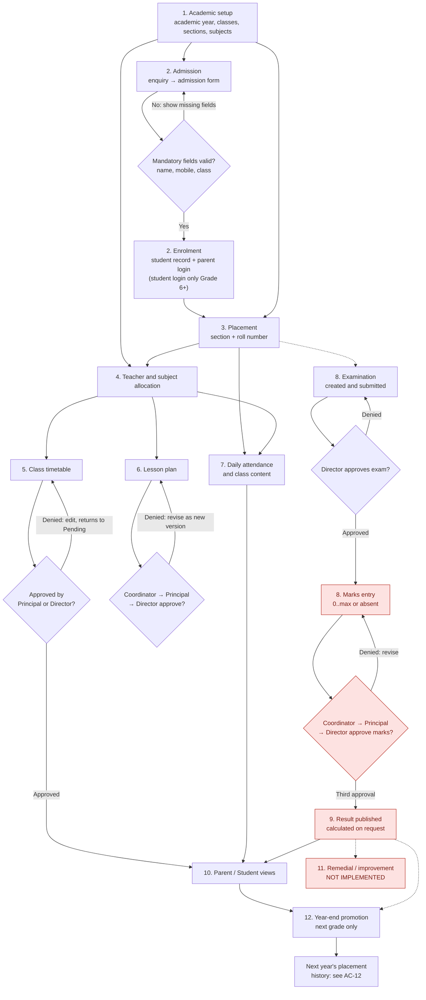
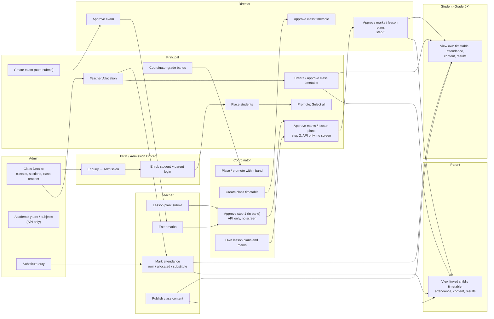
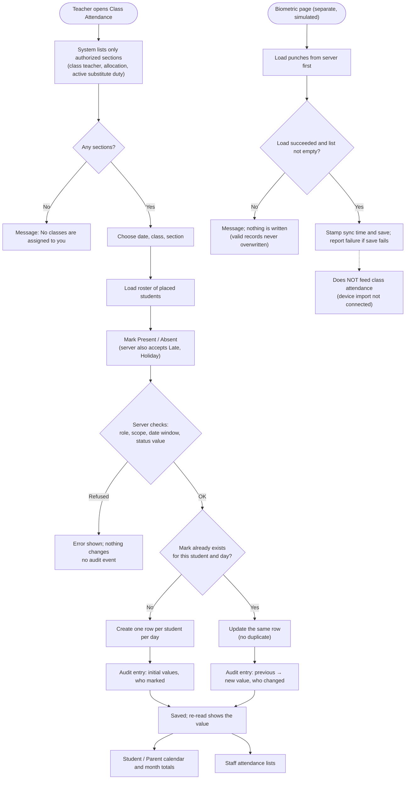
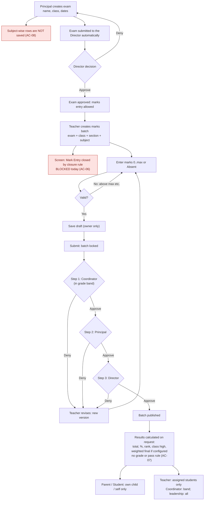
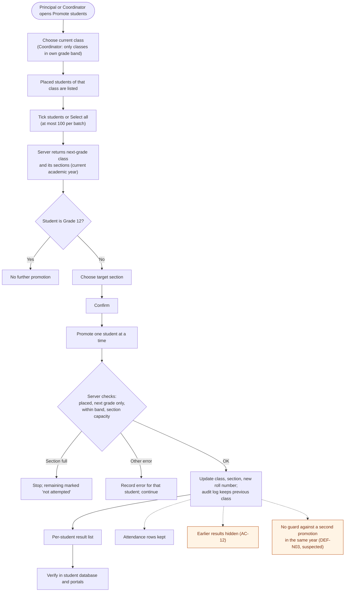
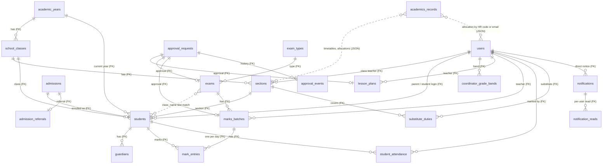

# QMIS ERP — Academic Workflow and Testing Guide

**Queen Mira International School — School ERP (QMIS ERP)**

| | |
|---|---|
| Document | Academic Workflow and Testing Guide |
| Version | 1.0 |
| Prepared on | 27 October 2026 |
| Code baseline | Branch `main` (last commit `457aedb`) plus uncommitted changes of 27 Oct 2026 |
| Companion document | `QMIS_ERP_Comprehensive_Testing_Report.md`, which holds the test IDs, defect IDs and evidence codes used here |
| Audience | School management, academic staff, testers, developers |

> This guide describes what the system **actually does today**, stage by stage. Where something is planned or missing, it says so. Evidence codes (T, TS, A, B, C, L) and defect IDs (AC-…, DEF-N…) are explained in the testing report, §2 and §7.

---

## Table of contents

1. [Status legend](#1-status-legend)
2. [Roles in the academic workflow](#2-roles-in-the-academic-workflow)
3. [Workflow diagrams](#3-workflow-diagrams)
4. [Stage-by-stage workflow](#4-stage-by-stage-workflow)
5. [End-to-end test scenarios](#5-end-to-end-test-scenarios)
6. [Manual browser test checklist](#6-manual-browser-test-checklist)
7. [Open decisions](#7-open-decisions)
8. [Glossary](#8-glossary)

---

## 1. Status legend

| Label | Meaning |
|---|---|
| ✅ **Working** | Built and proven by automated/API tests; screen seen in the browser |
| 🟦 **Working (server); screen not browser-verified** | Rules proven by tests; saving through the screen not yet exercised |
| 🟨 **Partial** | Works with listed gaps |
| ⛔ **Blocked in the screens** | The server works, but a user cannot complete the step from the screens today |
| ❌ **Not implemented** | No screen, API or data exists |
| ⬜ **Pending verification** | No evidence yet |

---

## 2. Roles in the academic workflow

Permissions come from `backend/app/permissions/matrix.py` and the service-level checks. Screens come from the sidebar and route files in `src/`.

| Role | Academic responsibilities (verified) |
|---|---|
| **Admin** | Class Details (classes, sections, class teacher); academic years and subjects (API); admissions and enrolment; File Management; substitute duty |
| **PRM (Admission Officer)** | Admission enquiries, admissions, enrolment |
| **Principal** | Placement and promotion; coordinator grade bands; Teacher Allocation; class timetable create/approve; examination timetable create (auto-submitted); substitute duty; marks/lesson-plan approval step 2 (**API only, no screen**) |
| **Coordinator** | Placement and promotion within their grade band (screens restored 27 Oct 2026); class timetable create; own lesson plans and marks; approval step 1 for in-band lesson plans and marks (**API only, no screen**) |
| **Teacher** | Own lesson plans; marks entry for approved exams; attendance for class-teacher and allocated sections (or a valid substitute duty); class content (Home Fun, Study Materials, CA/RCT, Online/Extended class); weekly timetable view |
| **Director** | Approves exams; approves class timetables; approval step 3 for marks and lesson plans (screens exist, but the earlier steps have no screens); substitute duty |
| **Student** | Own timetable, attendance, class content, exam schedule, published results (Grade 6+ only have student logins) |
| **Parent** | Same as the student, for each linked child |

---

## 3. Workflow diagrams

### Diagram 1 — Complete academic lifecycle

Solid arrows are dependencies the system enforces. Dashed arrows are links that work through matching text or that run in parallel. Red nodes are stages that cannot be completed through the screens today, or that are not implemented.

**How to read it**
- Timetable, lesson plans, attendance and examinations run **in parallel** once placement and allocation exist; they do not wait for each other.
- Examinations link to students by matching **class name text** (dashed arrow), not by a database key (AC-13).
- Promotion does **not** check results or attendance today; the dashed arrow S9 → S12 marks a dependency the school may want (open decision 5).

### Diagram 2 — Role-based swimlanes

The two "API only, no screen" boxes (Coordinator step 1, Principal step 2) are why marks and lesson plans cannot reach the Director from the screens today (AC-06).

### Diagram 3 — Attendance

### Diagram 4 — Examinations and results

Steps 1 and 2 of the approval have **no screen** today; they are reachable only through the API.

### Diagram 5 — Student promotion

### Diagram 6 — Data relationships

Relationships come from the database models in `backend/app/models/`. Solid lines are database foreign keys. **Dashed lines are links by matching text or by IDs stored inside JSON records; they are not enforced by the database** and are marked "text match" or "JSON".

**Notes**
- **Results are not a table.** They are calculated from published `marks_batches` and `mark_entries` each time they are requested.
- **Text link:** `exams.class_name` must equal `students.class_name`; exam years are free text.
- **Inferred, requires verification:** none beyond the dashed lines; every solid line is a declared foreign key.

---

## 4. Stage-by-stage workflow

Each stage lists: who does it, where (screen / API), the rules the system enforces, what the next stages read from it, and the current status.

### Stage 1 — Academic setup

| | |
|---|---|
| Who | Admin (`masters.write`: Admin, Super Admin, Managing Director) |
| Screens | Admin → **Class Details** (add class, sections with capacity, room and class teacher). **Academic Years**: no screen (component not routed). **Subjects**: screen is a mock-up |
| API | `/api/v1/masters/academic-years` (create, set current), `/classes`, `/sections`, `/subjects`, `/class-teacher-options` |
| Rules enforced | End date before start date refused; duplicate class in the same year refused (409); section for an unknown class refused (404); only masters-write roles can create, others can read; a class cannot be renamed, because other records refer to it by name |
| Prerequisite for later stages | A **current** academic year. Enrolment uses it, and placement refuses to run without it ("Mark an academic year as current before assigning sections") |
| Read next by | Enrolment (current year), placement (classes and sections), class-teacher roster |
| Status | 🟨 **Partial.** API ✅ (T: 7 tests; A). Class Details screen wired (save not browser-verified). Academic Years and Subjects screens ❌ (AC-11). Live database: one subject only |
| School decisions | Agreed subject list; whether to build the Academic Years and Subjects screens |

### Stage 2 — Admission and enrolment

| | |
|---|---|
| Who | PRM, Admin (`admissions.write`) |
| Screens | **Admission Enquiry** → Add → Convert; **Admission List** → Add / Edit → Enrol |
| API | `/api/v1/admissions/enquiries[/{id}/convert]`, `/api/v1/admissions[/{id}]`, `/api/v1/admissions/{id}/enroll` |
| Mandatory fields | First name, mobile number, class (enquiry: name, mobile, class). The form lists the missing fields and highlights them; the server refuses them as well |
| Account information | Parent login email and password are required at enrolment. **Student login only for Grade 6 and above**: for Pre-KG, LKG, UKG, KG and Grades 1–5 the student-login fields are hidden and the server refuses them (school decision of 27 Oct 2026; setting `STUDENT_LOGIN_MIN_GRADE=6`). Older junior admissions that already carry a student login still enrol, as parent-only |
| Other fields | Typed route and bus stop (up to 80 characters); optional **Referral** (record only, listed for the Account Head) |
| Status transitions | Enquiry → converted → Admission (Active) → **Enrolled**. Enrolled admissions cannot be edited or enrolled again (409); the list shows "Enrolled" instead of actions |
| What enrolment creates | A `students` record (admission number = admission code; class in standard form, e.g. "V" → "Grade 5"; current academic year; placement status **pending**); a parent user (created or linked); a student user for Grade 6+ when requested; a guardian record |
| Duplicate prevention | Re-enrolment prevented. **No check for a duplicate applicant** (same child entered twice) was found in the code (⬜ Pending verification) |
| Downstream | Placement pending list; parent/student portals (via the linked user IDs) |
| Status | 🟦 **Working (server); screen save not browser-verified.** T: 17 admission tests. B-DOM: form sections, LKG rule. Known gap: class value not checked against the class master (AC-13); enrolment accepts some emails that sign-in rejects (AC-18) |

### Stage 3 — Student placement

| | |
|---|---|
| Who | Principal (all grades); Coordinator (own grade band; screens restored 27 Oct 2026); Director/Admin (API) |
| Screens | Principal → **Student Allocation** → Place; Coordinator → **Section Assignment** |
| API | `/api/v1/students/pending-placement`, `/placement-options?className=`, `/{id}/place`, `/coordinator-grade-bands` |
| What happens | Student gets a section in the current year, roll number = highest in the section + 1, and placement status **placed**. Section capacity is respected. A coordinator can place only within their band and into the student's own class |
| Invalid / missing | Out-of-band → 403; no current year → 409; re-placing a placed student is **allowed** and renumbers (AC-16); asking for options of a class that does not exist **creates** it with sections A/B/C (AC-17) |
| Effect on other stages | Teacher rosters (class teacher of the section, allocations); attendance roster; portal pages (timetable, attendance and class content stay hidden behind "Awaiting section assignment" until placed); marks and results (linked by class name) |
| Status | 🟦 **Working (server); screen save not browser-verified.** A: place and roll numbers. **No automated test** for placement (AC-21). Fixed 27 Oct: portals now recognise placed students (B-SS-06) |

### Stage 4 — Teacher and subject allocation

| | |
|---|---|
| Who | Principal (screen); Admin/Director (API). The class teacher of a section is set by Admin in Class Details |
| Screens | Principal → **Teacher Allocation** → Allocate / Edit / View |
| API | `/api/v1/academics/teacher-allocations` (whole list saved at once) |
| Data | Per teacher (HR employee code): status, class-teacher class/section, teaching classes, subjects, and class–section–subject mappings |
| Who appears | Real HR teachers only (demo teachers removed 27 Oct 2026); the Director is no longer counted as a teacher |
| What allocation controls | Which students a teacher can list; which sections they can mark attendance for; which results they can read; which classes and subjects they can choose in the class timetable; the coordinator's approval scope (with grade bands) |
| What it does **not** control | Marks-batch subjects and sections (AC-14); lesson-plan subjects |
| Status | 🟨 **Partial.** T: allocation-scope tests pass. B-DOM: real teacher list. No validation of contents (AC-19); save errors not shown (AC-09). **Live data: every teacher "Not Allocated"**, so subjects are empty in the timetable until allocation is done |

### Stage 5 — Timetable management

| | |
|---|---|
| Who | Principal and Coordinator create; Principal or Director approve; teachers file change requests |
| Screens | Principal → **Class Timetable** (list, create, edit); Coordinator → **Create Class Timetable** (restored 27 Oct); Director → **Timetable Approvals → Class Timetable** (menu link restored 27 Oct); Teacher/Coordinator → **My Class Timetable** (weekly view); Student/Parent → **Timetable** |
| API | `/api/v1/academics/class-timetables`, `/class-timetable-change-requests` |
| Structure | A timetable belongs to one teacher and contains periods: day, start/end time, class, section, subject, teacher. Subjects offered come from that teacher's allocation |
| Filters | List: search, academic year, class, section (matched against every period), teacher, approval status, with pagination. Director approvals: search, status, submitted-from/to dates |
| Approval | Status field Pending → Approved / Denied; edits return it to Pending. The Principal can approve their own timetable; no separate approval record is kept (AC-10) |
| Conflicts | **No clash validation on save** (DEF-N05). The teacher's weekly view marks overlapping periods "(clash)" |
| Who sees what | Teachers see their own periods (approved, and pending ones labelled). Students and parents see only **approved** periods for their own class **and** section, merged from all teachers' timetables, with correct weekday dates |
| Status | 🟨 **Partial.** T: portal visibility and write permissions. B-DOM: filters, Director page. Screen creation not browser-verified |

### Stage 6 — Lesson plans and learning delivery

| | |
|---|---|
| Who | Teacher and Coordinator write; Coordinator (in band) → Principal → Director approve. A coordinator's own plan goes Principal → Director |
| Screens | Teacher/Coordinator → **Lesson Plan** with two tabs: **My Submissions** (add, track) and **Approved & Delivery** (Mark as Done). Director → **Lesson Plan Approval** |
| API | `/api/v1/lesson-plans` (create, list, get, patch), `/{id}/submit`, `/{id}/complete`, `/{id}/revise`, `/api/v1/approvals/{id}/decide` |
| Rules | One plan per teacher, class, section, subject and month; deadline is the 25th of the previous month (late flag); locked after submission; denied plans can be revised as a new version; reminders before the deadline |
| What changed 27 Oct 2026 | Saving now **submits** the plan, so it enters approval. The Director's Approve/Reject and the teacher's Mark as Done are now saved on the server; before, they reverted on reload. Older drafts show "Submit for approval" |
| Gap | **No Coordinator or Principal approval screen**, so a teacher's plan cannot reach the Director from the screens (same pattern as AC-06) |
| Learning materials | **Home Fun**, **Study Materials**, **Sample Questions**, **CA / RCT**, **Online Class**, **Extended Class**: staff publish an item for one class and section; students and parents see only their own class and section; homework submission details stay staff-only |
| Status | Lesson plans: 🟦 server ✅ (T: 7 + scope tests); screen submission ⬜ Pending verification; approval from screens ⛔ (steps 1–2). Learning materials: 🟦 (T) |

### Stage 7 — Daily attendance

| | |
|---|---|
| Who | Class teacher of the section; teachers allocated to it; a teacher with an **active substitute duty** (date, period, section); Coordinator (band); Principal, Director, Admin |
| Screens | Teacher/Coordinator → **Class Attendance** (lists only authorized sections); Principal/Director/Admin → **Substitute Duty**; Student/Parent → **Attendance List** and **Attendance Report**; Teacher/Coordinator → **Biometric** (simulated) |
| API | `GET /api/v1/attendance` (roster/list), `GET /attendance/my-classes`, `POST /attendance`, `GET /attendance/students/{id}/calendar`, `/api/v1/substitute-duties` |
| Rules | One mark per student per day (database constraint). Marking again **updates** that row, and every change is audited with previous and new values and who changed it. If the audit write fails, the attendance change is rolled back. Refused writes leave no trace. Parents and students cannot read class rosters |
| Corrections | Through the same screen by an authorized user; the audit chain keeps every before/after value. There is no attendance-history screen; audit entries are stored |
| Biometric | Page loads punches from the server first and never saves an empty list. The device import is **not connected** (`rfid_import_enabled` unused), and biometric data does not feed class attendance |
| Summaries | Student/Parent: monthly calendar and totals computed from marks (working days = present + absent; holidays excluded) |
| Status | 🟦 **Working (server)** (T: 8 audit tests, scope and substitute tests). B: student page ✅ (B-SS-06); teacher page shows "No classes are assigned to you" for the unallocated demo teacher. Marking through the screen ⬜ Pending verification. Biometric import: Blocked (external) |

### Stage 8 — Examination management

| | |
|---|---|
| Who | Principal creates (Coordinator via API); Director approves; Teacher/Coordinator enter marks; Coordinator → Principal → Director approve marks |
| Screens | Principal → **Examination Timetable** → Create; Director → **Timetable Approvals → Exam Timetable**; Teacher/Coordinator → **Mark Entry**; Director → **Mark Entry Approval**; Student/Parent → **Exam Schedule** |
| API | `/api/v1/exams` (create, submit, list), `/api/v1/exam-types`, `/api/v1/exam-weightage`, `/api/v1/marks-batches` (create, entries, submit, revise), `/api/v1/approvals/{id}/decide` |
| Setup | Exam = name, type, class, dates. The screen fixes the type as MIDTERM and **does not send the subject-wise rows** (AC-08) |
| Eligibility | Marks can be entered only after the exam is approved (409 before). Students are those whose class name equals the exam's class name (text match, AC-13) |
| Marks rules | 0..maximum or Absent; draft save by the owner only; locked after submit; denied batches are revised as a new version |
| Approval | Three steps: Coordinator (in band) → Principal → Director. Out-of-band coordinators are refused. A step with no eligible approver waits and alerts an administrator |
| Screen blocker | **Mark Entry shows "Entry closed"** (a browser-stored closure rule from 1 Sep 2026; re-entry needs a Super Admin approval), and **steps 1–2 have no screen** (AC-06; B-SS-04, B-SS-05) |
| Status | Server ✅ (T `test_exams.py`, scope tests; A). Screens ⛔ Blocked. Student Exam Schedule ❌ (shows demo rows; B-SS-08) |

### Stage 9 — Result processing and publication

| | |
|---|---|
| How results are made | Not stored. Each request combines **published** marks batches: total, percentage (2 decimals; absent subjects excluded), rank across the whole class, class-high per subject, and an optional weighted final if exam weightages are configured |
| Publication | Happens when the **Director gives the third approval** on a marks batch; nothing is visible before that |
| Visibility | Parent: linked child only. Student: self only. Teacher: assigned students. Coordinator: grade band/allocations. Leadership: all. The whole-class table is staff-only |
| Grades / pass rules | **None implemented.** The school must decide the grading scale and pass criteria (open decision 1) |
| Corrections | Before publication: deny → revise. After publication: correction path ⬜ Pending verification |
| Audit | Approval events record who approved or denied at each step |
| Status | Server ✅ (T `test_exams.py::test_marks_flow_publish_ranks_and_parent_visibility`, privacy tests). Screens ⛔ (cannot publish). Student result page shows a hardcoded summary (AC-07, B-SS-07) |

### Stage 10 — Parent and student academic views

| View | Source | Privacy control |
|---|---|---|
| Class and section | `/students/me` (student), `/parents/me/children` (parent) | Only the signed-in student, or children linked to the parent |
| Timetable | Approved class timetables, own class **and** section | Server filters; others not reachable by ID |
| Attendance | `/attendance/students/{id}/calendar` | Own child / self; class rosters refused |
| Homework & materials | Class content collections | Own class and section; submission details hidden |
| Exam schedule | **Demo data today** (AC-08) | — |
| Results | `/results/students/{id}` | Own child / self; class table refused |
| Notifications | Fee reminders, payment confirmations, announcements | **No academic notifications** (DEF-N04) |

First sign-in forces a password change. Tampered or unknown IDs return nothing (T `test_academic_privacy.py::test_tampered_or_unknown_identifiers_reveal_nothing`).
**Status:** privacy ✅ (T: 26 + 21 + 19 tests). Pages verified read-only in the browser (B-SS-06, B-SS-07, B-SS-08).

### Stage 11 — Remedial learning and improvement

❌ **Not implemented.** There is no screen, API or data for identifying students who need support, assigning improvement activities, follow-up or re-assessment. The nearest data sources a future feature could use are results and attendance. Requirements are an open decision (7).

### Stage 12 — Year-end promotion and academic history

| | |
|---|---|
| Who | Principal (all grades); Coordinator (own band) |
| Screens | Principal → Student Allocation → **Promote**; Coordinator → Section Assignment → **Promote** |
| API | `/api/v1/students/promote-options/{id}`, `/api/v1/students/{id}/promote` (one student per request) |
| Steps | Choose current class → placed students listed → tick students or **Select all** (up to 100) → the next-grade class and its sections are offered → choose section → confirm → students promoted one by one, with a result line per student |
| Validation | Must be placed; target must be exactly the next grade; nothing beyond Grade 12; within band; section capacity (the run stops when the section is full) |
| What changes | Class, section, new roll number; academic year set to the year given, otherwise the **current** year; audit log records the previous class and roll |
| History | Attendance rows are kept. Marks entries are kept, but **earlier results disappear from result views** because results are matched by the current class (AC-12). There is no "previous years" view |
| Duplicate prevention | **No guard** against promoting the same student twice in one year (DEF-N03, suspected from code, not executed) |
| Eligibility | **Not checked** (results, attendance, fees): school policy needed (open decision 5) |
| Status | 🟨 **Partial.** B: Select all ✅ (B-SS-01). Promotion through the screen ⬜ Pending verification. No backend automated test for promotion (AC-21) |

---

## 5. End-to-end test scenarios

Each scenario lists preconditions, steps, expected and actual results, evidence and status. "Actual" reflects the evidence of 27 Oct 2026; the browser session was read-only.

### Scenario A — New student to published result

| | |
|---|---|
| Preconditions | Current academic year; class "Grade 5" with sections; teacher and coordinator logins; coordinator band covering Grade 5; a fresh parent email |
| Steps | 1. PRM: create admission (Grade 5), enrol with parent login. 2. Principal: place in Grade 5-A. 3. Principal: allocate a teacher to Grade 5-A Maths. 4. Principal: create and approve a class timetable. 5. Teacher: mark attendance. 6. Principal: create the Grade 5 exam; Director approves. 7. Teacher: enter marks, save, submit. 8. Coordinator, Principal, Director approve in order. 9. Parent: sign in (change password) and open Timetable, Attendance, Exam Result. 10. Refresh and sign in again; repeat 9 |
| Expected | Each step saves; the parent sees only their child's timetable, attendance and result; data survives refresh and a new login |
| Actual (server) | Steps 1, 2, 6, 7, 8 and 9 (result part) passed through the API on an isolated database: same student ID and admission number at every stage; parent sees 90/100, 90 %, rank 1; another child not visible |
| Actual (screens) | Steps 7–8 **cannot be completed**: Mark Entry is closed and steps 1–2 of the approval have no screens |
| Evidence | A (audit §4, Stages 2–9); T `test_exams.py::test_marks_flow_publish_ranks_and_parent_visibility`, `test_e2e_campus_flow.py`; B-SS-04, B-SS-05 |
| Status | **Server: Pass. Screens: Blocked** (AC-06). Persistence after refresh/new login through screens: ⬜ Pending verification |

### Scenario B — Teacher access restrictions

| | |
|---|---|
| Preconditions | Teacher A is class teacher of 5-A; teacher B has no allocation; one student each in 5-A and 5-B |
| Steps | 1. As A, list students, open Class Attendance, mark 5-A. 2. As A, try 5-B via the screen and by calling the API with 5-B's ID. 3. As B, open Class Attendance. 4. As A, read results of a 5-B student. 5. As A, change the timetable directly through the API. 6. Change A's allocation; repeat 1–2 |
| Expected | A sees and marks only 5-A; 5-B refused by screen and API; B sees no classes; results of 5-B refused; timetable write refused; access follows the new allocation |
| Actual | As expected (server). Browser: the unallocated demo teacher sees "No classes are assigned to you for attendance" and an empty student list |
| Evidence | T `test_academic_access_phase2.py` (teacher cases incl. `test_identifier_tampering_cannot_widen_teacher_access`), `test_academic_privacy.py::test_teacher_access_follows_allocation_changes`, `test_academics_collections.py::test_teacher_cannot_replace_timetables`; B-DOM |
| Status | **Pass** (server); screen walkthrough with an allocated teacher ⬜ Pending verification |

### Scenario C — Parent and student privacy

| | |
|---|---|
| Preconditions | Two families with one child each, both with published results |
| Steps | 1. Parent A opens own child's pages. 2. Parent A calls the API with child B's ID (results, attendance calendar, student record). 3. Parent A requests the class result table and class attendance roster. 4. Student A reads self, then B. 5. Parent A requests timetables, star ratings, allocations and draft exams. 6. Try unknown/garbled IDs |
| Expected | Only own child/self; every other request refused or empty; no names or marks of other students |
| Actual | As expected |
| Evidence | T `test_academic_privacy.py` (15 functions, 26 cases), `test_academic_access_phase2.py::test_portal_cannot_write_or_reach_hidden_timetables_another_way`, `::test_portal_gets_no_staff_lists_and_only_own_star_ratings` |
| Status | **Pass** (server). DevTools check in a browser ⬜ Pending verification |

### Scenario D — Attendance correction and audit

| | |
|---|---|
| Preconditions | Teacher authorized for 5-A |
| Steps | 1. Mark a student Present. 2. Change to Absent. 3. Change again. 4. Read the audit entries as an authorized reviewer. 5. As an unauthorized teacher, try to change it. 6. As a parent, try to read audit details. 7. Biometric: press Sync with no punches |
| Expected | Single attendance row; audit chain Present → Absent → …; unauthorized change refused with no audit event; parent refused; biometric sync shows a message and writes nothing |
| Actual | Steps 1–6 as expected. Step 7 not executed (read-only session) |
| Evidence | T `test_attendance_audit.py` (8); TS `test_biometric_saves_never_write_an_empty_list_before_loading` |
| Status | **Pass** (1–6, server). Step 7 ⬜ Pending verification |

### Scenario E — Examination approval

| | |
|---|---|
| Preconditions | Exam in draft |
| Steps | 1. Try to enter marks (exam not approved). 2. Director approves the exam. 3. Enter 101/100; then valid marks; save; submit; try to edit. 4. Director tries to approve before the Coordinator. 5. Out-of-band coordinator tries to approve. 6. Coordinator denies; teacher revises; chain approves. 7. Parent checks results before and after the final approval |
| Expected | 1 refused; 3 invalid refused, edit after submit refused; 4 and 5 refused; 6 works; 7 empty before, visible after |
| Actual (server) | As expected |
| Actual (screens) | Blocked at step 3 (Mark Entry closed) and at steps 4–6 (no Coordinator/Principal screens) |
| Evidence | T `test_exams.py::test_marks_validation_and_deny_revise`, `::test_marks_flow_publish_ranks_and_parent_visibility`; `test_academic_access_phase2.py::test_coordinator_cannot_open_or_approve_out_of_band_batch`; B-SS-04 |
| Status | **Server: Pass. Screens: Blocked** |

### Scenario F — Bulk student promotion

| | |
|---|---|
| Preconditions | Several placed students in one class; the next-grade class has sections with spare capacity; at least one student with a published result |
| Steps | 1. Open Promote, choose the class, Select all. 2. Choose the target section; confirm. 3. Read the per-student results. 4. Try to promote the same students again. 5. Fill the target section to capacity and promote more. 6. Check that earlier results and attendance are still visible |
| Expected | Each student moves to the next grade with a new roll number; a result line per student; second promotion refused; run stops when the section is full; history visible |
| Actual | Step 1 ✅ in the browser ("1 selected", target Grade 8, sections A/B/C, "Promote 1 student"; not confirmed). Steps 2–3: server logic and a single promotion proven (A). Step 4: no guard found in code (DEF-N03). Step 5: capacity check in code and in the screen's stop rule (TS). Step 6: earlier results disappear (AC-12, A) |
| Evidence | B-DOM, B-SS-01; A; C `services/placement.py`; TS `test_bulk_promotion_is_sequential_and_capped` |
| Status | **Partial.** Selection Pass; promotion through the screen ⬜ Pending verification; duplicate guard ⬜ suspected Fail; history **Fail** |

---

## 6. Manual browser test checklist

Use a **separate test database or approved test records**: these steps create data. Mark each with the date, tester and result.

| # | Check | Role | Status |
|---|---|---|---|
| 1 | Class Details: create class + sections + class teacher; refresh; values kept | Admin | ⬜ Pending |
| 2 | Admission: save with missing fields (message and highlights), then complete, enrol, Student Database shows "awaiting placement" | PRM | ⬜ Pending |
| 3 | Junior class (LKG): student login hidden; Grade 6: student login saved and works after enrolment | PRM, Student | ⬜ Pending (form part ✅) |
| 4 | Parent first sign-in forces a password change | Parent | ⬜ Pending |
| 5 | Place a student; roll number shown; refresh | Principal, Coordinator | ⬜ Pending |
| 6 | Teacher Allocation: allocate a teacher; the teacher's Students List and Class Attendance show the section | Principal, Teacher | ⬜ Pending |
| 7 | Class timetable: create, approve; Teacher weekly view; Student/Parent timetable shows only approved periods for own section | Principal, Teacher, Parent | ⬜ Pending |
| 8 | Lesson plan: add from My Submissions; reload (status Pending with approval in progress); Director decision persists after reload | Teacher, Director | ⬜ Pending |
| 9 | Attendance: mark, correct, reload; student calendar shows the change | Teacher, Student | ⬜ Pending |
| 10 | Substitute duty: assign; substitute can mark only during the period | Principal, Teacher | ⬜ Pending |
| 11 | Exam: create; Director approves; exam appears for teachers | Principal, Director | ⬜ Pending |
| 12 | Mark Entry: closure banner shown (✅ 27 Oct); after a Super Admin re-entry approval, save and submit work | Teacher, Super Admin | ⬜ Pending (banner ✅) |
| 13 | Marks approval through the screens | Coordinator, Principal, Director | ⛔ Blocked (no screens for steps 1–2) |
| 14 | Promotion: Select all (✅ 27 Oct), confirm, per-student results, refresh | Principal | ⬜ Pending (selection ✅) |
| 15 | Portal privacy in DevTools: call another child's results/attendance; expect refusal | Parent | ⬜ Pending |
| 16 | Mobile/tablet layout of Attendance, Timetable, Exam Result | Student, Parent | ⬜ Pending |
| 17 | A second browser (e.g. Firefox or Safari) for the main pages | Any | ⬜ Pending |

---

## 7. Open decisions

| # | Decision | Affects |
|---|---|---|
| 1 | Grading scale, pass marks, result status wording | Stage 9, report cards |
| 2 | Report card design and contents | Stage 9–10 |
| 3 | Keep or remove the Mark Entry closure window; who reopens it | Stage 8 |
| 4 | Marks / lesson plan approval chain (build Coordinator and Principal screens, or shorten the chain) | Stages 6, 8 |
| 5 | Promotion eligibility, retention, move to the **next** academic year, history view | Stage 12 |
| 6 | Timetable: separate approver required? clash rules? | Stage 5 |
| 7 | Remedial / improvement workflow scope | Stage 11 |
| 8 | Biometric device and import method | Stage 7 |
| 9 | Academic notifications to parents (events and channels) | Stage 10 |
| 10 | Subject master list; Academic Years and Subjects screens | Stage 1 |
| 11 | Clean-up of demo/test records in the demo database | All |

---

## 8. Glossary

| Term | Meaning |
|---|---|
| **API** | The interface the screens use to ask the server to read or save data |
| **Approval chain** | The ordered list of people who must approve: here Coordinator → Principal → Director for marks and lesson plans |
| **Database persistence** | Saved data is still there after a refresh, a new login or a restart |
| **Foreign key (FK)** | A database link that guarantees a record points to a real record (e.g. a mark points to a real student) |
| **Grade band** | The grades a coordinator is responsible for |
| **Placement** | Giving an enrolled student a section and roll number |
| **Publication** | Results become visible to parents/students after the final (Director) approval |
| **Regression testing** | Re-running all tests after changes, to catch anything that broke |
| **Role-based access control** | Each role sees and changes only what it is allowed to |
| **Substitute duty** | Temporary permission for a teacher to take attendance for another class during one period |
| **UAT** | User Acceptance Testing: the school's own staff test real scenarios before go-live |
